<!--
Copyright 2026 David Greco

Licensed under the Apache License, Version 2.0 (the "License");
you may not use this file except in compliance with the License.
You may obtain a copy of the License at

    http://www.apache.org/licenses/LICENSE-2.0

Unless required by applicable law or agreed to in writing, software
distributed under the License is distributed on an "AS IS" BASIS,
WITHOUT WARRANTIES OR CONDITIONS OF ANY KIND, either express or implied.
See the License for the specific language governing permissions and
limitations under the License.
-->

# rya-ng architecture

This document explains how rya-ng works inside. It covers:
- how an RDF statement becomes Accumulo keys;
- how a SPARQL query becomes a handful of range scans;
- how statistics, inference, batched joins and the search indexes fit around that.

It assumes you know Java, but little or nothing about Accumulo or RDF4J. Sections 2 to 4 introduce what you need of RDF, Accumulo and RDF4J. If you already know them, skip to [section 5](#5-modules).

To use rya-ng rather than change it, start with the [README](README.md). [AGENTS.md](AGENTS.md) has the build commands and the short list of rules for contributors.

## Contents

1. [The big picture](#1-the-big-picture)
2. [Primer: RDF and SPARQL](#2-primer-rdf-and-sparql)
3. [Primer: Accumulo](#3-primer-accumulo)
4. [Primer: RDF4J](#4-primer-rdf4j)
5. [Modules](#5-modules)
6. [The data model](#6-the-data-model)
7. [Storage layout](#7-storage-layout)
8. [From a triple pattern to a range scan](#8-from-a-triple-pattern-to-a-range-scan)
9. [The write path](#9-the-write-path)
10. [Deletes, graph drops and purges](#10-deletes-graph-drops-and-purges)
11. [Statistics and join ordering](#11-statistics-and-join-ordering)
12. [The query path](#12-the-query-path)
13. [Batched joins](#13-batched-joins)
14. [Inference](#14-inference)
15. [Text and geo search](#15-text-and-geo-search)
16. [Security: visibility labels and authorizations](#16-security-visibility-labels-and-authorizations)
17. [The SPARQL endpoint](#17-the-sparql-endpoint)
18. [The synthetic-data loader](#18-the-synthetic-data-loader)
19. [Test infrastructure](#19-test-infrastructure)
20. [Invariants](#20-invariants)
21. [Glossary](#21-glossary)

---

## 1. The big picture

rya-ng stores RDF graph data in [Apache Accumulo](https://accumulo.apache.org/), a distributed sorted key-value store, and answers [SPARQL](https://www.w3.org/TR/sparql11-query/) queries over it. It is derived from Apache Rya and keeps Rya's storage model.

The core idea fits in one sentence:

> **Every statement is written three times, into three tables whose row keys start with its subject, its predicate and its object respectively.** Whatever parts of a statement a query knows, one of the three tables keeps all the matching statements next to each other, so they come back from a single range scan.

Everything else is built around that idea:
- **Statistics** choose a good join order.
- **Inference** widens patterns using an ontology.
- **Batched joins** cut round trips.
- **Search indexes** narrow text and geo filters.

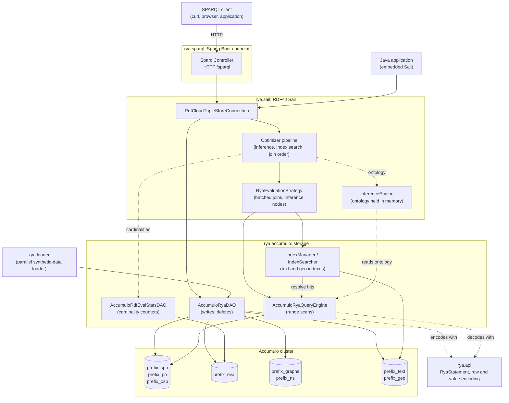

Two ways in:
- **The SPARQL endpoint** (`rya.sparql`): a Spring Boot server that speaks the SPARQL 1.1 Protocol over HTTP.
- **The embedded Sail** (`rya.sail`): a Java application builds the same RDF4J repository itself with `RyaAccumuloSailFactory` and calls it directly.

Both paths end in the same objects: an `RdfCloudTripleStoreConnection` on top of an `AccumuloRyaDAO`.

---

## 2. Primer: RDF and SPARQL

### 2.1 Statements

RDF describes data as **statements** (also called *triples*): `subject predicate object`.

| Part | Can be | Example |
|---|---|---|
| subject | an IRI or a blank node | `<http://ex.org/alice>` |
| predicate | an IRI | `<http://ex.org/age>` |
| object | an IRI, a blank node, or a literal | `42`, `"Alice"@en`, `<http://ex.org/bob>` |

- An **IRI** is a global identifier that looks like a URL.
- A **blank node** is an anonymous node, only meaningful inside one dataset.
- A **literal** is a value: a *lexical form* (the text `"42"`) plus either a *datatype* IRI (`xsd:integer`, `xsd:string`, `xsd:dateTime`, `geo:wktLiteral`, …) or a *language tag* (`"ciao"@it`, whose datatype is `rdf:langString`).

A statement can also belong to a **named graph** (a *context*), identified by an IRI. Statements without one are in the **default graph**. With its graph, a statement is sometimes called a *quad*.

### 2.2 Queries

A SPARQL query is mostly a set of **triple patterns**: triples in which some positions are variables (`?x`). The engine finds every assignment of values to variables (a *binding set*) under which all patterns match stored statements. Two patterns that share a variable are **joined** on it. On top of that come `FILTER`, `OPTIONAL`, `UNION`, `GRAPH`, aggregates and so on.

### 2.3 The running example

This dataset and query are used throughout the document:

```turtle
PREFIX ex:  <http://ex.org/>
PREFIX xsd: <http://www.w3.org/2001/XMLSchema#>

GRAPH ex:g1 {
  ex:alice  ex:age    42 .          # 42 is "42"^^xsd:integer
  ex:alice  ex:knows  ex:bob .
  ex:bob    ex:age    37 .
}
```

```sparql
PREFIX ex: <http://ex.org/>
SELECT ?friend ?age WHERE {
  ex:alice ex:knows ?friend .
  ?friend  ex:age   ?age .
}
```

The two patterns share `?friend`, so this query is one join. The answer is `?friend = ex:bob, ?age = 37`.

---

## 3. Primer: Accumulo

### 3.1 A sorted map with a five-part key

An Accumulo **table** is a sorted map from **keys** to **values**. A key has five parts:

```
┌───────────┬───────────────┬──────────────────┬───────────────────┬───────────┐     ┌────────┐
│    row    │ column family │ column qualifier │ column visibility │ timestamp │ ──▶ │ value  │
└───────────┴───────────────┴──────────────────┴───────────────────┴───────────┘     └────────┘
   bytes        bytes            bytes            label expression     long            bytes
```

**Sort order:**
- Keys are sorted by row, then column family, then column qualifier, then visibility, comparing bytes one by one (unsigned).
- Then by timestamp, newest first.

So all the keys whose row starts with the same bytes are stored next to each other. *"Give me everything whose row starts with X"* is one sequential read, called a **range scan**. rya-ng is built on that property.

A **row** is all the keys that share the same row bytes. One row can hold many cells (one per column family / qualifier / visibility / timestamp combination).

### 3.2 Tablets and tablet servers

A table is cut by row ranges into **tablets**. Each tablet is served by one **tablet server**, and tablets split as they grow and are spread across the servers. ZooKeeper coordinates the cluster; clients find which server holds which tablet through Accumulo's metadata and talk to the servers directly.

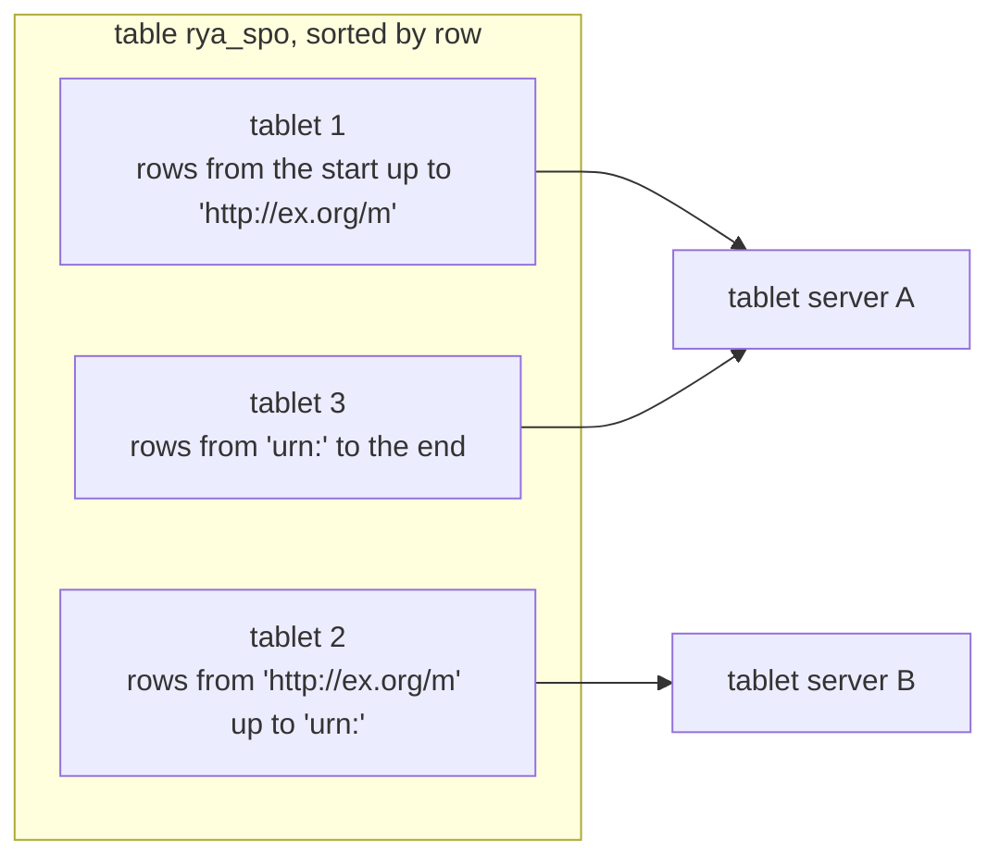

A new table has a single tablet, so at first every write goes to one server. The loader pre-splits tables for that reason ([section 18](#18-the-synthetic-data-loader)).

### 3.3 Reading: Scanner and BatchScanner

| Reader | Ranges | Order of results | Used for |
|---|---|---|---|
| `Scanner` | one range at a time | sorted | single statement-pattern lookups |
| `BatchScanner` | many ranges at once, several threads | unordered | batched join lookups, index searches, full-table work |

Both can:
- restrict the columns they return (`fetchColumnFamily`);
- carry a set of **authorizations** (see 3.6);
- attach scan-time iterators (see 3.5).

A **Range** runs from a start key to an end key. rya-ng mostly builds ranges of the form *from `prefix` to `prefix` followed by byte `0xFF`*, which covers every row that starts with `prefix`.

### 3.4 Writing: Mutation and BatchWriter

- **Mutation:** a set of changes to *one row* (puts and deletes of cells). A mutation is applied atomically. There are no transactions across rows or tables.
- **BatchWriter:** buffers mutations in memory and sends them to the tablet servers in the background. `flush()` blocks until everything buffered so far is written. A **MultiTableBatchWriter** shares one buffer between writers for several tables.
- **Delete:** a delete is a *marker* for an exact key, including its visibility and timestamp. It hides the cells with that key whose timestamp is not newer than the marker's. To delete a cell you must know its exact visibility, which is why rya-ng reads a statement before deleting it ([section 10](#10-deletes-graph-drops-and-purges)).

### 3.5 Iterators

**Iterators** are code that runs *inside* the tablet servers, on the sorted stream of cells:
- **When:** at scan time, and when files are compacted.
- **Order:** they are stacked by priority.

rya-ng uses three kinds:

| Iterator | What it does | Where rya-ng uses it |
|---|---|---|
| `VersioningIterator` | keeps only the newest version of each key (Accumulo attaches it to new tables by default, at priority 20) | every table, implicitly |
| `SummingCombiner` | merges all the cells of a key by adding their values | the `eval` table: the statistics counters |
| `RegExFilter`, `TimestampFilter` | drop cells that don't match | object-type checks, the optional TTL |

### 3.6 Visibility labels and authorizations

**On write:** every cell carries a **visibility** expression such as `A`, `A&B` or `A&(B|C)`. Empty means visible to everyone.

**On read:**
- An administrator grants each Accumulo user a set of **authorizations** (labels).
- Every scan passes a set of authorizations, which must be a subset of the user's.
- The scan returns only the cells whose expression those authorizations satisfy.

The visibility is **part of the key**. The same row, family and qualifier under two different labels are two separate cells, and both are returned to a reader holding both labels.

---

## 4. Primer: RDF4J

[RDF4J](https://rdf4j.org/) is a Java framework for RDF. rya-ng uses its SPARQL parser, query algebra, optimizers and evaluation engine, and plugs its own storage underneath.

### 4.1 Repository and Sail

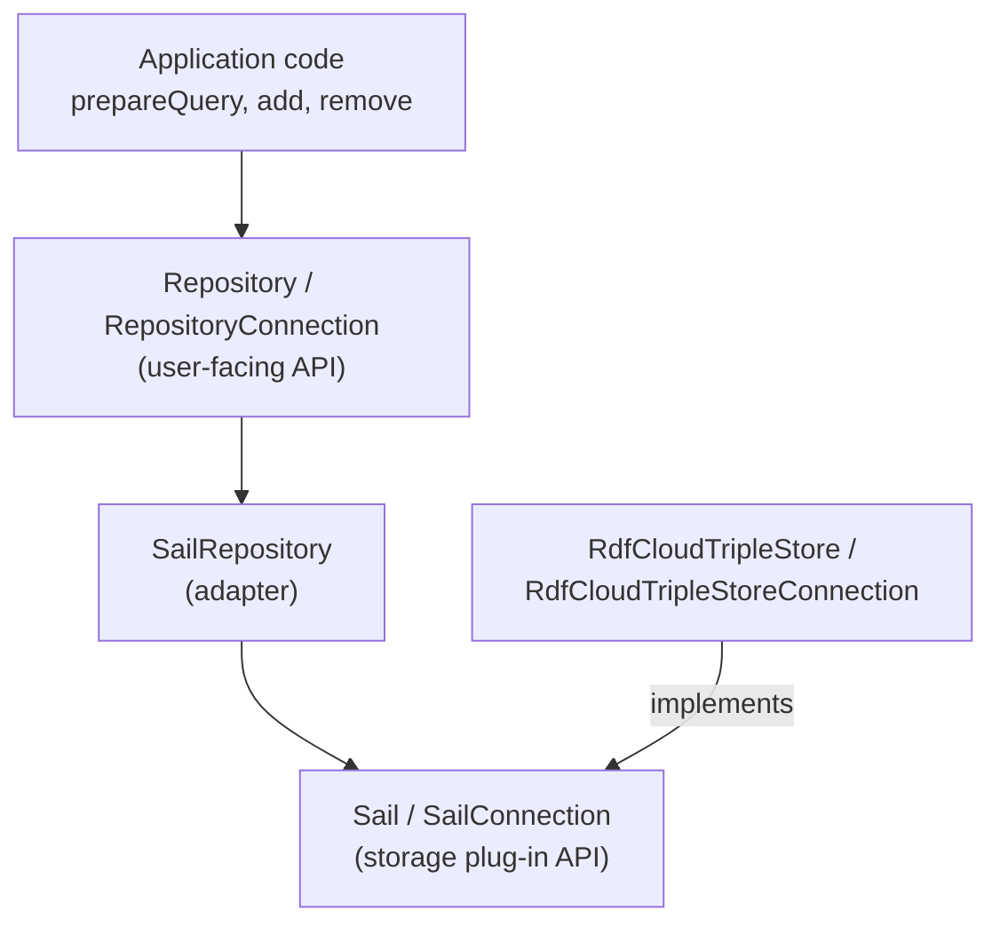

- **Repository API:** what applications call.
- **Sail API** ("Storage And Inference Layer"): what storage back ends implement.
- **SailRepository:** turns any Sail into a Repository.
- **Base classes:** `AbstractSail` and `AbstractSailConnection`. A subclass fills in the `…Internal` methods:
  - `addStatementInternal`, `removeStatementsInternal`, `clearInternal` for writes;
  - `getStatementsInternal` and `evaluateInternal` for reads;
  - `commitInternal` and the namespace methods for the rest.

rya-ng's Sail is `RdfCloudTripleStore`. Its connection is `RdfCloudTripleStoreConnection`.

### 4.2 From SPARQL text to an algebra tree

RDF4J parses a query into a tree of **TupleExpr** nodes. Each node produces a stream of binding sets. The running example parses to:

```
Projection (?friend, ?age)
└── Join
    ├── StatementPattern   ex:alice  ex:knows  ?friend
    └── StatementPattern   ?friend   ex:age    ?age
```

Each position of a `StatementPattern` is a **Var**: either a variable (no value) or a constant (a Var with a value). A `GRAPH` clause adds a fourth Var, the context. Other nodes include `Filter`, `LeftJoin` (OPTIONAL), `Union`, `Extension` (BIND), `Difference` (MINUS) and `Slice` (LIMIT/OFFSET).

### 4.3 Optimizers

A **QueryOptimizer** rewrites the tree in place. A **QueryOptimizerPipeline** lists the optimizers to run, in order. The important one here is **`QueryJoinOptimizer`**: it asks an `EvaluationStatistics` object how many results each pattern will produce (its *cardinality*), and reorders the joins so the most selective patterns run first.

### 4.4 Evaluation

The **EvaluationStrategy** turns each node into a **QueryEvaluationStep** (`prepare(node)`). Calling `evaluate(bindings)` on a step returns a lazy `CloseableIteration<BindingSet>`.

RDF4J's default join is a **nested loop**: for each binding set from the left side, evaluate the right side with those bindings filled in. For the running example, the left pattern is `ex:alice ex:knows ?friend` and the right one `?friend ex:age ?age`:

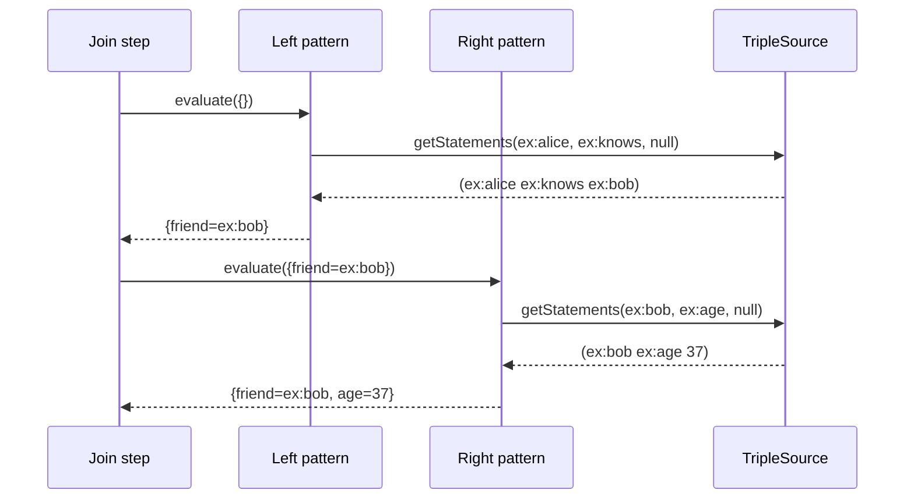

A statement-pattern step reads data only through a **TripleSource**: `getStatements(subject, predicate, object, contexts...)`.
- **Bound positions:** a position that is bound is passed as a value; `null` is a wildcard.
- **Contexts:**
  - none: any graph;
  - a list of graphs: only those graphs;
  - a `null` element: the default graph.

**Updates:** a SPARQL Update runs its `WHERE` part with the same machinery, then calls the connection's add and remove methods.

---
## 5. Modules

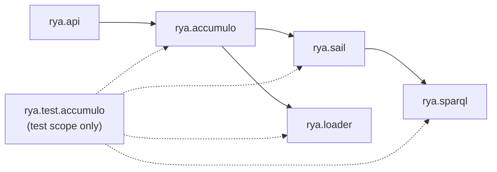

An arrow `A → B` means *B depends on A*. `rya.coverage` only exists under `-Pcoverage` and merges the coverage reports.

| Module | Role | Main classes |
|---|---|---|
| `rya.api` | Storage-independent model, DAO interfaces, how statements and values become bytes, which table answers which pattern | `RyaStatement`, `RyaType`, `RyaIRI`, `RyaContext`, `WholeRowTripleResolver`, `*TriplePatternStrategy`, `RdfCloudTripleStoreConfiguration` |
| `rya.accumulo` | Everything that talks to Accumulo: writes, scans, statistics, graph markers, namespaces, the text and geo indexes | `AccumuloRyaDAO`, `AccumuloRyaQueryEngine`, `EvalStatsMutations`, `AccumuloRdfEvalStatsDAO`, `IndexManager`, `IndexSearcher` |
| `rya.sail` | The RDF4J Sail: connection, optimizer pipeline, evaluation strategy, batched joins, inference, index-search rewrite | `RdfCloudTripleStore`, `RdfCloudTripleStoreConnection`, `RyaEvaluationStrategy`, `BatchedJoinStep`, `InferenceEngine`, `IndexSearchOptimizer` |
| `rya.sparql` | Spring Boot SPARQL 1.1 Protocol endpoint and query page | `SparqlController`, `RyaStoreConfiguration`, `RyaProperties`, `BlankNodeOutput` |
| `rya.loader` | Command-line generator and parallel loader of synthetic data | `LoaderMain`, `Prepare`, `Loader`, `Verify`, `EntityGenerator` |
| `rya.test.accumulo` | One in-process MiniAccumuloCluster per test JVM | `MiniAccumuloSingleton`, `AccumuloITBase` |

`rya.loader` writes through `rya.accumulo` only. It uses `rya.sail` in its tests.

---

## 6. The data model

Inside rya-ng, a statement is a `RyaStatement` (`rya.api`):

| Field | Type | Meaning |
|---|---|---|
| `subject` | `RyaIRI` | subject IRI (blank nodes are turned into IRIs, see below) |
| `predicate` | `RyaIRI` | predicate IRI |
| `object` | `RyaType` | object: `RyaIRI` for an IRI, plain `RyaType` for a literal |
| `context` | `RyaIRI` or `null` | named graph; `null` is the default graph |
| `qualifier` | `String` | an extra column qualifier inherited from Apache Rya; normally `null` |
| `columnVisibility` | `byte[]` | the Accumulo visibility label of the statement |
| `value` | `byte[]` | serialized `StatementMetadata`; empty in practice |
| `timestamp` | `Long` | defaults to the creation time |

A `RyaType` holds three strings: the data (the lexical form), the datatype IRI, and the language tag. `RyaIRI` is a `RyaType` with datatype `xsd:anyURI`.

`RdfToRyaConversions` and `RyaToRdfConversions` translate between RDF4J values and Rya types.

**Blank nodes become IRIs.** `_:b1` is stored as the IRI `urn:rya-ng/bnode/2012/07#b1` (`RyaSchema.BNODE_NAMESPACE`), and the Sail returns it as that IRI. The inference engine relies on this: it casts these values to `IRI` throughout. Only the endpoint turns them back into blank nodes, and only in its output (`BlankNodeOutput`, [section 17](#17-the-sparql-endpoint)).

**`null` context: two meanings.**

| Where | `null` context means |
|---|---|
| a `RyaStatement` used as a **pattern** for the DAO | any graph |
| an RDF4J `getStatements(..., contexts)` call, as an element of `contexts` | the default graph only |

The Sail translates between the two. To look up or delete *only* default-graph statements, it asks the DAO for "any graph" and keeps the results whose context is `null` (`StoreTripleSource.lookup`, `RdfCloudTripleStoreConnection.removeStatementsInternal`).

---

## 7. Storage layout

### 7.1 The tables

All tables are named `<prefix><suffix>`. The default prefix is `rya_`.

| Table | Row | Column family | Column qualifier | Visibility | Value | Purpose |
|---|---|---|---|---|---|---|
| `spo` | subject `00` predicate `00` object `01` type | graph IRI, empty for the default graph | qualifier, normally empty | statement's label | metadata, normally empty | patterns with a known subject |
| `po` | predicate `00` object `00` subject `01` type | same | same | same | same | patterns with a known predicate |
| `osp` | object `00` subject `00` predicate `01` type | same | same | same | same | patterns with a known object |
| `eval` | one value, or two joined by `00` | which counter: `s`, `p`, `o`, `sp`, `po`, `so` | empty (all graphs) or a graph IRI | statement's label | a count as decimal text, summed server side | cardinality statistics ([section 11](#11-statistics-and-join-ordering)) |
| `graphs` | graph IRI | `g` | empty | statement's label | empty | named-graph markers |
| `ns` | a prefix, or `rya` | `namespace`, `version` or `index` | empty, or the index id | none | namespace IRI, `1.0.0`, or index state | namespaces, storage version, index state |
| `text` | word `00` predicate `00` subject `00` object hash | graph IRI | qualifier | statement's label | empty | full-text index (optional, [section 15](#15-text-and-geo-search)) |
| `geo` | geohash cell `00` predicate `00` subject `00` object hash | graph IRI | qualifier | statement's label | empty | geospatial index (optional) |

`AccumuloRyaDAO.init()` creates the first six tables if they are missing and attaches the summing combiner to `eval`. `IndexManager` creates `text` and `geo` when their index is enabled.

### 7.2 Row keys of the statement tables

`WholeRowTripleResolver` builds the three rows. For `ex:alice ex:age 42` in graph `ex:g1`, these are the exact bytes. Printable bytes are shown as text, the others in hex:

```
spo  row  http://ex.org/alice 00 http://ex.org/age 00 800000012a 01 05
po   row  http://ex.org/age 00 800000012a 00 http://ex.org/alice 01 05
osp  row  800000012a 00 http://ex.org/alice 00 http://ex.org/age 01 05

     column family     http://ex.org/g1
     column qualifier  (empty)
     visibility        the statement's label, or empty
     value             (empty)
```

Broken into parts, the `spo` row is:

```
┌─────────────────────┬────┬───────────────────┬────┬──────────────┬────┬────────┐
│ http://ex.org/alice │ 00 │ http://ex.org/age │ 00 │  800000012a  │ 01 │   05   │
└─────────────────────┴────┴───────────────────┴────┴──────────────┴────┴────────┘
  subject, UTF-8       sep   predicate, UTF-8   sep   object value   type  marker:
                                                      (encoded 42)   sep   xsd:integer
```

**The type suffix always comes last.** It is `01` plus a marker byte, and it sits after the third element in all three layouts. When a row is read back, `WholeRowTripleResolver.deserialize` splits it:
1. at the **first** `00` (end of the first part);
2. at the **last** `00` (start of the third part);
3. at the **first** `01` (start of the type).

The type is put back on the object, wherever the object sits in the row.

### 7.3 Value encoding

The object's bytes come from a **type resolver** (`RyaContext` picks one by datatype). Each resolver encodes the lexical form and appends `01` plus a **marker byte** that says how to decode it. Numbers and dates use [Calrissian mango](https://github.com/calrissian/mango)'s `LexiTypeEncoders`: hexadecimal strings whose text order is the numeric order.

| Datatype | Resolver | Marker | Example: value → encoded data part |
|---|---|---|---|
| IRI (`xsd:anyURI`) | `RyaIRIResolver` | 2 | `http://ex.org/bob` → `http://ex.org/bob` |
| `xsd:string` | `RyaTypeResolverImpl` | 3 | `"Alice"` → `Alice` |
| `xsd:long` | `LongRyaTypeResolver` | 4 | |
| `xsd:integer` | `IntegerRyaTypeResolver` | 5 | `-7` → `7ffffffff9`, `42` → `800000012a`, `1000` → `8000000203e8` |
| `xsd:double` | `DoubleRyaTypeResolver` | 6 | `3.5` → `c00c000000000000` |
| `xsd:dateTime` | `DateTimeRyaTypeResolver` | 7 | `2024-05-01T10:00:00+02:00` → `8000018f332ae400` (milliseconds, UTC) |
| any other datatype | `CustomDatatypeResolver` | 8 | data, then `01` + datatype IRI + `01 08` |
| `xsd:byte` | `ByteRyaTypeResolver` | 9 | |
| `xsd:boolean` | `BooleanRyaTypeResolver` | 10 | `true` → `1` |
| `xsd:float` | `FloatRyaTypeResolver` | 11 | |
| `xsd:short` | `ShortRyaTypeResolver` | 12 | |
| `xsd:int` | `IntRyaTypeResolver` | 13 | `42` → `8000002a` |

A few consequences:
- **Language-tagged literals** go through the custom resolver: `"ciao"@it` is stored as `ciao@it 01 http://www.w3.org/1999/02/22-rdf-syntax-ns#langString 01 08`. `geo:wktLiteral` values are stored the same way, with their own datatype IRI.
- **`xsd:int` and `xsd:integer` are different values** with different markers (13 and 5), as they are in RDF.
- **Ordering:** `-7 < 42 < 1000` and `7ffffffff9 < 800000012a < 8000000203e8` compare the same way, so values of one numeric type are sorted by value inside the tables.
- **Time zones:** `xsd:dateTime` keeps the instant but not its offset. It reads back in UTC.
- **Old constants:** `RdfCloudTripleStoreConstants` still declares `URI_MARKER = 7`, `DATATYPE_LITERAL_MARKER = 11` and so on, from Apache Rya. They are not the bytes written. The resolvers' constants above are.

### 7.4 Why `00` and `01` are reserved

Rows are split at `00` and `01` when they are read back, so a value containing either byte would make its row unreadable. `RyaTypeResolverImpl.checkNoReservedBytes` rejects such values when they are written. That means literals containing U+0000 or U+0001, and custom datatype IRIs containing them. `TypeEncodingDelimiterTest` checks that no resolver ever emits those bytes.

For the same reason, Accumulo's own lexicoders must not replace mango's encoders: they emit raw binary, which can contain both bytes.

### 7.5 The other key parts

- **Column family = graph.** Restricting a scan to a graph is one `fetchColumnFamily(graph)` call. Dropping a graph is a delete restricted to that column family, in every table that uses it ([section 10](#10-deletes-graph-drops-and-purges)).
- **Visibility = the statement's label.** The three statement cells, the statistics counters, the graph marker and the index entries of a statement all carry the same label.
- **Timestamp = the statement's timestamp.** All tables and index entries get the same one, so a delete computed from the stored statement hits every copy.
- **Writing a statement again** produces the same keys with a newer timestamp. Accumulo's versioning keeps only the newest, so the statement is still stored once (but its statistics are counted twice, see [section 11](#11-statistics-and-join-ordering)).
- **The same statement under two labels** is two cells per table. A reader holding both labels gets it twice: nothing deduplicates them.

### 7.6 Alternative hashed layout

`RyaTripleContext` can also use `WholeRowHashedTripleResolver`, which prefixes the `spo` and `po` rows with a hash. This option (`tbl.hashprefix`) comes from Apache Rya and is off by default. The rest of this document describes the default layout.

---

## 8. From a triple pattern to a range scan

### 8.1 Choosing the table

`RyaTripleContext` holds four `TriplePatternStrategy` objects and asks them in this order:
1. `SpoWholeRowTriplePatternStrategy`
2. `PoWholeRowTriplePatternStrategy`
3. `NullRowTriplePatternStrategy`
4. `OspWholeRowTriplePatternStrategy`

The first whose `handles(...)` returns true builds the range. For the eight combinations of bound (✓) and unbound (·) positions:

| s | p | o | Table | Scan range (start; the end is the start followed by `FF`) |
|---|---|---|---|---|
| ✓ | ✓ | ✓ | `spo` | `s 00 p 00 o 01` |
| ✓ | ✓ | · | `spo` | `s 00 p 00` |
| ✓ | · | ✓ | `osp` | `o 00 s 00` |
| ✓ | · | · | `spo` | `s 00` |
| · | ✓ | ✓ | `po` | `p 00 o 00` |
| · | ✓ | · | `po` | `p 00` |
| · | · | ✓ | `osp` | `o 00` |
| · | · | · | `spo` | everything (empty start, end `FF`) |

Here `o` means the object's encoded value **without** its type suffix. A known graph does not change the table: it becomes a column-family restriction.

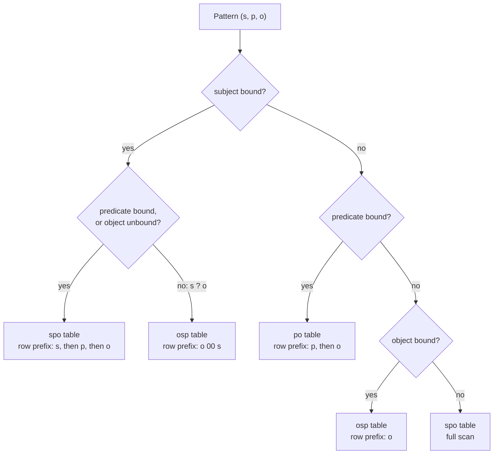

### 8.2 What the scan adds on top of the range

`AccumuloRyaQueryEngine.query(pattern, conf)` builds one `Scanner` over the chosen table, with the reader's authorizations, and adds:

| Addition | When | How |
|---|---|---|
| object-type check | the object is bound | The range ignores the type suffix, so values of different types with the same data bytes fall in the same range: the string `"800000012a"` and the integer `42` both encode to `800000012a`. A server-side `RegExFilter` (priority 11, named `ri`) built by `AbstractTriplePatternStrategy.buildRegex` keeps only rows ending in the object's own type suffix. |
| graph restriction | the pattern has a context | `fetchColumnFamily(graph)` |
| qualifier | the pattern has a qualifier | `fetchColumn`, or a `RegExFilter` on the qualifier (priority 8) |
| time to live | `query.ttl` is set | a `TimestampFilter` (priority 9) keeping cells newer than now minus the TTL |
| result cap | `query.limit` is set | the iterator stops after that many statements |

`RyaStatementKeyValueIterator` turns each returned Accumulo key back into a `RyaStatement`, including its graph, visibility and timestamp.

### 8.3 The running example, scan by scan

| Lookup | Table | Range start |
|---|---|---|
| `ex:alice ex:knows ?friend` | `spo` | `http://ex.org/alice 00 http://ex.org/knows 00` |
| `?friend ex:age ?age`, `?friend` unbound | `po` | `http://ex.org/age 00` |
| `?friend ex:age ?age` with `?friend = ex:bob` | `spo` | `http://ex.org/bob 00 http://ex.org/age 00` |

### 8.4 Many patterns at once: `batchQuery`

`AccumuloRyaQueryEngine.batchQuery(patterns, conf)` returns the union of the matches of many patterns. They must all resolve to the same table and share one context.
- **Readers:** with more than `getMaxRangesForScanner()` ranges (default 2) it uses one `BatchScanner` over all the ranges. Otherwise it uses one `Scanner` per range, read one after the other.
- **No type check:** it adds no object-type regex, because the patterns have different objects. Callers must match results to patterns exactly. `BatchLookup` does ([section 13](#13-batched-joins)), and so does `IndexSearcher` ([section 15](#15-text-and-geo-search)).

---

## 9. The write path

### 9.1 From an INSERT to Accumulo

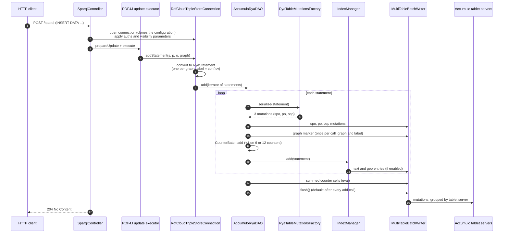

`RdfCloudTripleStoreConnection.addStatementInternal` builds one `RyaStatement` per target graph (just the default graph when none is given). It gives each the connection's visibility label (`conf.cv`) and hands them to the DAO in one `add` call.

### 9.2 What one statement writes

For `ex:alice ex:age 42` in graph `ex:g1`, with statistics and both indexes on:

| Table | Cells | Notes |
|---|---|---|
| `spo`, `po`, `osp` | 1 each | the rows of [section 7.2](#72-row-keys-of-the-statement-tables) |
| `graphs` | 1 | row `http://ex.org/g1`, family `g`. Written once per `add` call for each graph and label, not once per statement. |
| `eval` | 12 | 6 counters (`s`, `p`, `o`, `sp`, `po`, `so`) for all graphs, and 6 more for graph `ex:g1` |
| `text` | 0 | `42` is not a string, so the text index ignores it |
| `geo` | 0 | not a `geo:wktLiteral` |

A label such as `"Colosseo di Roma"@it` adds one `text` entry per distinct word. A WKT point adds one `geo` entry, and a polygon up to 32.

### 9.3 Counters are summed before they are written

`EvalStatsMutations.CounterBatch` adds up the counter deltas of a whole `add` call in memory: one entry per distinct counter key (row, family, graph, label). It writes one cell per key, holding the sum. The combiner on the server adds cells up the same way, so writing `+3` once equals writing `+1` three times.

The batch is written early once it holds 50,000 keys (`MAX_PENDING_COUNTERS`), so memory stays bounded. The Sail adds statements one call at a time, so this summing pays off only for bulk callers, such as the loader, that pass thousands of statements per call.

### 9.4 Flushing, threads and transactions

- **Flushing:** by default (configuration key `ac.dao.flush`, read by `flushEachUpdate()`) the DAO flushes after every `add`, so a write is on the tablet servers when the call returns. Bulk writers call `setFlush(false)` and flush themselves.
- **Writer buffer:** set it with `setBatchWriterConfig(...)` before `init()`. The default buffer is 10,000,000 bytes, with a 60-second timeout and 4 write threads.
- **Threads:** `add` is `synchronized`, so one DAO serves one writer thread at a time. Parallel writers each need their own DAO, as the loader does.
- **No transactions:** a SPARQL commit is a flush, and rollback does nothing. An update that fails halfway leaves its earlier statements written. `add` still writes the counters of the statements it handed to the writers before the failure.

### 9.5 Opening a store

`AccumuloRyaDAO.init()`:
1. creates any missing tables;
2. checks that the summing combiner is attached to `eval`, and attaches it if not. Listing a table's iterators needs `ALTER_TABLE`, so for a user without it the check is skipped;
3. writes the storage version (`ns` row `rya`, family `version`) only if it is missing;
4. opens the batch writers and the query engine;
5. creates the `IndexManager`, which opens, creates or validates the index tables ([section 15.6](#156-index-lifecycle)).

`init()` writes nothing when the store is already set up, so a read-only account (such as an endpoint user) can open it.

---

## 10. Deletes, graph drops and purges

### 10.1 Deleting statements

Deleting cannot just write delete markers for a pattern: a marker needs the exact key, including the visibility label and timestamp, which the caller doesn't know. So `deleteMatches` reads first:

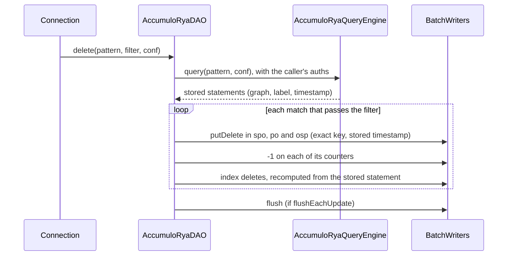

- **Only visible statements are deleted.** A user can only delete what its authorizations let it see.
- **Graph scope**, as `removeStatementsInternal` maps it:
  - no contexts: every graph;
  - a `null` context: the default graph only, via the filter `st.getContext() == null`;
  - a named context: that graph.
- **Index deletes** are computed from the stored statement. This is why an index's terms may depend only on what `spo` stores ([section 20](#20-invariants)).

### 10.2 Dropping graphs: `dropGraph`

SPARQL `CLEAR` and `DROP` call `clearInternal`, which calls `dropGraph(conf, graphs...)`. Nothing is read first: it deletes with Accumulo `BatchDeleter`s, with the caller's authorizations.

1. **Statement and index tables.** In `spo`, `po`, `osp` and the active index tables, it deletes the whole range, restricted to the column families of the given graphs. A `null` graph means the default graph (empty family). No graphs at all means everything. The index tables use the graph as column family too, so the same delete clears them.
2. **Graph markers.** It deletes the markers of the named graphs, or all of them.
3. **Counters.** Only when dropping everything, it also deletes the visible `eval` counters. A single-graph drop leaves the all-graphs counters too high, which only affects join ordering.

### 10.3 Listing graphs: the `graphs` table

`getContextIDs()` reads the visible markers. For each graph it checks that `spo` still holds at least one visible statement in it. Markers of graphs that turn out empty are deleted, so the list stays accurate after deletes. Markers are never cached across `add` calls, for the same reason.

### 10.4 Purge and destroy

- **`purge(conf)`** deletes everything visible from every table, then writes the storage version and the index state records again.
- **`dropAndDestroy()`** deletes the tables.

---

## 11. Statistics and join ordering

### 11.1 What is counted

Every insert adds `+1`, and every delete `-1`, to six counters:

| Counter | Column family | Row (for `ex:alice ex:age 42`) |
|---|---|---|
| subject | `s` | `http://ex.org/alice` |
| predicate | `p` | `http://ex.org/age` |
| object | `o` | `42` |
| subject + predicate | `sp` | `http://ex.org/alice 00 http://ex.org/age` |
| predicate + object | `po` | `http://ex.org/age 00 42` |
| subject + object | `so` | `http://ex.org/alice 00 42` |

- **Rows** use the *lexical* values, not the type-encoded ones. `"42"^^xsd:int` and `"42"^^xsd:integer` therefore share a counter.
- **Column qualifier:** empty for the all-graphs counter. A named-graph statement adds a second set of six cells whose qualifier is the graph IRI.
- **Visibility:** each cell carries the statement's label, so a reader only counts what it may see.

The combiner setting (`EvalStatsMutations.combinerSetting()`) is a `SummingCombiner`:
- **Name and priority:** `ryaStatsSum`, at priority 10, so it runs before the default versioning iterator at 20.
- **Encoding:** values are decimal text (`STRING`).
- **Scope:** it applies to all columns, at scan time and at both compaction scopes.

Accumulo sums the cells when they are read and when files are compacted, so the table converges to one cell per counter and label.

### 11.2 How a pattern's cardinality is estimated

`AccumuloRdfEvalStatsDAO.getCardinality` builds the row from the values' string forms joined by `00`. It reads the cell of the requested family, and qualifier (graph or empty), and adds up every visible cell (one per label). It returns `-1` if there is none.

`RdfCloudTripleStoreEvaluationStatistics` turns that into a cardinality for each pattern:

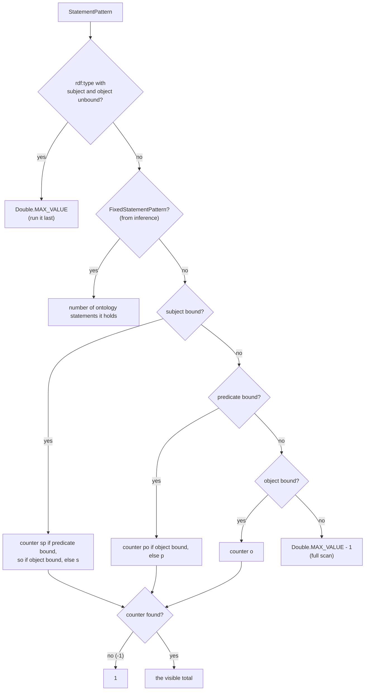

The two-value counters (`sp`, `po`, `so`) are used because `query.usecompositecard` is on by default; with it off, only the single-value counters are read. The `rdf:type` rule is `conf.stats.rdftype.down`, also on by default.

More rules:
- **Indexed patterns:** an `IndexedStatementPattern` ([section 15](#15-text-and-geo-search)) gets its plain estimate times 0.001 (`SELECTIVITY`), but at least 1.
- **Filters:** a `Filter` node is estimated at a tenth of its argument.
- **Joins:** a `Join` is estimated at the larger of its two sides.

RDF4J's `QueryJoinOptimizer` uses these estimates to order joins, running the cheapest patterns first. For the running example:

| Pattern | Counter read | Estimate |
|---|---|---|
| `ex:alice ex:knows ?friend` | `sp` on row `http://ex.org/alice 00 http://ex.org/knows` | 1 |
| `?friend ex:age ?age` | `p` on row `http://ex.org/age` | 2 |

So the `knows` pattern runs first, and the `age` lookup runs once, with `?friend` bound.

### 11.3 Approximate by design

The counters only influence join order, never results, so some drift is accepted:
- **Re-inserts:** re-inserting an existing statement counts it twice, although Accumulo stores it once.
- **Graph drops:** dropping one graph doesn't adjust the all-graphs counters.
- **Failed loads:** a load that fails part way may have written counters for blocks it writes again on resume.

**Switches:**
- `query.usestats=false` makes queries use RDF4J's own heuristic, with Rya's adjustments for inference and indexed patterns (`RyaDefaultStatistics`).
- `ac.stats.maintain=false` (`setMaintainStats(false)`) stops counting on writes.
- The endpoint's `rya.stats` sets both.

### 11.4 Graph sizes from the counters

*How many statements does each named graph hold?* `COUNT(*)` grouped by graph answers it exactly, but it reads every statement: minutes on a store of hundreds of millions. The counters answer it approximately with a handful of reads, and queries reach that answer through the predicate `stats:approxSize` (namespace `urn:rya-ng:stats#`):

```sparql
PREFIX stats: <urn:rya-ng:stats#>
SELECT ?graph ?statements WHERE { ?graph stats:approxSize ?statements }
```

**Where the number comes from.** Every statement in a named graph adds 1 to the counter of its predicate *for that graph*: family `p`, qualifier = the graph IRI ([section 11.1](#111-what-is-counted)). A graph's size is therefore the sum of its `p` counters over all predicates. There are few predicates (55 in the loader's dataset), so that is a few dozen small rows.

`GraphSizes` (`rya.accumulo`, used through `AccumuloRdfEvalStatsDAO.graphSizes(conf)`) computes it in three steps, all with the reader's authorizations:

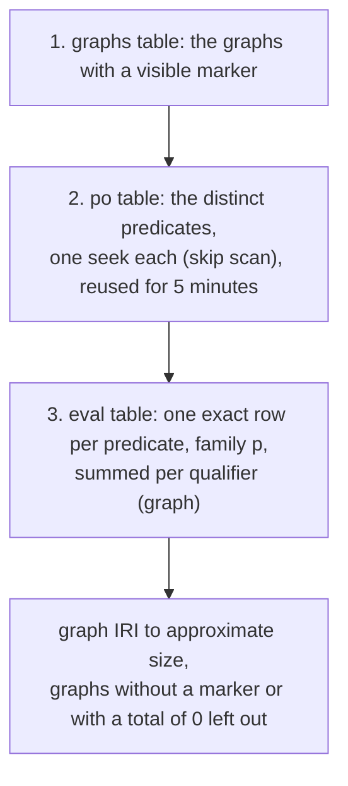

1. **Graphs.** The visible markers in the `graphs` table. A dropped graph keeps its counters ([section 10.2](#102-dropping-graphs-dropgraph)) but loses its marker, so it isn't listed.
2. **Predicates.** A skip scan of `po`:
   - read the first row, whose first part is a predicate;
   - seek to the predicate followed by byte `01`, the first possible row of the next predicate;
   - repeat until the table ends.

   That is one seek per predicate, not a read of the whole table. Seeks are usually milliseconds, but can take seconds while a bulk load keeps the tablet servers busy, so the list is kept for 5 minutes (`PREDICATES_TTL_MS`) per set of authorizations. A predicate used for the first time within that window isn't counted until the list is read again.
3. **Counters.** One `BatchScanner` over the exact `eval` rows of those predicates, family `p`. The values are added up per qualifier, keeping the graphs from step 1.

Scanning `eval` for family `p` directly would be simpler but much slower. A column-family restriction still reads the whole table unless the family has its own locality group, and `eval` holds about 50 bytes per statement.

**How the query uses it.** `GraphSizeOptimizer` (`rya.sail`) runs just before the inference rewrite ([section 12.3](#123-the-optimizer-pipeline)). It replaces every pattern whose predicate is `stats:approxSize` with a `FixedStatementPattern` holding one statement per graph (`<graph> stats:approxSize "n"^^xsd:long`), the same in-memory node inference uses ([section 14.3](#143-example-rdfssubclassof)). The rest of the query, such as filters, joins, bound subjects and `ORDER BY`, works as for any pattern. The sizes are read only if the query contains such a pattern, and fail with an explanation when the store was opened without statistics.

**Approximate**, like every counter: re-inserted statements and resumed load blocks count twice, and a new predicate shows up only after the predicate list is read again.

---

## 12. The query path

### 12.1 End to end

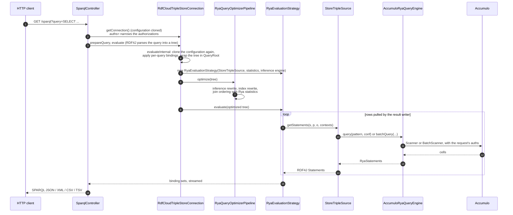

Results are lazy: Accumulo is scanned as the result writer asks for rows, so `LIMIT` and `ASK` stop the scans early.

### 12.2 `evaluateInternal` step by step

`RdfCloudTripleStoreConnection.evaluateInternal(tupleExpr, dataset, bindings, includeInferred)`:

1. **Per-query configuration.** It clones the connection's configuration, then applies overrides passed as query bindings named after configuration keys:

   | Binding | Effect |
   |---|---|
   | `query.auth` | authorizations for this query (comma-separated) |
   | `query.infer` | inference on or off |
   | `query.usestats` | statistics-based join ordering on or off |
   | `query.useindex` | text and geo index on or off |
   | `query.ttl`, `query.startTime` | only statements written in a time window |
   | `query.printqueryplan` | log the optimized plan |

   If RDF4J asks for no inferred statements (`includeInferred = false`), inference is turned off.
2. **Tree.** It clones the tree, so the caller's copy is never modified, and wraps it in a `QueryRoot`.
3. **Collaborators.** It builds:
   - a `StoreTripleSource` over the DAO, with the per-query configuration;
   - an `EvaluationStatistics`: `RdfCloudTripleStoreEvaluationStatistics` when statistics are on, `RyaDefaultStatistics` otherwise;
   - a `RyaEvaluationStrategy`;
   - a `RyaQueryOptimizerPipeline`.
4. **Optimize, then evaluate.** `strategy.optimize(...)`, then `strategy.evaluate(...)`.

### 12.3 The optimizer pipeline

`RyaQueryOptimizerPipeline` is RDF4J 6.1's standard pipeline with four Rya steps added (marked ★):

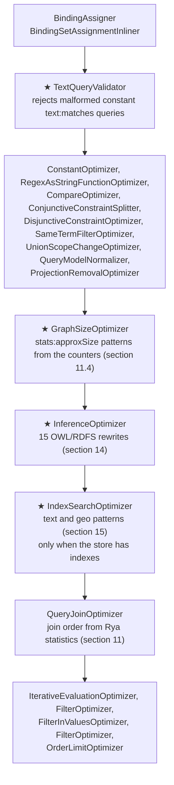

**Where the Rya steps sit:**
- **Graph sizes** are filled in before inference, which leaves the in-memory pattern they produce alone.
- **Inference** runs after the tree is normalized and before join ordering. Join ordering therefore runs once, on the final tree, and sees the patterns inference created.
- **The index rewrite** runs after inference, so sub-properties added by inference are searched too. It runs before join ordering, which then sees the much smaller indexed patterns.

### 12.4 The evaluation strategy

`RyaEvaluationStrategy` extends RDF4J's `DefaultEvaluationStrategy` and changes two `prepare` methods:

| Node | Step used |
|---|---|
| `Join` whose right side is a plain statement pattern (optionally under filters) | `BatchedJoinStep` ([section 13](#13-batched-joins)); otherwise RDF4J's own join |
| `IndexedStatementPattern` | RDF4J's `StatementPatternQueryEvaluationStep`, reading through an `IndexTripleSource` ([section 15](#15-text-and-geo-search)) |
| `FixedStatementPattern` | matched against its in-memory list of ontology statements ([section 14](#14-inference)) |
| `TransitivePropertySP` | the closure computed by `InferenceEngine.findTransitiveProperty` when one end is bound; otherwise a plain lookup |
| any other node | RDF4J's default |

### 12.5 `StoreTripleSource`: RDF4J lookups on top of Rya

`StoreTripleSource` (an inner class of the connection) is the only way the evaluation reads statements. `getStatements(s, p, o, contexts)`:
1. **Prefetched batches first.** It looks the lookup up in the batches a batched join prefetched. If the lookup is there, it is answered from memory.
2. **Otherwise one scan per graph.** It converts the lookup to a `RyaStatement` pattern and calls `AccumuloRyaQueryEngine.query`, applying RDF4J's context semantics:
   - no contexts: one lookup over every graph;
   - one graph: a lookup restricted to its column family;
   - `null`: an "any graph" lookup, keeping only results without a context (the default graph);
   - several graphs: one lookup per graph, read one after the other.
3. **Conversion.** It converts each `RyaStatement` to an RDF4J `Statement`.

### 12.6 The running example, optimized

```
QueryRoot
└── Projection (?friend, ?age)
    └── Join                                     algorithm: RyaBatchedJoin
        ├── StatementPattern  ex:alice ex:knows ?friend      estimate 1 → spo scan
        └── StatementPattern  ?friend  ex:age   ?age         estimate 2 → spo lookup per friend
```

The join is set up as a batched join. With only one left row (`ex:bob`) there is nothing to batch, so that row's lookup goes straight to the store. With thousands of friends, the lookups would be fetched 1000 at a time.

`query.printqueryplan=true` logs a plan like this.

---

## 13. Batched joins

### 13.1 The problem

With a nested-loop join, every row from the left side costs one Accumulo round trip for the right side. A left side of 100,000 rows means 100,000 small scans, one after the other.

### 13.2 The idea

`BatchedJoinStep` keeps the nested-loop semantics but fetches the right-hand lookups in batches:

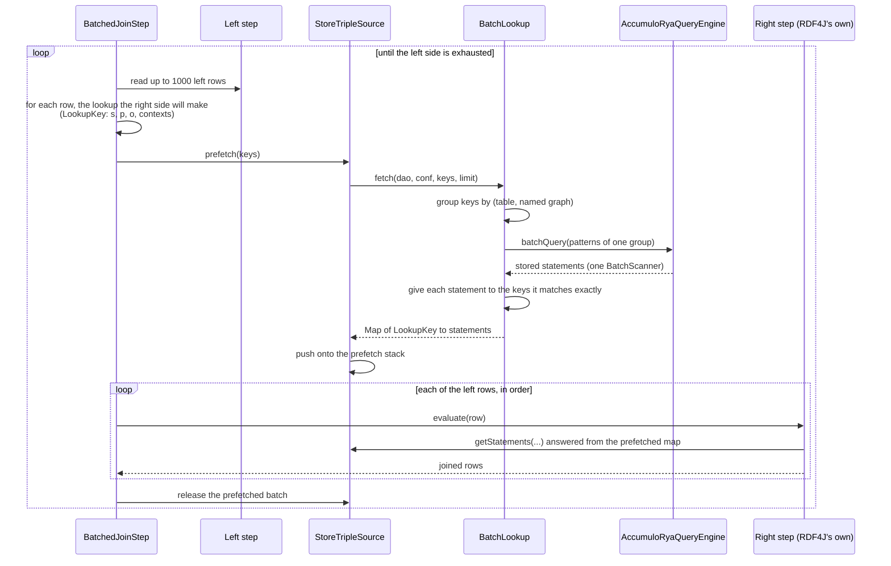

The right side is still RDF4J's own statement-pattern step, run once per left row. Only where its statements come from changes, so join semantics (optional variables, repeated variables, graph scopes) stay RDF4J's.

### 13.3 When a join is batched

`RyaEvaluationStrategy.batchableRightPattern` allows batching only when all of these hold:
- **The store:** the triple source is a `StoreTripleSource`.
- **Settings:** `query.join.batchsize` is above 1 (default 1000), and `query.limit` is not set.
- **The query:** it has no `FROM` / `FROM NAMED` dataset.
- **The join:** it is not a merge join, and RDF4J is not tracking result sizes or times.
- **The right side:**
  - it is a statement pattern, possibly under filters, with no variable-scope change and no subquery;
  - it is not a `FixedStatementPattern` or a `TransitivePropertySP`;
  - if it is an `IndexedStatementPattern`, the left side binds its subject or its object (so the lookup is a plain store lookup).

The join then shows `algorithm: RyaBatchedJoin` in the plan. A chunk with a single left row skips the prefetch: its one lookup goes straight to the store.

### 13.4 Keeping the answers identical

`BatchLookup` is where correctness is decided:
1. **Grouping.** Keys are grouped by the table their pattern resolves to and by the named graph they ask for. Each group is one `batchQuery`.
2. **Exact matching.** The scan ranges are looser than the keys: they ignore the object's type, and they may overlap. So every stored statement is matched to each key on the key's bound positions:
   - same subject and predicate;
   - the same encoded object, data **and** type;
   - for default-graph keys, no context.

   A key's answer is exactly what a single lookup would have returned.
3. **No double counting.** Within a group, a stored cell counts once, identified by its statement, graph, qualifier, label and timestamp.
4. **A size cap.** If more than `query.join.prefetchlimit` statements (default 100,000) would be held in memory, `fetch` returns `null`. Nothing is cached, and every key is looked up on its own.
5. **Never a partial batch.** A key missing from the cache must mean "ask the store", never "no results". So a batch is registered whole or not at all.

Batches form a stack in `StoreTripleSource`, so nested batched joins each keep their own until they release it.

**Testing:** the ITs can push every join through chunk boundaries with `-Drya.test.joinBatchSize=2`, and the endpoint tests with `-Drya.join-batch-size=2`.

---

## 14. Inference

Inference makes queries also return statements that follow from an **ontology** (RDFS/OWL statements such as `ex:Dog rdfs:subClassOf ex:Animal`), without storing them. rya-ng does it at **query time**: it rewrites the query tree so the extra matches are found by the same scans. It is off by default (`query.infer`, or `rya.inference` on the endpoint).

### 14.1 The InferenceEngine: the ontology in memory

`InferenceEngine` reads the ontology from the store when it starts, and again on a timer (every 5 minutes by default; `rya.inference-refresh` on the endpoint). It keeps:

| What | Built from |
|---|---|
| subclass graph (`ValueGraph`) | `rdfs:subClassOf`, `owl:equivalentClass` (both ways), `owl:unionOf` |
| subproperty graph | `rdfs:subPropertyOf`, `owl:equivalentProperty` (both ways) |
| property sets | members of `owl:SymmetricProperty`, `owl:TransitiveProperty`, `owl:ReflexiveProperty` |
| property maps | `owl:inverseOf`, `owl:propertyChainAxiom`, `rdfs:domain`, `rdfs:range` |
| class expressions | `owl:intersectionOf`, `owl:oneOf`, and restrictions with `owl:hasValue`, `owl:someValuesFrom`, `owl:allValuesFrom`, `owl:hasSelf` |

Changes to the ontology are invisible until the next refresh. Tests call `refreshGraph()` explicitly. A scheduled refresh that fails is logged and retried on the next tick. The parts are reloaded one after another, so until a refresh succeeds the ontology in memory may be partly updated.

Two kinds of reasoning still read the store at query time:
- **Transitive closures**, followed one hop at a time from the bound end.
- **`owl:sameAs` sets**, read when the query is rewritten.

### 14.2 The rewrite

`InferenceOptimizer` runs 15 tree visitors in a fixed order. Later visitors expand what earlier ones produced. Each one can be switched off with its own flag:

| # | Visitor | Flag (`infer.include.…`) | `?x rdf:type :C` or `?x :p ?y` also matches… |
|---|---|---|---|
| 1 | `DomainRangeVisitor` | `domainrange` | subjects of properties with `rdfs:domain :C`, objects of properties with `rdfs:range :C` |
| 2 | `SomeValuesFromVisitor` | `somevaluesfrom` | members of a `someValuesFrom` restriction, through its property and class |
| 3 | `AllValuesFromVisitor` | `allvaluesfrom` | values of a property whose subject is in an `allValuesFrom` restriction |
| 4 | `HasValueVisitor` | `hasvalue` | resources with the restriction's value, and the value for members of the restriction |
| 5 | `IntersectionOfVisitor` | `intersectionof` | resources of every class of an intersection that implies `:C` |
| 6 | `ReflexivePropertyVisitor` | `reflexiveprop` | `?x = ?y`, for a reflexive `:p` |
| 7 | `PropertyChainVisitor` | `propertychain` | the chain of properties `:p` is defined as |
| 8 | `TransitivePropertyVisitor` | `transprop` | the transitive closure of `:p` (becomes a `TransitivePropertySP`) |
| 9 | `SymmetricPropertyVisitor` | `symmprop` | `?y :p ?x`, for a symmetric `:p` |
| 10 | `InverseOfVisitor` | `inverseof` | `?y :q ?x`, for `:p owl:inverseOf :q` |
| 11 | `SubPropertyOfVisitor` | `subpropof` | `?x :sub ?y` for every subproperty `:sub` of `:p` |
| 12 | `SubClassOfVisitor` | `subclassof` | instances of every subclass of `:C` |
| 13 | `SameAsVisitor` | `sameas` | the same pattern with a constant subject or object replaced by each resource `owl:sameAs` it |
| 14 | `OneOfVisitor` | `oneof` | the enumerated members of `:C` (`owl:oneOf`) |
| 15 | `HasSelfVisitor` | `hasself` | `?x :p ?x` for a `hasSelf` restriction on `:p` |

Visitors only touch patterns whose predicate is a constant, except `SameAsVisitor`, which also expands patterns with a variable predicate. They skip the nodes inference itself created.

### 14.3 Example: `rdfs:subClassOf`

Ontology and data:

```turtle
ex:Dog rdfs:subClassOf ex:Animal .
ex:Cat rdfs:subClassOf ex:Animal .
ex:rex rdf:type ex:Dog .
```

Query: `SELECT ?x WHERE { ?x rdf:type ex:Animal }`.

Before the rewrite:

```
Projection (?x)
└── StatementPattern  ?x rdf:type ex:Animal
```

After `SubClassOfVisitor` (`?t` stands for a fresh variable with a random name):

```
Projection (?x)
└── InferJoin
    ├── FixedStatementPattern  ?t rdfs:subClassOf ex:Animal
    │      in-memory statements:  ex:Dog    rdfs:subClassOf ex:Animal
    │                             ex:Cat    rdfs:subClassOf ex:Animal
    │                             ex:Animal rdfs:subClassOf ex:Animal   (the class itself)
    └── DoNotExpandSP          ?x rdf:type ?t
```

- **`FixedStatementPattern`** never touches the store. `RyaEvaluationStrategy` matches it against its list, so `?t` becomes `ex:Dog`, `ex:Cat` and `ex:Animal` in turn. Its estimated cardinality is the length of the list, so join ordering runs it first.
- **`DoNotExpandSP`** is an ordinary lookup (`?x rdf:type ex:Dog`, on the `po` table) that later visitors must not expand again. It is a plain statement pattern on the right of a join, so the three lookups are fetched in one batched scan ([section 13](#13-batched-joins)).
- **`InferJoin` / `InferUnion`** are plain `Join` / `Union` nodes marked as produced by inference, which later visitors skip.

Result: `?x = ex:rex`.

### 14.4 Transitive properties

If `ex:partOf` is an `owl:TransitiveProperty`, `ex:wheel ex:partOf ?x` becomes a `TransitivePropertySP`. At evaluation time, `InferenceEngine.findTransitiveProperty` starts from the bound end and follows `ex:partOf` one hop at a time, one store lookup per hop. It returns a statement from the start to every node it reaches. If neither end is bound, the pattern is evaluated as a plain lookup, without the closure.

### 14.5 Caveats

- **RDF4J 6 `Var` nodes have one parent.** A visitor that reuses a variable in a new node must clone it (`AbstractInferVisitor.c(var)`). Tests run with `-ea`, so a violation fails an assertion.
- **Blank nodes** are IRIs to the engine ([section 6](#6-the-data-model)), which casts values to `IRI` throughout.
- **`getStatements` with inference** (the Repository API, with `includeInferred`) is evaluated as a one-pattern query through this same rewrite, but only across all graphs. A lookup restricted to graphs returns stored statements only.

---

## 15. Text and geo search

### 15.1 Filters are exact; indexes only narrow

Two kinds of filter can search literal values:
- **Text:** `text:matches(?literal, "query")` (`TextMatchesFunction`, registered through `META-INF/services`).
- **Geo:** RDF4J's GeoSPARQL functions (`geof:sfWithin`, `geof:distance`, …).

Both are always **evaluated exactly**, row by row, with or without an index.

Without an index, a filter has to check every candidate: `?doc rdfs:label ?label FILTER(text:matches(?label, "colosseo"))` reads every `rdfs:label` in the store. The optional **text** and **geo** indexes (`index.text`, `index.geo`) let the query start from the few statements that *could* pass the filter:

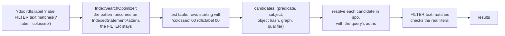

The index can only cost time, never change results:
- **Every hit is resolved:** each index hit is read back from `spo` with the query's own configuration (authorizations, TTL).
- **The filter still runs:** it makes the exact check on what comes back.

So an index entry that is too broad, or left behind by a failure, costs a lookup and returns nothing.

### 15.2 Index key layout

Both index tables use the same key layout (`IndexKeys`):

```
row        term-or-cell 00 predicate 00 subject 00 objectHash
family     graph IRI (empty for the default graph), as in spo
qualifier  the spo qualifier (normally empty)
visibility the statement's label
timestamp  the statement's timestamp
value      empty
```

- **`term-or-cell`** is a word (text index) or a geohash cell (geo index).
- **`objectHash`** is the first 8 bytes of SHA-256 over the object's Rya encoding (value and type), as 16 hex digits. The literal itself is never copied into the index.
- **Why the subject is in the row:** no row grows without bound, so tablets can still split under a very common word.

Real examples, from the running code:

```
ex:rome rdfs:label "Colosseo di Roma"@it          (text index: one entry per distinct word)
  colosseo 00 http://www.w3.org/2000/01/rdf-schema#label 00 http://ex.org/rome 00 ab142638208bc3bb
  di       00 http://www.w3.org/2000/01/rdf-schema#label 00 http://ex.org/rome 00 ab142638208bc3bb
  roma     00 http://www.w3.org/2000/01/rdf-schema#label 00 http://ex.org/rome 00 ab142638208bc3bb

ex:colosseo geo:asWKT "POINT(12.4922 41.8902)"^^geo:wktLiteral      (geo index: one cell)
  sr2yk3bs1772 00 http://www.opengis.net/ont/geosparql#asWKT 00 http://ex.org/colosseo 00 <hash>
```

### 15.3 Text analysis

`TextAnalyzer` splits text into the words that the index, the query parser and `text:matches` all use, so a word is spelled the same way everywhere:
1. **Normalize:** Unicode decomposition, lower case, combining marks (accents) removed, a few letters folded (`ß`→`ss`, `æ`→`ae`, `ø`→`o`, …).
2. **Split:** a word is a run of letters and digits. Each Han ideograph or Hiragana character is a word on its own.
3. **Cut:** words longer than 64 code points (`MAX_TERM`) are cut.

`"Colosseo di Roma — Café Ærø"` → `colosseo`, `di`, `roma`, `cafe`, `aero`.

Only `xsd:string` and language-tagged literals are text. `index.text.predicates` can restrict the index to some predicates (empty means all).

### 15.4 Text queries and their candidates

`TextQuery` parses the query language: words, `"phrases"`, `prefix*`, `AND` (or a space), `OR`, `NOT` and parentheses, with `NOT` binding tighter than `AND`, and `AND` tighter than `OR`.

`TextCandidates` turns a query into what the index can look up: a boolean expression of words and word prefixes, matched by every text that satisfies the query (and maybe more):
- **Phrases** become the AND of their words.
- **`NOT` parts** are dropped. The filter applies them later.
- **No lookup possible:** a query with no word that every match must contain cannot use the index. That covers a pure `NOT`, an `OR` with such a branch, and a prefix shorter than 3 characters (`MIN_PREFIX`).

```
alice AND (bob OR caro*) AND NOT "old draft"
  → AllOf[ Word alice, AnyOf[ Word bob, Start caro ] ]
```

`IndexSearcher` evaluates the candidate expression lazily:
- **Word or prefix:** a range over its rows, restricted to the predicate and graphs when known. Reading at most 1000 entries (`PROBE_LIMIT`) tells whether it is *small*. Small ones are kept in memory.
- **AND:** the operand with the smallest estimate *drives*: its entries are streamed in chunks of 1000 (`VERIFY_CHUNK`), and each chunk is checked against the other operands. A check is an in-memory lookup if the operand is small, or one exact-key lookup per candidate in the index if not. A large prefix lets everything through, since the filter checks it anyway.
- **OR:** the union of its operands, without repeats.
- **Resolve:** candidates are resolved in chunks of 1000 (`RESOLVE_CHUNK`). One `batchQuery` on `spo` fetches each candidate's (subject, predicate) cells, and only the cells whose graph, qualifier and object hash match a candidate are kept.

### 15.5 Geo cells

A **geohash** names a rectangle of the Earth with a base-32 string. Each extra character divides a cell into 32 smaller ones, so **a cell's name is a prefix of the names of every cell inside it**. `sr2y` contains `sr2yk`, which contains `sr2yk3bs1772`.

`GeoCells` covers a shape with cells:
- **A point** gets one cell of 12 characters (`MAX_LEVEL`): a few centimetres.
- **A line or polygon** gets up to 32 cells (`K_STORE`), as fine as that budget allows. The cover always contains the shape, and the cells are grown by 10⁻⁹ degrees (`EPS`) before comparing, so shapes that only touch at a cell edge still share a cell.

For example, the small polygon `POLYGON((12.48 41.88, 12.50 41.88, 12.50 41.90, 12.48 41.90, 12.48 41.88))` is stored under 23 cells, from `sr2y7bp` to `sr2yk7`.

At query time, `GeoRegion` turns a filter into scans:

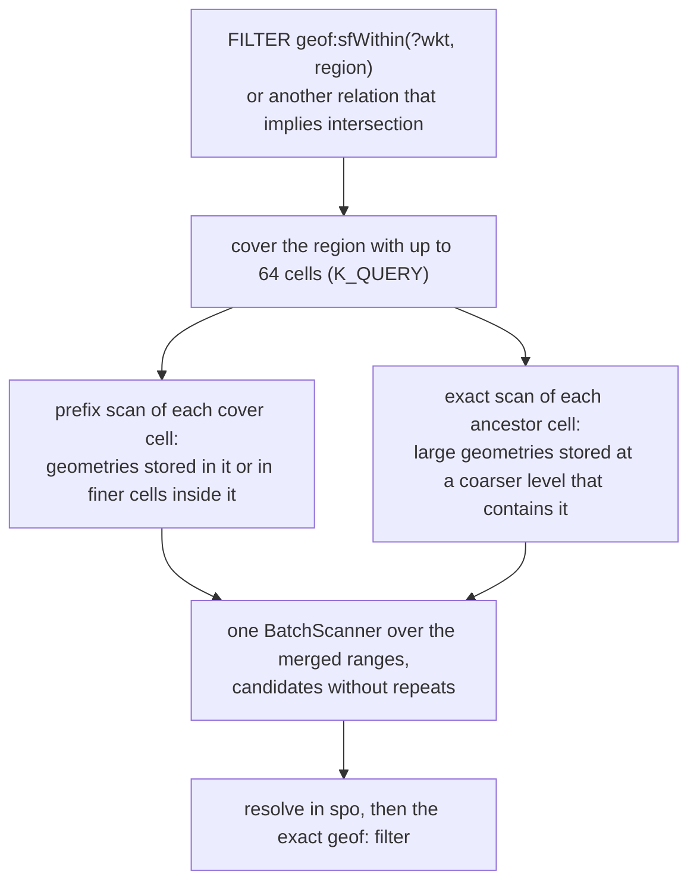

For the polygon above used as a query region: 54 prefix cells, plus the exact rows of the 11 ancestor cells `s`, `sr`, `sr2`, `sr2y`, `sr2y7`, `sr2y7b`, `sr2y7c`, `sr2y7f`, `sr2y7g`, `sr2yk` and `sr2yk0`.

Which filters can use the geo index:
- **Relations that imply intersection:** `sfEquals`, `sfIntersects`, `sfTouches`, `sfCrosses`, `sfWithin`, `sfContains`, `sfOverlaps`, their `eh*` and `rcc8*` equivalents, and `geof:relate` with a DE-9IM pattern that requires interiors or boundaries to meet.
- **Distances:** `geof:distance(?g, point, unit) < d` (or `<=`, or the reverse comparison). The circle is covered with cells and only points are looked up, since `geof:distance` rejects other geometries.

WKT is parsed with RDF4J's `SpatialSupport`. WKT that doesn't parse is stored but not indexed, and never matches.

### 15.6 Index lifecycle

An index is only usable if it covers every statement. `IndexManager` records each index's state in the `ns` table (row `rya`, family `index`, qualifier `text` or `geo`): `READY` or `BUILDING`, plus its **definition**. The definition is a string that captures the indexing rules (`text/1;max=64;preds=…`, `geo/1;k=32;lvl=12;eps=1.0E-9`).

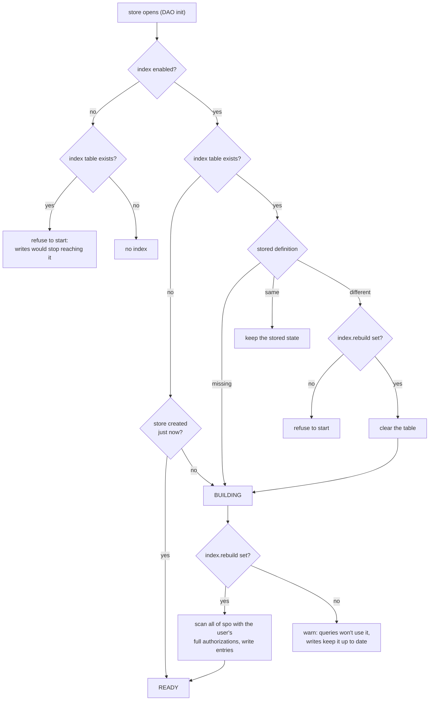

- **Writes:** while an index is enabled, every add and delete maintains it, whatever its state.
- **Queries:** queries use only `READY` indexes.
- **Versioned rules:** changing the analysis rules means bumping `TextAnalyzer.VERSION` or `GeoCells.DEFINITION`, so existing indexes are detected as different and must be rebuilt.

### 15.7 The query side, step by step

1. **`TextQueryValidator`** (always on) rejects a malformed constant `text:matches` query with a `MalformedQueryException`, which the endpoint maps to `400`.
2. **`IndexSearchOptimizer`** runs only when:
   - `query.useindex` is not false;
   - `query.limit` is not set;
   - at least one index is `READY`.

   For each chain of filters, it collects the conjuncts that can use an index, per variable. Text wins over geo on the same variable. It then looks for the statement patterns every filtered row must have come through: through joins, unions, nested filters, the left side of OPTIONAL and MINUS, and BINDs that don't rebind the variable. It replaces a pattern with an `IndexedStatementPattern` when:
   - its object is the filtered variable, unbound;
   - its subject is a variable;
   - the variable appears nowhere else in it;
   - for text, the index covers its predicate.
3. **`QueryJoinOptimizer`** sees the indexed pattern at a thousandth of the plain pattern's estimate (`SELECTIVITY`), so it usually runs first.
4. **At evaluation**, `RyaEvaluationStrategy` runs the pattern with RDF4J's own statement-pattern step over an `IndexTripleSource`:
   - neither subject nor object is bound: `IndexSearcher` searches the index;
   - otherwise (the pattern sits on the right of a join): a plain store lookup, which is cheaper and goes through the batched-join cache.

The index is **not** used when:
- the query sets Rya's `query.limit` (SPARQL `LIMIT` is fine);
- an embedded query sets the binding `query.useindex` to `false`;
- the plan starts elsewhere and reaches the pattern with its subject already bound.

**Testing:** with `-Drya.test.indexes=true` every IT maintains both indexes, and `RyaSailITBase` checks each test's index tables against `spo` with `IndexVerifier`.

---

## 16. Security: visibility labels and authorizations

rya-ng passes Accumulo's cell-level security through to RDF statements: each statement has a visibility label, and each read uses a set of authorizations.

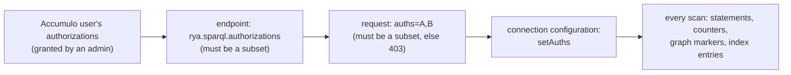

**Writing:**
- **The label:** a statement's label is the connection's `conf.cv`. On the endpoint that is `rya.sparql.default-visibility`. An update may set its own with `visibility=` when `rya.sparql.allow-request-visibility` is on, and the expression is checked first.
- **Where it goes:** the label is written on everything derived from the statement: the three statement cells, its counters, its graph marker and its index entries.

**Reading:** every scan uses the connection's authorizations. Readers therefore:
- see only the statements they may see;
- count only those in the statistics;
- list only graphs that have visible data;
- get index candidates only from visible entries, and resolve them against visible cells.

**Per-connection configuration.** Each connection clones the store's configuration, and each query clones the connection's. Per-request auths and labels must be set on `RdfCloudTripleStoreConnection.getConf()`, never on the store's shared configuration, which would leak them to every other request.

**Exceptions:**
- **Namespaces and state records:** the `ns` table (namespaces, storage version, index state) is read with empty authorizations and written without labels.
- **Index rebuilds** read `spo` with *all* of the Accumulo user's authorizations. Statements under labels the user lacks are not indexed, so the user that rebuilds must hold every label in the store.

**No HTTP authentication.** The endpoint does not authenticate users. Run it behind a proxy that does, or add Spring Security.

---

## 17. The SPARQL endpoint

### 17.1 Startup

`RyaSparqlApplication` is a Spring Boot application. `RyaStoreConfiguration` builds three beans:

1. **`AccumuloClient`**, either:
   - from `rya.accumulo.client-properties` (an `accumulo-client.properties` file, read with `AccumuloClients.fromFile`; if the file uses password authentication without a stored password, it comes from `rya.accumulo.password`, i.e. the `RYA_ACCUMULO_PASSWORD` environment variable);
   - or from `rya.accumulo.instance`, `zookeepers`, `user` and `password`.
2. **`AccumuloRdfConfiguration`**, from `RyaProperties` (`rya.*` in `application.yaml` or on the command line):

   | Setting | Configuration call |
   |---|---|
   | `rya.table-prefix` | `setTablePrefix` |
   | `rya.inference` | `setInfer` |
   | `rya.stats` | `setUseStats` and `setMaintainStats` |
   | `rya.join-batch-size` | `setJoinBatchSize` |
   | `rya.text-index`, `rya.text-index-predicates`, `rya.geo-index`, `rya.rebuild-indexes` | `setTextIndex`, `setTextIndexPredicates`, `setGeoIndex`, `setRebuildIndexes` |
   | `rya.sparql.authorizations` | `setAuths` (the most any request may read with) |
   | `rya.sparql.default-visibility` | `setCv` (the label written on inserts) |
   | `rya.inference-refresh` | the inference engine's refresh period |
3. **`SailRepository`**, built by `RyaAccumuloSailFactory.createSail` and initialized at startup. Initialization:
   - opens the DAO: tables, combiner, version, index states, and an optional index rebuild;
   - opens the statistics reader;
   - loads the ontology when inference is on.

   It shuts down with the application.

The Accumulo client belongs to Spring, which closes it after the repository.

### 17.2 Handling a request

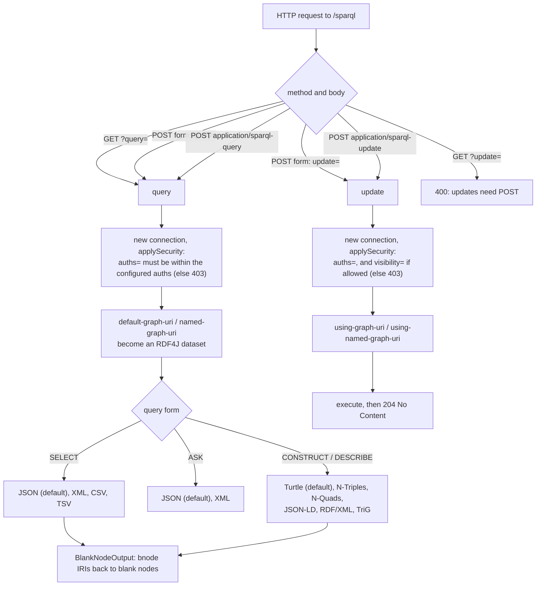

- **Formats:** `ContentNegotiation` picks the format from `Accept`, by quality and then by the client's order. The first format of each list is the default. If nothing supported is acceptable, the answer is `406`.
- **Time limit:** every query and update gets RDF4J's maximum execution time:
  - by default `rya.sparql.query-timeout` (120 s);
  - or the request's `timeout=` parameter, in whole seconds, up to `rya.sparql.max-query-timeout` (30 min by default; `0s` for no limit). The query page sends it from its **Timeout** field.
- **Errors:** `SparqlExceptionHandler` maps them to plain-text answers:

  | Status | Cause |
  |---|---|
  | `400` | malformed query, or a bad parameter (including a `timeout=` that isn't a positive whole number) |
  | `403` | `auths=` beyond the configured auths, `visibility=` while it is disabled, or `timeout=` above the maximum |
  | `406` | no acceptable result format |
  | `503` | timeout |
  | `500` | anything else |

### 17.3 The query page

`src/main/resources/static/index.html` and `ui/` hold the browser page:
- **`rya-ui.js`** sets up YASGUI on `/sparql`, with the Examples menu and two header fields the browser remembers: **Authorizations** (sent as `auths=`) and **Timeout** (sent as `timeout=`).
- **`rya-map.js`** draws `geo:wktLiteral` results on a map.
- **`wkt.js`** turns WKT into GeoJSON.

The third-party files (YASGUI, the map library, …) are not in the repository. At build time, `maven-antrun-plugin` downloads pinned npm tarballs into `~/.m2/repository/.cache/rya-ng-ui`, checks their SHA-512, and unpacks them into `static/vendor`. `SparqlUiIT` checks that every asset is served.

### 17.4 Running it

- **`rya.sparql/configure.sh`** (bash 3.2 compatible) asks for the settings and writes a launch script that passes them as `--rya.*` arguments. Only the password travels in the environment (`RYA_ACCUMULO_PASSWORD`), and the script never stores it.
- **`DevServer`** (test sources) runs the endpoint on a throwaway MiniAccumuloCluster.

---

## 18. The synthetic-data loader

`rya.loader` generates a synthetic dataset (people, organizations, cities, landmarks, events, products, reviews, articles, sensors, observations…) and writes it through the normal DAO, in parallel, for stress tests of up to billions of triples. It is a Spring Boot executable jar run with `rya.loader/run.sh`.

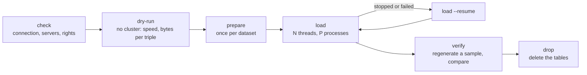

### 18.1 Deterministic generation

`EntityGenerator.generate(i)` returns the statements of entity `i`, about 7.5 on average. The result depends only on the dataset seed and `i`:
- **Randomness:** each entity uses its own `SplitMix64` random streams (graph and label, anchor, geometry, text). `SplitMix64` is implemented in the project, so the data never changes with the Java version.
- **Classes:** `ClassLayout` deals entity numbers into 1000 slots by weighted round robin, so classes interleave evenly and the `r`-th member of a class is found in O(1). Links can then point at random members of a class without generating them.
- **One timestamp:** each dataset uses one fixed timestamp, so writing an entity again produces exactly the same keys.

So any process can generate any range of entities, and a rerun after a failure overwrites what was there with identical cells. `GenConfig.fingerprint()` identifies a dataset.

### 18.2 `prepare`

`prepare` runs once, from one process, before any `load`:
1. **One DAO `init`** creates the tables. The index tables are created together with the store, so the indexes start `READY` ([section 15.6](#156-index-lifecycle)). Several processes initializing at once could race, which is why only `prepare` does it.
2. **`SplitPlanner` pre-splits every table**, about 4 tablets per tablet server. It samples entities, serializes their rows with the same code as the DAO, takes quantiles of the rows each table would receive, and shortens each split point to the shortest prefix that still separates it from the previous row. Writes then spread over all servers from the first second.
3. **`ReferenceData`** writes the ontology, 200 countries and a description of the dataset that includes its fingerprint.

### 18.3 `load`

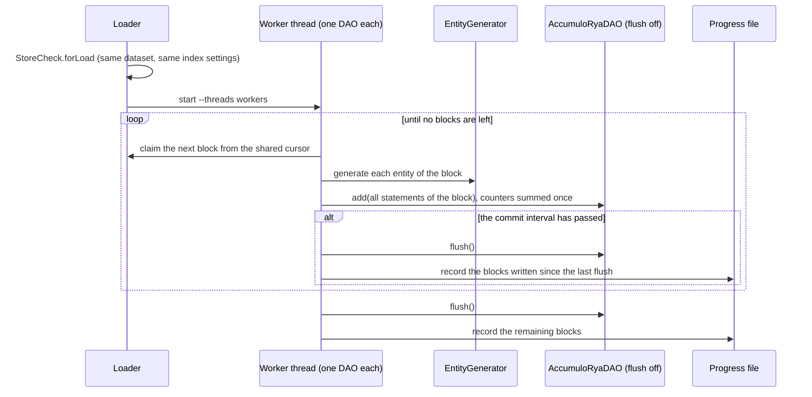

- **Workers:** each worker thread has its own DAO, because `add` is synchronized per DAO. Its batch-writer settings come from the options (buffer, writer threads, latency, timeout, durability).
- **Blocks:** blocks of entities (`--block-size`, default 1000) are claimed from a shared counter. Each block is written with one `add`, so its statistics counters are summed before they are sent ([section 9.3](#93-counters-are-summed-before-they-are-written)).
- **Progress:** a block is recorded in the progress file only after a flush that followed it. The file is written atomically (temporary file, then rename) and carries a fingerprint of the options, so `--resume` never mixes two loads. `--resume` skips recorded blocks and writes the others again. That is harmless for the statement tables (identical keys), but the counters of blocks in flight during a failure may be counted twice.
- **Parallelism:** `--part K --parts N` divides the entities between processes, on one or several machines.

### 18.4 `verify`

`verify` regenerates a random sample of entities. It checks, under the reader's authorizations, that:
- every statement the reader may see is in `spo`, and nothing else is;
- each subject's counter equals its number of visible statements.

---

## 19. Test infrastructure

- **Naming:** `*Test` classes are pure unit tests (surefire, `mvn test`). `*IT` classes need Accumulo (failsafe, `mvn verify`).
- **`MiniAccumuloSingleton`** starts one in-process MiniAccumuloCluster per test JVM, on first use, and stops it with a shutdown hook.
- **`AccumuloITBase`** gives each test:
  - a root `AccumuloClient`;
  - a unique table prefix, whose tables are deleted afterwards;
  - `grantAuthorizations(...)`. A real cluster rejects scans with labels the user doesn't hold, so visibility tests must call it.
- **`RyaSailITBase`** (`rya.sail`) adds `newConf()`, `newDao(conf)` and `newStore(conf, inference)`.
- **System properties that widen coverage:**

  | Property | Effect |
  |---|---|
  | `-Drya.test.joinBatchSize=2` | every batched join crosses chunk boundaries |
  | `-Drya.join-batch-size=2` | the same, for the endpoint tests |
  | `-Drya.test.indexes=true` | every test maintains both indexes, then `IndexVerifier` checks that each index table holds exactly the entries its statements call for |

- **Coverage:** `-Pcoverage` adds JaCoCo to both test phases and merges the reports in `rya.coverage`.

---

## 20. Invariants

Breaking any of these loses data or results, or makes the store refuse to start:

1. **No `00` or `01` in encoded values.** They split rows. Use mango's encoders, never Accumulo lexicoders ([section 7.4](#74-why-00-and-01-are-reserved)).
2. **Don't change existing encodings.** Every stored row and every range depends on them. For example, adding a `wktLiteral` type resolver would change how the existing objects are stored.
3. **Index terms depend only on what `spo` stores.** Deletes recompute them from the stored statement.
4. **Index puts and deletes use the statement's timestamp**, like the statement tables.
5. **Changing the text or geo rules means bumping `TextAnalyzer.VERSION` or `GeoCells.DEFINITION`**, so existing indexes are rebuilt.
6. **An index table never exists while its index is off.** It would silently stop receiving writes.
7. **A batched-join prefetch is complete or absent.** A key missing from it must mean "ask the store".
8. **Blank nodes are IRIs in `RyaSchema.BNODE_NAMESPACE`** everywhere inside the Sail. The inference engine relies on it.
9. **`null` context:** any graph in a Rya pattern, the default graph in RDF4J.
10. **Per-request settings go on the connection's configuration**, never on the store's.
11. **New query nodes clone their `Var`s.** RDF4J 6 allows one parent per `Var`.
12. **`init()` must not write to an existing store.** Read-only users must be able to open it.
13. **One DAO, one writer thread.** Parallel writers use separate DAOs.

---

## 21. Glossary

| Term | Meaning |
|---|---|
| **Authorizations** | The labels a scan presents. A cell is returned only if its visibility expression is satisfied by them. |
| **BatchScanner** | Accumulo reader that scans many ranges in parallel and returns results unordered. |
| **BatchWriter** | Accumulo writer that buffers mutations and sends them in the background. `flush()` waits for them. |
| **Binding set** | One solution of a query: values for some variables. |
| **Cardinality** | Estimated number of results of a pattern, used to order joins. |
| **Column family / qualifier** | Second and third parts of an Accumulo key. rya-ng puts the graph IRI in the family. |
| **Combiner** | Accumulo iterator that merges all cells of a key into one, for example by adding them up. |
| **Context** | RDF4J's name for a named graph. |
| **DAO** | Data access object: `AccumuloRyaDAO`, the class that reads and writes the tables. |
| **Default graph** | The statements without a named graph. Their column family is empty. |
| **Geohash** | Base-32 name of a rectangle on Earth. A longer name is a smaller cell inside the shorter one. |
| **Index (secondary)** | The optional `text` and `geo` tables that list candidate statements for search filters. |
| **Iterator (Accumulo)** | Code running inside tablet servers on the sorted stream of cells (filters, combiners, versioning). |
| **Marker byte** | Last byte of a stored object, telling which resolver decodes it. |
| **Mutation** | A set of changes to one Accumulo row, applied atomically. |
| **Named graph** | A set of statements identified by an IRI. The fourth element of a quad. |
| **Range scan** | Reading every key between a start and an end key, which is fast because keys are sorted. |
| **Resolver** | `RyaTypeResolver`: turns one datatype into bytes and back. |
| **Row** | First part of an Accumulo key. Keys are sorted by it first. |
| **Sail** | RDF4J's storage plug-in API ("Storage And Inference Layer"). |
| **Scanner** | Accumulo reader for one range, with results in sorted order. |
| **Statement pattern** | A triple with variables. A leaf of the query tree. |
| **Tablet / tablet server** | A row range of a table, and the server that holds it. |
| **TripleSource** | The RDF4J interface the evaluation reads statements through: `getStatements(s, p, o, contexts)`. |
| **TupleExpr** | A node of RDF4J's query algebra tree. |
| **Visibility** | A label expression on an Accumulo cell, such as `A&(B\|C)`. rya-ng gives every cell of a statement the statement's label. |
