<!--
Copyright 2026 David Greco

Licensed under the Apache License, Version 2.0 (the "License");
you may not use this file except in compliance with the License.
You may obtain a copy of the License at

    http://www.apache.org/licenses/LICENSE-2.0

Unless required by applicable law or agreed to in writing, software
distributed under the License is distributed on an "AS IS" BASIS,
WITHOUT WARRANTIES OR CONDITIONS OF ANY KIND, either express or implied.
See the License for the specific language governing permissions and
limitations under the License.
-->

# Tripatha architecture

This document explains how Tripatha works inside. It covers:
- how an RDF statement becomes Accumulo keys;
- how a SPARQL query becomes a handful of range scans;
- how statistics, inference, batched joins and the search indexes fit around that.

It assumes you know Java, but little or nothing about Accumulo or RDF4J. Sections 2 to 4 introduce what you need of RDF, Accumulo and RDF4J. If you already know them, skip to [section 5](#5-modules).

To use Tripatha rather than change it, start with the [README](README.md). [AGENTS.md](AGENTS.md) has the build commands and the short list of rules for contributors.

## Contents

1. [The big picture](#1-the-big-picture)
2. [Primer: RDF and SPARQL](#2-primer-rdf-and-sparql)
3. [Primer: Accumulo](#3-primer-accumulo)
4. [Primer: RDF4J](#4-primer-rdf4j)
5. [Modules](#5-modules)
6. [The data model](#6-the-data-model)
7. [Storage layout](#7-storage-layout)
8. [From a triple pattern to a range scan](#8-from-a-triple-pattern-to-a-range-scan)
9. [The write path](#9-the-write-path)
10. [Deletes, graph drops and purges](#10-deletes-graph-drops-and-purges)
11. [Statistics and join ordering](#11-statistics-and-join-ordering)
12. [The query path](#12-the-query-path)
13. [Batched joins](#13-batched-joins)
14. [Inference](#14-inference)
15. [Text and geo search](#15-text-and-geo-search)
16. [Security: visibility labels and authorizations](#16-security-visibility-labels-and-authorizations)
17. [The SPARQL endpoint](#17-the-sparql-endpoint)
18. [The synthetic-data loader](#18-the-synthetic-data-loader)
19. [Test infrastructure](#19-test-infrastructure)
20. [Speed and scale: the optimizations](#20-speed-and-scale-the-optimizations)
21. [Invariants](#21-invariants)
22. [Glossary](#22-glossary)

---

## 1. The big picture

Tripatha stores RDF graph data in [Apache Accumulo](https://accumulo.apache.org/), a distributed sorted key-value store, and answers [SPARQL](https://www.w3.org/TR/sparql11-query/) queries over it. It is derived from Apache Rya and keeps Rya's storage model.

The core idea fits in one sentence:

> **Every statement is written three times, into three tables whose row keys start with its subject, its predicate and its object respectively.** Whatever parts of a statement a query knows, one of the three tables keeps all the matching statements next to each other, so they come back from a single range scan.

Everything else is built around that idea:
- **Statistics** choose a good join order.
- **Inference** widens patterns using an ontology.
- **Batched joins** cut round trips.
- **Search indexes** narrow text and geo filters.

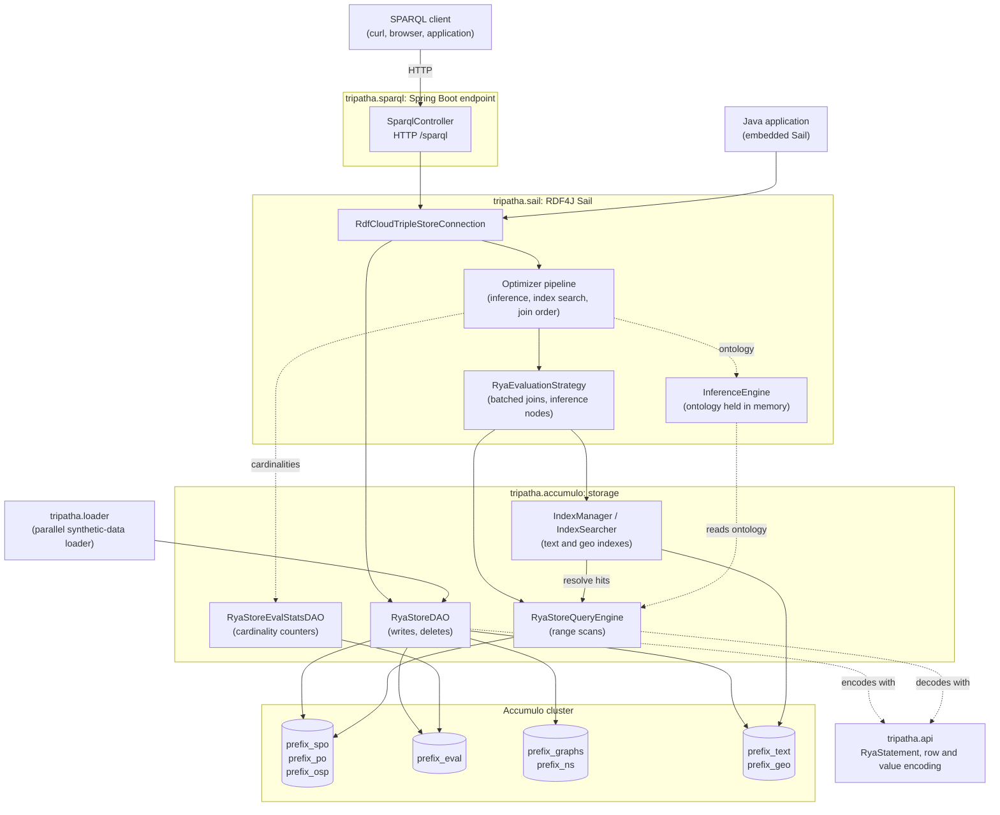

Two ways in:
- **The SPARQL endpoint** (`tripatha.sparql`): a Spring Boot server that speaks the SPARQL 1.1 Protocol over HTTP.
- **The embedded Sail** (`tripatha.sail`): a Java application builds the same RDF4J repository itself with `RyaSailFactory` and calls it directly.

Both paths end in the same objects: an `RdfCloudTripleStoreConnection` on top of an `RyaStoreDAO`.

---

## 2. Primer: RDF and SPARQL

### 2.1 Statements

RDF describes data as **statements** (also called *triples*): `subject predicate object`.

| Part | Can be | Example |
|---|---|---|
| subject | an IRI or a blank node | `<http://ex.org/alice>` |
| predicate | an IRI | `<http://ex.org/age>` |
| object | an IRI, a blank node, or a literal | `42`, `"Alice"@en`, `<http://ex.org/bob>` |

- An **IRI** is a global identifier that looks like a URL.
- A **blank node** is an anonymous node, only meaningful inside one dataset.
- A **literal** is a value: a *lexical form* (the text `"42"`) plus either a *datatype* IRI (`xsd:integer`, `xsd:string`, `xsd:dateTime`, `geo:wktLiteral`, …) or a *language tag* (`"ciao"@it`, whose datatype is `rdf:langString`).

A statement can also belong to a **named graph** (a *context*), identified by an IRI. Statements without one are in the **default graph**. With its graph, a statement is sometimes called a *quad*.

### 2.2 Queries

A SPARQL query is mostly a set of **triple patterns**: triples in which some positions are variables (`?x`). The engine finds every assignment of values to variables (a *binding set*) under which all patterns match stored statements. Two patterns that share a variable are **joined** on it. On top of that come `FILTER`, `OPTIONAL`, `UNION`, `GRAPH`, aggregates and so on.

### 2.3 The running example

This dataset and query are used throughout the document:

```turtle
PREFIX ex:  <http://ex.org/>
PREFIX xsd: <http://www.w3.org/2001/XMLSchema#>

GRAPH ex:g1 {
  ex:alice  ex:age    42 .          # 42 is "42"^^xsd:integer
  ex:alice  ex:knows  ex:bob .
  ex:bob    ex:age    37 .
}
```

```sparql
PREFIX ex: <http://ex.org/>
SELECT ?friend ?age WHERE {
  ex:alice ex:knows ?friend .
  ?friend  ex:age   ?age .
}
```

The two patterns share `?friend`, so this query is one join. The answer is `?friend = ex:bob, ?age = 37`.

---

## 3. Primer: Accumulo

### 3.1 A sorted map with a five-part key

An Accumulo **table** is a sorted map from **keys** to **values**. A key has five parts:

```
┌───────────┬───────────────┬──────────────────┬───────────────────┬───────────┐     ┌────────┐
│    row    │ column family │ column qualifier │ column visibility │ timestamp │ ──▶ │ value  │
└───────────┴───────────────┴──────────────────┴───────────────────┴───────────┘     └────────┘
   bytes        bytes            bytes            label expression     long            bytes
```

**Sort order:**
- Keys are sorted by row, then column family, then column qualifier, then visibility, comparing bytes one by one (unsigned).
- Then by timestamp, newest first.

So all the keys whose row starts with the same bytes are stored next to each other. *"Give me everything whose row starts with X"* is one sequential read, called a **range scan**. Tripatha is built on that property.

A **row** is all the keys that share the same row bytes. One row can hold many cells (one per column family / qualifier / visibility / timestamp combination).

### 3.2 Tablets and tablet servers

A table is cut by row ranges into **tablets**. Each tablet is served by one **tablet server**, and tablets split as they grow and are spread across the servers. ZooKeeper coordinates the cluster; clients find which server holds which tablet through Accumulo's metadata and talk to the servers directly.

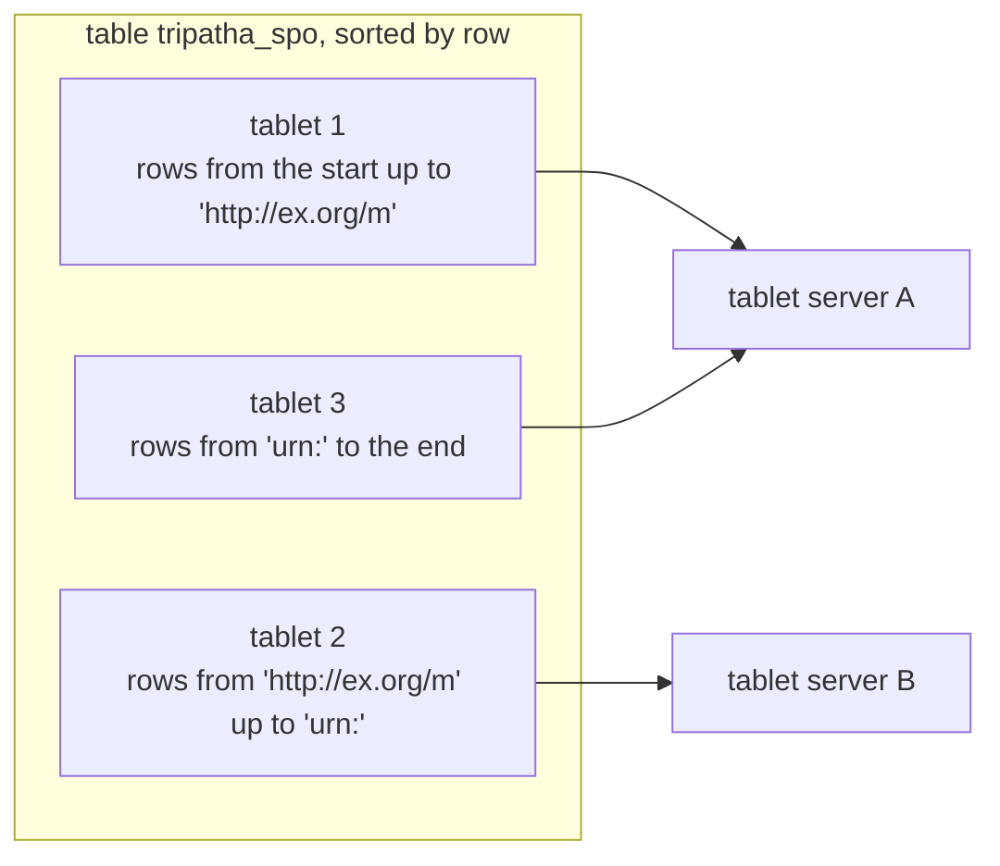

A new table has a single tablet, so at first every write goes to one server. The loader pre-splits tables for that reason ([section 18](#18-the-synthetic-data-loader)).

### 3.3 Reading: Scanner and BatchScanner

| Reader | Ranges | Order of results | Used for |
|---|---|---|---|
| `Scanner` | one range at a time | sorted | single statement-pattern lookups |
| `BatchScanner` | many ranges at once, several threads | unordered | batched join lookups, index searches, full-table work |

Both can:
- restrict the columns they return (`fetchColumnFamily`);
- carry a set of **authorizations** (see 3.6);
- attach scan-time iterators (see 3.5).

A **Range** runs from a start key to an end key. Tripatha mostly builds ranges of the form *from `prefix` to `prefix` followed by byte `0xFF`*, which covers every row that starts with `prefix`.

### 3.4 Writing: Mutation and BatchWriter

- **Mutation:** a set of changes to *one row* (puts and deletes of cells). A mutation is applied atomically. There are no transactions across rows or tables.
- **BatchWriter:** buffers mutations in memory and sends them to the tablet servers in the background. `flush()` blocks until everything buffered so far is written. A **MultiTableBatchWriter** shares one buffer between writers for several tables.
- **Delete:** a delete is a *marker* for an exact key, including its visibility and timestamp. It hides the cells with that key whose timestamp is not newer than the marker's. To delete a cell you must know its exact visibility, which is why Tripatha reads a statement before deleting it ([section 10](#10-deletes-graph-drops-and-purges)).

### 3.5 Iterators

**Iterators** are code that runs *inside* the tablet servers, on the sorted stream of cells:
- **When:** at scan time, and when files are compacted.
- **Order:** they are stacked by priority.

Tripatha uses three kinds:

| Iterator | What it does | Where Tripatha uses it |
|---|---|---|
| `VersioningIterator` | keeps only the newest version of each key (Accumulo attaches it to new tables by default, at priority 20) | every table, implicitly |
| `SummingCombiner` | merges all the cells of a key by adding their values | the `eval` table: the statistics counters |
| `RegExFilter`, `TimestampFilter` | drop cells that don't match | object-type checks, the optional TTL |

### 3.6 Visibility labels and authorizations

**On write:** every cell carries a **visibility** expression such as `A`, `A&B` or `A&(B|C)`. Empty means visible to everyone.

**On read:**
- An administrator grants each Accumulo user a set of **authorizations** (labels).
- Every scan passes a set of authorizations, which must be a subset of the user's.
- The scan returns only the cells whose expression those authorizations satisfy.

The visibility is **part of the key**. The same row, family and qualifier under two different labels are two separate cells, and both are returned to a reader holding both labels.

---

## 4. Primer: RDF4J

[RDF4J](https://rdf4j.org/) is a Java framework for RDF. Tripatha uses its SPARQL parser, query algebra, optimizers and evaluation engine, and plugs its own storage underneath.

### 4.1 Repository and Sail

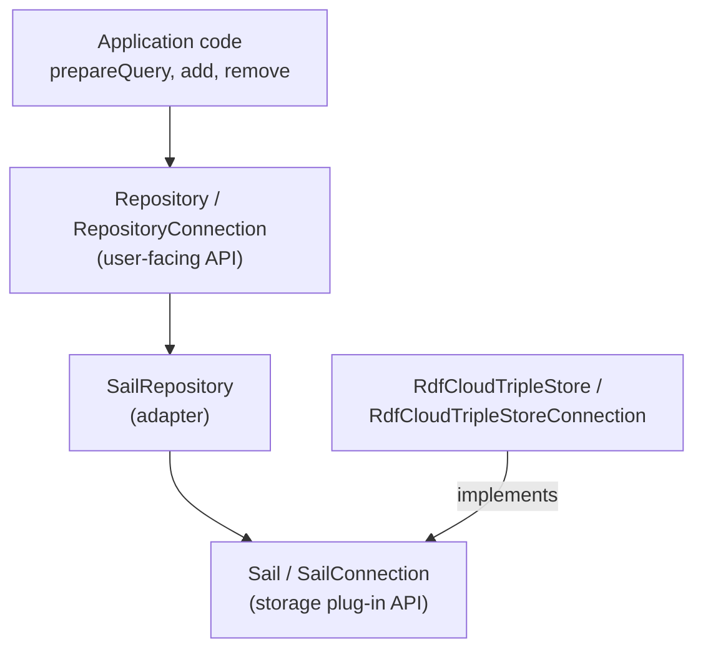

- **Repository API:** what applications call.
- **Sail API** ("Storage And Inference Layer"): what storage back ends implement.
- **SailRepository:** turns any Sail into a Repository.
- **Base classes:** `AbstractSail` and `AbstractSailConnection`. A subclass fills in the `…Internal` methods:
  - `addStatementInternal`, `removeStatementsInternal`, `clearInternal` for writes;
  - `getStatementsInternal` and `evaluateInternal` for reads;
  - `commitInternal` and the namespace methods for the rest.

Tripatha's Sail is `RdfCloudTripleStore`. Its connection is `RdfCloudTripleStoreConnection`.

### 4.2 From SPARQL text to an algebra tree

RDF4J parses a query into a tree of **TupleExpr** nodes. Each node produces a stream of binding sets. The running example parses to:

```
Projection (?friend, ?age)
└── Join
    ├── StatementPattern   ex:alice  ex:knows  ?friend
    └── StatementPattern   ?friend   ex:age    ?age
```

Each position of a `StatementPattern` is a **Var**: either a variable (no value) or a constant (a Var with a value). A `GRAPH` clause adds a fourth Var, the context. Other nodes include `Filter`, `LeftJoin` (OPTIONAL), `Union`, `Extension` (BIND), `Difference` (MINUS) and `Slice` (LIMIT/OFFSET).

### 4.3 Optimizers

A **QueryOptimizer** rewrites the tree in place. A **QueryOptimizerPipeline** lists the optimizers to run, in order. The important one here is **`QueryJoinOptimizer`**: it asks an `EvaluationStatistics` object how many results each pattern will produce (its *cardinality*), and reorders the joins so the most selective patterns run first.

### 4.4 Evaluation

The **EvaluationStrategy** turns each node into a **QueryEvaluationStep** (`prepare(node)`). Calling `evaluate(bindings)` on a step returns a lazy `CloseableIteration<BindingSet>`.

RDF4J's default join is a **nested loop**: for each binding set from the left side, evaluate the right side with those bindings filled in. For the running example, the left pattern is `ex:alice ex:knows ?friend` and the right one `?friend ex:age ?age`:

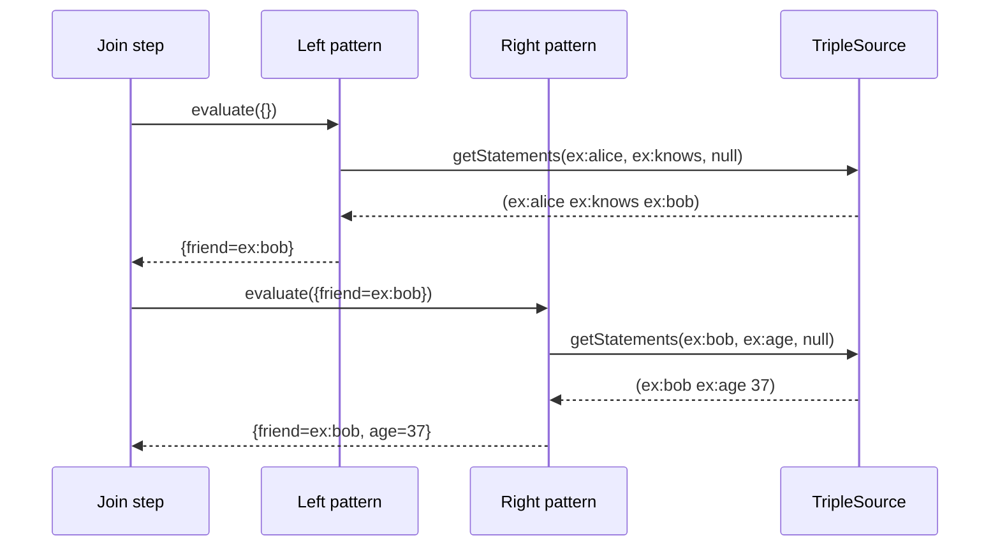

A statement-pattern step reads data only through a **TripleSource**: `getStatements(subject, predicate, object, contexts...)`.
- **Bound positions:** a position that is bound is passed as a value; `null` is a wildcard.
- **Contexts:**
  - none: any graph;
  - a list of graphs: only those graphs;
  - a `null` element: the default graph.

**Updates:** a SPARQL Update runs its `WHERE` part with the same machinery, then calls the connection's add and remove methods.

---
## 5. Modules

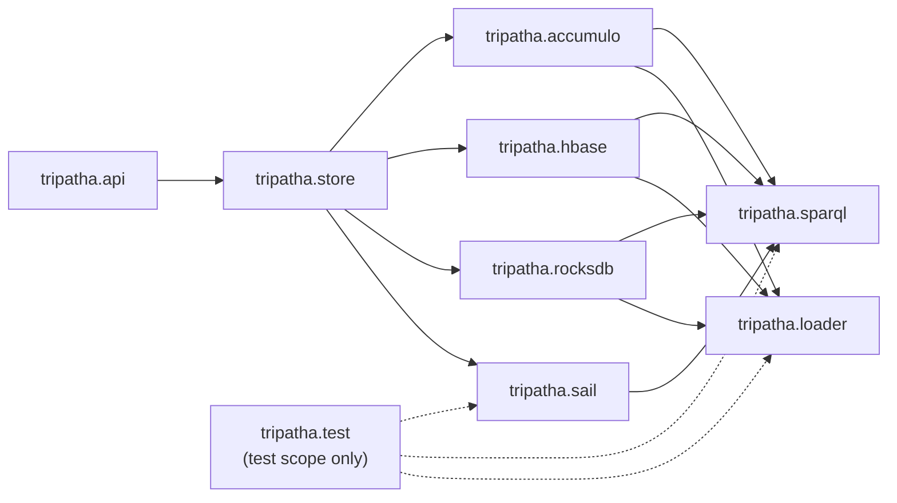

An arrow `A → B` means *B depends on A*. `tripatha.coverage` only exists under `-Pcoverage` and merges the coverage reports. `tripatha.hbase.coprocessor` is installed on HBase region servers, and `tripatha.accumulo.iterators` on Accumulo tablet servers; nothing depends on them but the test clusters (the code names the iterator's class, without linking it).

| Module | Role | Main classes |
|---|---|---|
| `tripatha.api` | Storage-independent model, DAO interfaces, how statements and values become bytes, which table answers which pattern | `RyaStatement`, `RyaType`, `RyaIRI`, `RyaContext`, `WholeRowTripleResolver`, `*TriplePatternStrategy`, `RdfCloudTripleStoreConfiguration` |
| `tripatha.store` | The storage SPI (labelled cells, ranges, batched reads, writers, counters), and everything written once on top of it: writes, scans, statistics, graph markers, namespaces, the text and geo indexes, the trace | `Store`, `RyaStoreDAO`, `RyaStoreQueryEngine`, `EvalStatsMutations`, `RyaStoreEvalStatsDAO`, `IndexManager`, `IndexSearcher`, `StoreTrace` |
| `tripatha.accumulo` | The Accumulo backend: each SPI call is one Accumulo call | `AccumuloStore`, `AccumuloCellWriter`, `AccumuloClients` |
| `tripatha.accumulo.iterators` | Iterators for the tablet servers; depends only on Accumulo | `EntityIntersectingIterator` |
| `tripatha.hbase` | The HBase backend: the cell mapping, labels, batched reads, counters | `HBaseStore`, `HBaseCodec`, `HBaseBatchScan`, `HBaseLabels` |
| `tripatha.rocksdb` | The RocksDB backend: a store in a local directory, in the caller's process | `RocksStore`, `RocksCodec`, `RocksScan`, `RocksCellWriter`, `RocksDatabase` |
| `tripatha.sail` | The RDF4J Sail: connection, optimizer pipeline, evaluation strategy, batched joins, inference, index-search rewrite | `RdfCloudTripleStore`, `RdfCloudTripleStoreConnection`, `RyaEvaluationStrategy`, `BatchedJoinStep`, `InferenceEngine`, `IndexSearchOptimizer`, `RyaSailFactory` |
| `tripatha.sparql` | Spring Boot SPARQL 1.1 Protocol endpoint and query page | `SparqlController`, `RyaStoreConfiguration`, `RyaProperties`, `BlankNodeOutput` |
| `tripatha.loader` | Command-line generator and parallel loader of synthetic data | `LoaderMain`, `Prepare`, `Loader`, `Verify`, `EntityGenerator` |
| `tripatha.standalone` | The endpoint with the RocksDB backend only, as an executable jar and a native executable | (no classes: packaging, native-image metadata, `smoke-test.sh`) |
| `tripatha.test` | One in-process cluster per backend per test JVM, and the store-level integration tests | `StoreITBase`, `TestBackends`, `MiniAccumuloSingleton`, `MiniHBaseSingleton`, `RocksDBTestBackend` |

`tripatha.loader` writes through `tripatha.store` only. It uses `tripatha.sail` in its tests.

This document describes Tripatha on Accumulo, the backend it was built for. [BACKENDS-STUDY.md](BACKENDS-STUDY.md) describes how the same cells, ranges, labels and counters map onto HBase, and onto an embedded RocksDB database (its section 10).

---

## 6. The data model

Inside Tripatha, a statement is a `RyaStatement` (`tripatha.api`):

| Field | Type | Meaning |
|---|---|---|
| `subject` | `RyaIRI` | subject IRI (blank nodes are turned into IRIs, see below) |
| `predicate` | `RyaIRI` | predicate IRI |
| `object` | `RyaType` | object: `RyaIRI` for an IRI, plain `RyaType` for a literal, `RyaTripleTerm` for an RDF 1.2 triple term |
| `context` | `RyaIRI` or `null` | named graph; `null` is the default graph |
| `qualifier` | `String` | an extra column qualifier inherited from Apache Rya; normally `null` |
| `columnVisibility` | `byte[]` | the Accumulo visibility label of the statement |
| `value` | `byte[]` | serialized `StatementMetadata`; empty in practice |
| `timestamp` | `Long` | defaults to the creation time |

A `RyaType` holds three strings: the data (the lexical form), the datatype IRI, and the language tag. `RyaIRI` is a `RyaType` with datatype `xsd:anyURI`.

`RdfToRyaConversions` and `RyaToRdfConversions` translate between RDF4J values and Tripatha types.

**RDF 1.2 values.**
- A **triple term** (`<<( s p o )>>`) is a `RyaTripleTerm`: a `RyaType` with the reserved datatype `RyaSchema.TRIPLE_TERM`, whose data is the term's encoded form ([section 7.3](#73-value-encoding)). It is immutable and can only be an object. Its own object can be another triple term. A literal that claims the reserved datatype is refused.
- A **literal with a base direction** (`"..."@ar--rtl`) has the datatype `rdf:dirLangString`, and its language field holds the tag with the direction (`ar--rtl`).

**Blank nodes become IRIs.** `_:b1` is stored as the IRI `urn:tripatha/bnode/2012/07#b1` (`RyaSchema.BNODE_NAMESPACE`), and the Sail returns it as that IRI. The inference engine relies on this: it casts these values to `IRI` throughout. Only the endpoint turns them back into blank nodes, and only in its output (`BlankNodeOutput`, [section 17](#17-the-sparql-endpoint)).

**`null` context: two meanings.**

| Where | `null` context means |
|---|---|
| a `RyaStatement` used as a **pattern** for the DAO | any graph |
| an RDF4J `getStatements(..., contexts)` call, as an element of `contexts` | the default graph only |

The Sail translates between the two. To look up or delete *only* default-graph statements, it asks the DAO for "any graph" and keeps the results whose context is `null` (`StoreTripleSource.lookup`, `RdfCloudTripleStoreConnection.removeStatementsInternal`).

---

## 7. Storage layout

### 7.1 The tables

All tables are named `<prefix><suffix>`. The default prefix is `tripatha_`.

| Table | Row | Column family | Column qualifier | Visibility | Value | Purpose |
|---|---|---|---|---|---|---|
| `spo` | subject `00` predicate `00` object `01` type | graph IRI, empty for the default graph | qualifier, normally empty | statement's label | metadata, normally empty | patterns with a known subject |
| `po` | predicate `00` object `00` subject `01` type | same | same | same | same | patterns with a known predicate |
| `osp` | object `00` subject `00` predicate `01` type | same | same | same | same | patterns with a known object |
| `eval` | one value, or two joined by `00` | which counter: `s`, `p`, `o`, `sp`, `po`, `so`; or `t`, a datatype marker | empty (all graphs) or a graph IRI; for `t`, the object's datatype IRI | statement's label | a count as decimal text, summed server side | cardinality statistics ([section 11](#11-statistics-and-join-ordering)); for `t`, the datatypes of a predicate's objects ([section 12.9](#129-comparisons-as-value-ranges)) |
| `graphs` | graph IRI | `g` | empty | statement's label | empty | named-graph markers |
| `ns` | a prefix, or `tripatha` | `namespace`, `version`, `datatypes` or `index` | empty, or the index id | none | namespace IRI, `1.1.0`, `1`, or index state | namespaces, storage version, whether the datatype markers are complete, index state |
| `text` | word `00` predicate `00` subject `00` object hash | graph IRI | qualifier | statement's label | empty | full-text index (optional, [section 15](#15-text-and-geo-search)) |
| `textcount` | word `00` predicate | `n` | empty | statement's label | a count, summed server side | the text index's posting counts, which plan an `AND` ([section 15.4](#154-text-queries-and-their-candidates)) |
| `geo` | geohash cell `00` predicate `00` subject `00` object hash | graph IRI | qualifier | statement's label | empty | geospatial index (optional) |
| `entity` | shard: `murmur3(subject) mod shards`, zero-padded decimal | the term: predicate `01` object (as `po` encodes it) | subject `01` graph `01` qualifier | statement's label | empty | entity index (optional, [section 13.7](#137-the-entity-index-stars-shard-by-shard)) |

`RyaStoreDAO.init()` creates the first six tables if they are missing and attaches the summing combiner to `eval`. `IndexManager` creates `text` and `geo` when their index is enabled.

### 7.2 Row keys of the statement tables

`WholeRowTripleResolver` builds the three rows. For `ex:alice ex:age 42` in graph `ex:g1`, these are the exact bytes. Printable bytes are shown as text, the others in hex:

```
spo  row  http://ex.org/alice 00 http://ex.org/age 00 800000012a 01 05
po   row  http://ex.org/age 00 800000012a 00 http://ex.org/alice 01 05
osp  row  800000012a 00 http://ex.org/alice 00 http://ex.org/age 01 05

     column family     http://ex.org/g1
     column qualifier  (empty)
     visibility        the statement's label, or empty
     value             (empty)
```

Broken into parts, the `spo` row is:

```
┌─────────────────────┬────┬───────────────────┬────┬──────────────┬────┬────────┐
│ http://ex.org/alice │ 00 │ http://ex.org/age │ 00 │  800000012a  │ 01 │   05   │
└─────────────────────┴────┴───────────────────┴────┴──────────────┴────┴────────┘
  subject, UTF-8       sep   predicate, UTF-8   sep   object value   type  marker:
                                                      (encoded 42)   sep   xsd:integer
```

**The type suffix always comes last.** It is `01` plus a marker byte, and it sits after the third element in all three layouts. When a row is read back, `WholeRowTripleResolver.deserialize` splits it:
1. at the **first** `00` (end of the first part);
2. at the **last** `00` (start of the third part);
3. at the **first** `01` (start of the type).

The type is put back on the object, wherever the object sits in the row.

### 7.3 Value encoding

The object's bytes come from a **type resolver** (`RyaContext` picks one by datatype). Each resolver encodes the lexical form and appends `01` plus a **marker byte** that says how to decode it. Numbers and dates use [Calrissian mango](https://github.com/calrissian/mango)'s `LexiTypeEncoders`: hexadecimal strings whose text order is the numeric order.

| Datatype | Resolver | Marker | Example: value → encoded data part |
|---|---|---|---|
| IRI (`xsd:anyURI`) | `RyaIRIResolver` | 2 | `http://ex.org/bob` → `http://ex.org/bob` |
| `xsd:string` | `RyaTypeResolverImpl` | 3 | `"Alice"` → `Alice` |
| `xsd:long` | `LongRyaTypeResolver` | 4 | |
| `xsd:integer` | `IntegerRyaTypeResolver` | 5 | `-7` → `7ffffffff9`, `42` → `800000012a`, `1000` → `8000000203e8` |
| `xsd:double` | `DoubleRyaTypeResolver` | 6 | `3.5` → `c00c000000000000` |
| `xsd:dateTime` | `DateTimeRyaTypeResolver` | 7 | `2024-05-01T10:00:00+02:00` → `8000018f332ae400` (milliseconds, UTC) |
| any other datatype | `CustomDatatypeResolver` | 8 | data, then `01` + datatype IRI + `01 08` |
| `xsd:byte` | `ByteRyaTypeResolver` | 9 | |
| `xsd:boolean` | `BooleanRyaTypeResolver` | 10 | `true` → `1` |
| `xsd:float` | `FloatRyaTypeResolver` | 11 | |
| `xsd:short` | `ShortRyaTypeResolver` | 12 | |
| `xsd:int` | `IntRyaTypeResolver` | 13 | `42` → `8000002a` |
| triple term | `TripleTermResolver` | 14 | `<<( <urn:a> <urn:b> <urn:c> )>>` → `02 urn:a 02 urn:b 02 urn:c 03 05 03 06` |

A few consequences:
- **Language-tagged literals** go through the custom resolver: `"ciao"@it` is stored as `ciao@it 01 http://www.w3.org/1999/02/22-rdf-syntax-ns#langString 01 08`. `geo:wktLiteral` values are stored the same way, with their own datatype IRI.
- **Literals with a base direction** are stored the same way, with the direction in the tag: `"x"@ar--rtl` is `x@ar--rtl 01 http://www.w3.org/1999/02/22-rdf-syntax-ns#dirLangString 01 08`.
- **Triple terms** are `02 esc(subject) 02 esc(predicate) 02 esc(object)`, where the object is its own full encoding, marker included, so a nested term is the same layout applied again.
  - `esc` replaces the four bytes that must not appear raw: `00` → `03 04`, `01` → `03 05`, `02` → `03 06`, `03` → `03 03`. IRIs and ordinary text contain none of them, so in practice only the inner object's `01` and marker are escaped (`03 05 03 06` in the example above). Each level of nesting doubles the escape bytes of the innermost object.
  - The leading `02` keeps all triple terms together in the object order, and the inner subject comes first. The terms about one subject, or one subject and predicate, are therefore one range of `po` ([section 12.7](#127-triple-terms)).
  - `EncodingCompatibilityTest` pins the exact bytes of every resolver and row layout, these included.
- **`xsd:int` and `xsd:integer` are different values** with different markers (13 and 5), as they are in RDF.
- **Ordering:** `-7 < 42 < 1000` and `7ffffffff9 < 800000012a < 8000000203e8` compare the same way, so values of one numeric type are sorted by value inside the tables.
- **Time zones:** `xsd:dateTime` keeps the instant but not its offset. It reads back in UTC.
- **Old constants:** `RdfCloudTripleStoreConstants` still declares `URI_MARKER = 7`, `DATATYPE_LITERAL_MARKER = 11` and so on, from Apache Rya. They are not the bytes written. The resolvers' constants above are.

### 7.4 Why `00` and `01` are reserved

Rows are split at `00` and `01` when they are read back, so a value containing either byte would make its row unreadable. `RyaTypeResolverImpl.checkNoReservedBytes` rejects such values when they are written. That means literals containing U+0000 or U+0001, and custom datatype IRIs containing them. `TypeEncodingDelimiterTest` checks that no resolver ever emits those bytes.

For the same reason, Accumulo's own lexicoders must not replace mango's encoders: they emit raw binary, which can contain both bytes.

### 7.5 The other key parts

- **Column family = graph.** Restricting a scan to a graph is one `fetchColumnFamily(graph)` call. Dropping a graph is a delete restricted to that column family, in every table that uses it ([section 10](#10-deletes-graph-drops-and-purges)).
- **Visibility = the statement's label.** The three statement cells, the statistics counters, the graph marker and the index entries of a statement all carry the same label.
- **Timestamp = the statement's timestamp.** All tables and index entries get the same one, so a delete computed from the stored statement hits every copy.
- **Writing a statement again** produces the same keys with a newer timestamp. Accumulo's versioning keeps only the newest, so the statement is still stored once (but its statistics are counted twice, see [section 11](#11-statistics-and-join-ordering)).
- **The same statement under two labels** is two cells per table. A reader holding both labels gets it twice: nothing deduplicates them.

### 7.6 Alternative hashed layout

`RyaTripleContext` can also use `WholeRowHashedTripleResolver`, which prefixes the `spo` and `po` rows with a hash. This option (`tbl.hashprefix`) comes from Apache Rya and is off by default. The rest of this document describes the default layout.

**It is deprecated** (SCALE-STUDY.md D7, O9):
- **It doesn't do what it is kept for:** every row of one predicate gets the same prefix, so a hot predicate stays one range, while sorted IRIs and `prepare`'s quantile splits already spread different subjects and predicates.
- **It costs:** 33 bytes more per `spo` and `po` row.
- **Features refuse it:** graph sizes and merge joins.

Stores on it keep working, and a DAO opening one logs a warning. Its setter and resolver are marked `@Deprecated`; leave it off for a new store.

---

## 8. From a triple pattern to a range scan

### 8.1 Choosing the table

`RyaTripleContext` holds four `TriplePatternStrategy` objects and asks them in this order:
1. `SpoWholeRowTriplePatternStrategy`
2. `PoWholeRowTriplePatternStrategy`
3. `NullRowTriplePatternStrategy`
4. `OspWholeRowTriplePatternStrategy`

The first whose `handles(...)` returns true builds the range. For the eight combinations of bound (✓) and unbound (·) positions:

| s | p | o | Table | Scan range (start; the end is the start followed by `FF`) |
|---|---|---|---|---|
| ✓ | ✓ | ✓ | `spo` | `s 00 p 00 o 01` |
| ✓ | ✓ | · | `spo` | `s 00 p 00` |
| ✓ | · | ✓ | `osp` | `o 00 s 00` |
| ✓ | · | · | `spo` | `s 00` |
| · | ✓ | ✓ | `po` | `p 00 o 00` |
| · | ✓ | · | `po` | `p 00` |
| · | · | ✓ | `osp` | `o 00` |
| · | · | · | `spo` | everything (empty start, end `FF`) |

Here `o` means the object's encoded value **without** its type suffix. A known graph does not change the table: it becomes a column-family restriction.

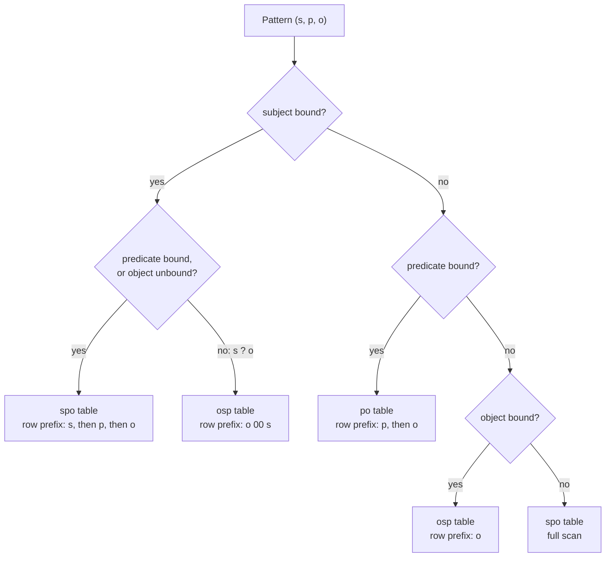

### 8.2 What the scan adds on top of the range

`RyaStoreQueryEngine.query(pattern, conf)` builds one `Scanner` over the chosen table, with the reader's authorizations, and adds:

| Addition | When | How |
|---|---|---|
| object-type check | the object is bound | The range ignores the type suffix, so values of different types with the same data bytes fall in the same range: the string `"800000012a"` and the integer `42` both encode to `800000012a`. So the scan keeps only rows ending in the object's own type suffix (`01` and the marker, or `01` datatype IRI `01 08`). It is a row suffix in the `ScanSpec`:<br>• **RocksDB** compares the bytes.<br>• **Accumulo and HBase** filter on the server with an equivalent linear expression, `[\s\S]*` and the quoted suffix. On Accumulo this is a `RegExFilter` at priority 11, named `ri`.<br>A row regex from the configuration (`query.regex.*`), or the hashed layout, still uses `AbstractTriplePatternStrategy.buildRegex`'s full expression. |
| graph restriction | the pattern has a context | `fetchColumnFamily(graph)` |
| qualifier | the pattern has a qualifier | `fetchColumn`, or a `RegExFilter` on the qualifier (priority 8) |
| time to live | `query.ttl` is set | a `TimestampFilter` (priority 9) keeping cells newer than now minus the TTL |
| result cap | `query.limit` is set | the iterator stops after that many statements |

`RyaStatementCellIterator` turns each returned Accumulo key back into a `RyaStatement`, including its graph, visibility and timestamp.

### 8.3 The running example, scan by scan

| Lookup | Table | Range start |
|---|---|---|
| `ex:alice ex:knows ?friend` | `spo` | `http://ex.org/alice 00 http://ex.org/knows 00` |
| `?friend ex:age ?age`, `?friend` unbound | `po` | `http://ex.org/age 00` |
| `?friend ex:age ?age` with `?friend = ex:bob` | `spo` | `http://ex.org/bob 00 http://ex.org/age 00` |

### 8.4 Many patterns at once: `batchQuery`

`RyaStoreQueryEngine.batchQuery(patterns, conf)` returns the union of the matches of many patterns. They must all resolve to the same table and share one context.
- **Readers:** with more than `getMaxRangesForScanner()` ranges (default 2) it uses one `BatchScanner` over all the ranges. Otherwise it uses one `Scanner` per range, read one after the other.
- **No type check:** it adds no object-type regex, because the patterns have different objects. Callers must match results to patterns exactly. `BatchLookup` does ([section 13](#13-batched-joins)), and so does `IndexSearcher` ([section 15](#15-text-and-geo-search)).

---

## 9. The write path

### 9.1 From an INSERT to Accumulo

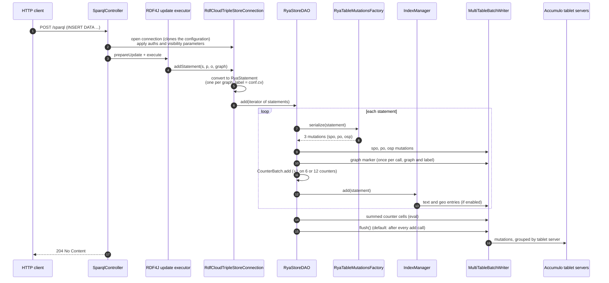

`RdfCloudTripleStoreConnection.addStatementInternal` builds one `RyaStatement` per target graph (just the default graph when none is given). It gives each the connection's visibility label (`conf.cv`) and hands them to the DAO in one `add` call.

### 9.2 What one statement writes

For `ex:alice ex:age 42` in graph `ex:g1`, with statistics and both indexes on:

| Table | Cells | Notes |
|---|---|---|
| `spo`, `po`, `osp` | 1 each | the rows of [section 7.2](#72-row-keys-of-the-statement-tables) |
| `graphs` | 1 | row `http://ex.org/g1`, family `g`. Written once per `add` call for each graph and label, not once per statement. |
| `eval` | 13 | 6 counters (`s`, `p`, `o`, `sp`, `po`, `so`) for all graphs, 6 more for graph `ex:g1`, and the datatype marker of `ex:age` for `xsd:integer`. The marker is written once per `add` call for each predicate, datatype and label, whether or not statistics are on. |
| `text` | 0 | `42` is not a string, so the text index ignores it |
| `geo` | 0 | not a `geo:wktLiteral` |

A label such as `"Colosseo di Roma"@it` adds one `text` entry per distinct word. A WKT point adds one `geo` entry, and a polygon up to 32.

### 9.3 Counters are summed before they are written

`EvalStatsMutations.CounterBatch` adds up the counter deltas of a whole `add` call in memory: one entry per distinct counter key (row, family, graph, label). It writes one cell per key, holding the sum. The combiner on the server adds cells up the same way, so writing `+3` once equals writing `+1` three times.

The batch is written early once it holds 50,000 keys (`MAX_PENDING_COUNTERS`), so memory stays bounded. The Sail adds statements one call at a time, so this summing pays off only for bulk callers, such as the loader, that pass thousands of statements per call.

**Leaving counters of 1 out.** The planner reads a missing counter as 1 ([section 11.2](#112-how-a-patterns-cardinality-is-estimated)), so a counter whose total is 1 changes no estimate. Most subject counters are such: a subject rarely has two statements with the same object (`so`) or the same predicate (`sp`).

`add(statements, CounterPolicy.SKIP_SUBJECT_ONES)` leaves out the `s`, `sp` and `so` cells whose sum for the call is 1, label by label.
- **When it is exact:** only when the call holds every statement of its subjects. So with this policy the whole call's counters are summed before any is written, without the early write at 50,000 keys.
- **Who uses it:** the loader passes whole blocks of entities, which meet that condition ([section 18.3](#183-load)).
- **What it saves:** about half of the counter cells it sends.

### 9.4 Flushing, threads and transactions

- **Flushing:** by default (configuration key `ac.dao.flush`, read by `flushEachUpdate()`) the DAO flushes after every `add`, so a write is on the tablet servers when the call returns. Bulk writers call `setFlush(false)` and flush themselves.
- **Writer buffer:** set it with `setBatchWriterConfig(...)` before `init()`. The default buffer is 10,000,000 bytes, with a 60-second timeout and 4 write threads.
- **Threads:** `add` is `synchronized`, so one DAO serves one writer thread at a time. Parallel writers each need their own DAO, as the loader does.
- **No transactions:** a SPARQL commit is a flush, and rollback does nothing. An update that fails halfway leaves its earlier statements written. `add` still writes the counters of the statements it handed to the writers before the failure.

### 9.5 Opening a store

`RyaStoreDAO.init()`:
1. creates any missing tables;
2. checks that the summing combiner is attached to `eval`, and attaches it if not. Listing a table's iterators needs `ALTER_TABLE`, so for a user without it the check is skipped;
3. opens the batch writers and the query engine;
4. reads the storage version (`ns` row `tripatha`, family `version`):
   - **on a store it has just created,** it writes version `1.1.0` (`1.2.0` with the entity index on) and the `datatypes` flag, which says that every statement of the store has its datatype markers ([section 12.9](#129-comparisons-as-value-ranges));
   - **when a loader rebuild job starts,** it raises the store to `1.3.0`: older code neither records its deletes while an index is BUILDING nor refuses graph drops during a job ([section 18.5](#185-rebuild));
   - **with the entity index on,** it raises an older store to `1.2.0`, so that code from before the index, which would add statements without their postings, refuses to write to it ([section 13.7](#137-the-entity-index-stars-shard-by-shard));
   - **on any other store,** it writes neither. A store created before the markers keeps its version (`1.0.0`, or none) and has no flag, so comparisons there read whole predicates;
   - **on a store whose version is newer than its own,** it opens read-only: every write method (`add`, `delete`, `dropGraph`, `purge`, namespaces, index rebuilds) throws. A newer store may rely on writes this code doesn't make, as a 1.1.0 store relies on the markers. Versions compare number by number between the dots;
5. creates the `IndexManager`, which opens, creates or validates the index tables ([section 15.6](#156-index-lifecycle)).

`init()` writes nothing when the store is already set up, so a read-only account (such as an endpoint user) can open it.

The version check came with the markers, so a build from before it isn't stopped from writing to a 1.1.0 store, and its statements would have no markers. No such build is deployed: the project is a pre-release snapshot.

---

## 10. Deletes, graph drops and purges

### 10.1 Deleting statements

Deleting cannot just write delete markers for a pattern: a marker needs the exact key, including the visibility label and timestamp, which the caller doesn't know. So `deleteMatches` reads first:

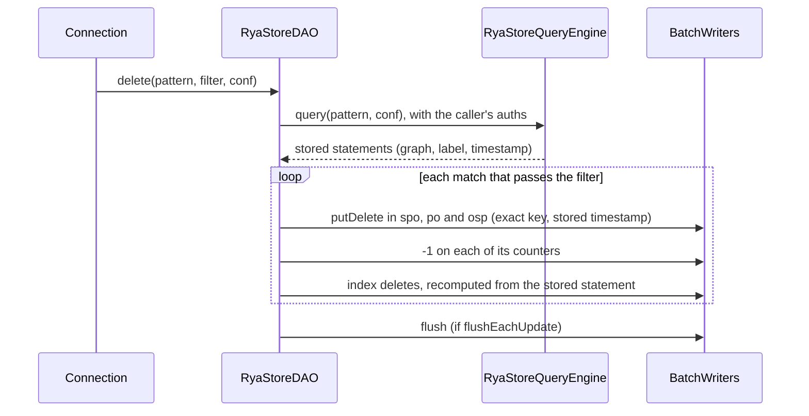

- **Only visible statements are deleted.** A user can only delete what its authorizations let it see.
- **Graph scope**, as `removeStatementsInternal` maps it:
  - no contexts: every graph;
  - a `null` context: the default graph only, via the filter `st.getContext() == null`;
  - a named context: that graph.
- **Index deletes** are computed from the stored statement. This is why an index's terms may depend only on what `spo` stores ([section 21](#21-invariants)).

### 10.2 Dropping graphs: `dropGraph`

SPARQL `CLEAR` and `DROP` call `clearInternal`, which calls `dropGraph(conf, graphs...)`. Nothing is read first: it deletes with Accumulo `BatchDeleter`s, with the caller's authorizations.

1. **Statement and index tables.** In `spo`, `po`, `osp` and the active index tables, it deletes the whole range, restricted to the column families of the given graphs. A `null` graph means the default graph (empty family). No graphs at all means everything. The index tables use the graph as column family too, so the same delete clears them.
2. **Graph markers.** It deletes the markers of the named graphs, or all of them.
3. **Counters.** Only when dropping everything, it also deletes the visible `eval` counters, family by family. A single-graph drop leaves the all-graphs counters too high, which only affects join ordering.
4. **The entity index** files its postings under their term, not their graph: for each dropped graph, the postings whose qualifier names it are deleted (`EntityIndex.graphQualifierRegex`), a filtered pass over the table like the statement tables'.
5. **Not the datatype markers.** A writer adding statements meanwhile may have written its marker before this delete reached it, and a deleted marker would hide its statements from comparisons. A marker for a type with no values left only narrows less.

### 10.3 Listing graphs: the `graphs` table

`getContextIDs()` reads the visible markers. For each graph it checks that `spo` still holds at least one visible statement in it. Markers of graphs that turn out empty are deleted, so the list stays accurate after deletes. Markers are never cached across `add` calls, for the same reason.

### 10.4 Purge and destroy

- **`purge(conf)`** deletes everything visible from every table, then writes back the storage version and the `datatypes` flag it found, and the index state records. Exactly what it found: statements under labels the purger lacks stay, so a store without complete markers mustn't come out of a purge with the flag.
- **`dropAndDestroy()`** deletes the tables.

---

## 11. Statistics and join ordering

### 11.1 What is counted

Every insert adds `+1`, and every delete `-1`, to six counters:

| Counter | Column family | Row (for `ex:alice ex:age 42`) |
|---|---|---|
| subject | `s` | `http://ex.org/alice` |
| predicate | `p` | `http://ex.org/age` |
| object | `o` | `42` |
| subject + predicate | `sp` | `http://ex.org/alice 00 http://ex.org/age` |
| predicate + object | `po` | `http://ex.org/age 00 42` |
| subject + object | `so` | `http://ex.org/alice 00 42` |

- **Rows** use the *lexical* values, not the type-encoded ones. `"42"^^xsd:int` and `"42"^^xsd:integer` therefore share a counter.
- **Column qualifier:** empty for the all-graphs counter. A named-graph statement adds a second set of six cells whose qualifier is the graph IRI.
- **Visibility:** each cell carries the statement's label, so a reader only counts what it may see.

The combiner setting (`EvalStatsMutations.combinerSetting()`) is a `SummingCombiner`:
- **Name and priority:** `ryaStatsSum`, at priority 10, so it runs before the default versioning iterator at 20.
- **Encoding:** values are decimal text (`STRING`).
- **Scope:** it applies to all columns, at scan time and at both compaction scopes.

Accumulo sums the cells when they are read and when files are compacted, so the table converges to one cell per counter and label.

### 11.2 How a pattern's cardinality is estimated

`RyaStoreEvalStatsDAO.getCardinality` builds the row from the values' string forms joined by `00`. It reads the cell of the requested family, and qualifier (graph or empty), and adds up every visible cell (one per label). It returns `-1` if there is none.

`RdfCloudTripleStoreEvaluationStatistics` turns that into a cardinality for each pattern:

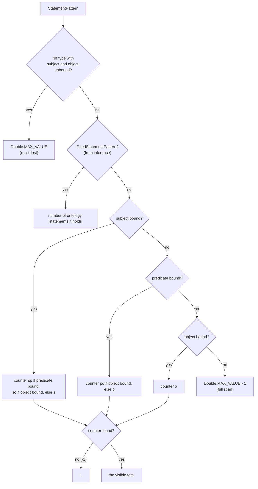

The two-value counters (`sp`, `po`, `so`) are used because `query.usecompositecard` is on by default; with it off, only the single-value counters are read. The `rdf:type` rule is `conf.stats.rdftype.down`, also on by default.

More rules:
- **Indexed patterns:** an `IndexedStatementPattern` ([section 15](#15-text-and-geo-search)) gets its plain estimate times 0.001 (`SELECTIVITY`), but at least 1.
- **Value ranges:** a `ValueRangePattern` ([section 12.9](#129-comparisons-as-value-ranges)) in a join is estimated at the number of cells its ranges hold, counted up to the estimate of the shortest other pattern of the join, and at most `query.valueranges.count` (1,000,000). A range that reaches the cap gets the larger of the cap and its plain estimate. A pattern that isn't counted (on its own, or with the cap at 0) gets a tenth of its plain estimate. 1 when no value can match.
- **Filters:** a `Filter` node is estimated at a tenth of its argument.
- **Joins:** a `Join` is estimated at the larger of its two sides.

RDF4J's `QueryJoinOptimizer` uses these estimates to order joins, running the cheapest patterns first. For the running example:

| Pattern | Counter read | Estimate |
|---|---|---|
| `ex:alice ex:knows ?friend` | `sp` on row `http://ex.org/alice 00 http://ex.org/knows` | 1 |
| `?friend ex:age ?age` | `p` on row `http://ex.org/age` | 2 |

So the `knows` pattern runs first, and the `age` lookup runs once, with `?friend` bound.

**Read together** (SCALE-STUDY.md O27, M14). Each estimate reads one counter, and on Accumulo or HBase a read is a round trip (0.4 to 0.65 ms on the Accumulo test cluster). So before the optimizers that estimate, `RdfCloudTripleStoreEvaluationStatistics.prefetch` works out every pattern's counter, through the method the estimates use, and reads them in one batch scan (`RyaStoreEvalStatsDAO.getCardinalities`). The estimates read that per-query map first. `query.stats.prefetch=false` reads them one by one.

### 11.3 Approximate by design

The counters only influence join order, never results, so some drift is accepted:
- **Re-inserts:** re-inserting an existing statement counts it twice, although Accumulo stores it once.
- **Graph drops:** dropping one graph doesn't adjust the all-graphs counters.
- **Failed loads:** a load that fails part way may have written counters for blocks it writes again on resume.
- **Left-out counters of 1** ([section 9.3](#93-counters-are-summed-before-they-are-written)):
  - Re-adding such a statement online reads 1 instead of 2.
  - A subject with one statement under label `A` and more under other labels reads the others only, one less.

**Switches:**
- `query.usestats=false` makes queries use RDF4J's own heuristic, with Tripatha's adjustments for inference and indexed patterns (`RyaDefaultStatistics`).
- `ac.stats.maintain=false` (`setMaintainStats(false)`) stops counting on writes.
- The endpoint's `tripatha.stats` sets both.

### 11.4 Graph sizes from the counters

*How many statements does each named graph hold?* `COUNT(*)` grouped by graph answers it exactly, but it reads every statement: minutes on a store of hundreds of millions. The counters answer it approximately with a handful of reads, and queries reach that answer through the predicate `stats:approxSize` (namespace `urn:tripatha:stats#`):

```sparql
PREFIX stats: <urn:tripatha:stats#>
SELECT ?graph ?statements WHERE { ?graph stats:approxSize ?statements }
```

**Where the number comes from.** Every statement in a named graph adds 1 to the counter of its predicate *for that graph*: family `p`, qualifier = the graph IRI ([section 11.1](#111-what-is-counted)). A graph's size is therefore the sum of its `p` counters over all predicates. There are few predicates (55 in the loader's dataset), so that is a few dozen small rows.

`GraphSizes` (`tripatha.store`, used through `RyaStoreEvalStatsDAO.graphSizes(conf)`) computes it in three steps, all with the reader's authorizations:

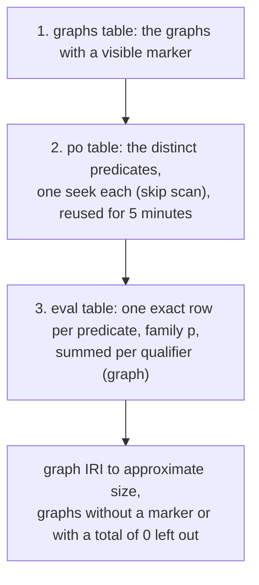

1. **Graphs.** The visible markers in the `graphs` table. A dropped graph keeps its counters ([section 10.2](#102-dropping-graphs-dropgraph)) but loses its marker, so it isn't listed.
2. **Predicates.** A skip scan of `po`:
   - read the first row, whose first part is a predicate;
   - seek to the predicate followed by byte `01`, the first possible row of the next predicate;
   - repeat until the table ends.

   That is one seek per predicate, not a read of the whole table. Seeks are usually milliseconds, but can take seconds while a bulk load keeps the tablet servers busy, so the list is kept for 5 minutes (`PREDICATES_TTL_MS`) per set of authorizations. A predicate used for the first time within that window isn't counted until the list is read again.
3. **Counters.** One `BatchScanner` over the exact `eval` rows of those predicates, family `p`. The values are added up per qualifier, keeping the graphs from step 1.

Scanning `eval` for family `p` directly would be simpler but much slower. A column-family restriction still reads the whole table unless the family has its own locality group, and `eval` holds about 50 bytes per statement.

**How the query uses it.** `ApproxCountOptimizer` (`tripatha.sail`, which also answers the predicates of [section 11.5](#115-class-and-predicate-sizes)) runs just before the inference rewrite ([section 12.3](#123-the-optimizer-pipeline)). It replaces every pattern whose predicate is `stats:approxSize` with a `FixedStatementPattern` holding one statement per graph (`<graph> stats:approxSize "n"^^xsd:long`), the same in-memory node inference uses ([section 14.3](#143-example-rdfssubclassof)). The rest of the query, such as filters, joins, bound subjects and `ORDER BY`, works as for any pattern. The sizes are read only if the query contains such a pattern, and fail with an explanation when the store was opened without statistics.

**Approximate**, like every counter: re-inserted statements and resumed load blocks count twice, and a new predicate shows up only after the predicate list is read again.

---

### 11.5 Class and predicate sizes

The same counters give two more sizes (SCALE-STUDY.md O8), answered by the same optimizer:

```sparql
PREFIX stats: <urn:tripatha:stats#>
SELECT ?class ?members WHERE { ?class stats:approxInstances ?members } ORDER BY DESC(?members)
SELECT ?predicate ?statements WHERE { ?predicate stats:approxTriples ?statements }
```

- **`stats:approxInstances`:** a class's `rdf:type` statements, its all-graphs `po` counter (row `rdf:type 00 class`, family `po`, empty qualifier). With the class constant, that one row is read; with a variable, one scan of `rdf:type`'s counter rows, one per class.
- **`stats:approxTriples`:** a predicate's statements, its all-graphs `p` counter. With a variable, the predicates come from the list graph sizes keep (step 2 above).
- **Counted as stored:** no inference, so a subclass's members aren't a class's. The `po` and `p` families never leave out counters of 1, so the counts drift only as every counter does ([section 11.3](#113-approximate-by-design)).
- **Labels:** read under the query's labels, and HBase's unfolded deltas added up.

A class's size costs one counter cell where `COUNT(*)` reads every member: on the join benchmark 0.4 against 12.4 ms on RocksDB at 10M.

## 12. The query path

### 12.1 End to end

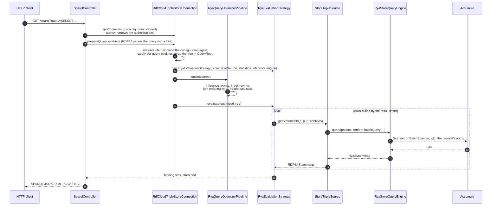

Results are lazy: Accumulo is scanned as the result writer asks for rows, so `LIMIT` and `ASK` stop the scans early.

### 12.2 `evaluateInternal` step by step

`RdfCloudTripleStoreConnection.evaluateInternal(tupleExpr, dataset, bindings, includeInferred)`:

1. **Per-query configuration.** It clones the connection's configuration, then applies overrides passed as query bindings named after configuration keys:

   | Binding | Effect |
   |---|---|
   | `query.auth` | authorizations for this query (comma-separated) |
   | `query.infer` | inference on or off |
   | `query.usestats` | statistics-based join ordering on or off |
   | `query.useindex` | text and geo index on or off |
   | `query.ttl`, `query.startTime` | only statements written in a time window |
   | `query.printqueryplan` | log the optimized plan |

   If RDF4J asks for no inferred statements (`includeInferred = false`), inference is turned off.
2. **Tree.** It clones the tree, so the caller's copy is never modified, and wraps it in a `QueryRoot`.
3. **Collaborators.** It builds:
   - a `StoreTripleSource` over the DAO, with the per-query configuration;
   - an `EvaluationStatistics`: `RdfCloudTripleStoreEvaluationStatistics` when statistics are on, `RyaDefaultStatistics` otherwise;
   - a `RyaEvaluationStrategy`;
   - a `RyaQueryOptimizerPipeline`.
4. **Optimize, then evaluate.** `strategy.optimize(...)`, then `strategy.evaluate(...)`.

### 12.3 The optimizer pipeline

`RyaQueryOptimizerPipeline` is RDF4J 6.1's standard pipeline with eleven Tripatha steps added (marked ★):

```mermaid
flowchart TD
    o1["BindingAssigner<br/>BindingSetAssignmentInliner"] --> o2["★ TextQueryValidator<br/>rejects malformed constant text:matches queries"]
    o2 --> o3["ConstantOptimizer, RegexAsStringFunctionOptimizer,<br/>CompareOptimizer, ConjunctiveConstraintSplitter,<br/>DisjunctiveConstraintOptimizer, SameTermFilterOptimizer,<br/>UnionScopeChangeOptimizer, QueryModelNormalizer,<br/>ProjectionRemovalOptimizer"]
    o3 --> o3a["★ TripleTermOptimizer.fold<br/>constant triple terms become values (section 12.7)"]
    o3a --> o3b["★ ApproxCountOptimizer<br/>stats: patterns from the counters (sections 11.4, 11.5)"]
    o3b --> o4["★ InferenceOptimizer<br/>15 OWL/RDFS rewrites (section 14)"]
    o4 --> o5["★ IndexSearchOptimizer<br/>text and geo patterns (section 15)<br/>only when the store has indexes"]
    o5 --> o5b["★ ValueRangeOptimizer<br/>comparisons narrow patterns to value ranges (section 12.9)"]
    o5b --> o6["QueryJoinOptimizer<br/>join order from Tripatha statistics (section 11)"]
    o6 --> o6b["★ TripleTermOptimizer.order<br/>each triple-term pattern right after what binds its term (section 12.7)"]
    o6b --> o7["IterativeEvaluationOptimizer, FilterOptimizer,<br/>FilterInValuesOptimizer, FilterOptimizer,<br/>OrderLimitOptimizer"]
    o7 --> o8["★ LeftDeepJoinOptimizer<br/>right-nested joins become left-deep (section 13)"]
    o8 --> o9["★ SubjectMergeOptimizer<br/>a star's constant patterns become one merge join (section 13.6)"]
    o9 --> o10["★ SubjectMergeCountOptimizer<br/>a star's COUNT asked of the store (section 13.7)<br/>only when the store intersects"]
    o10 --> o11["★ CountedPatternOptimizer<br/>lookups of unused objects counted (section 13.8)"]
```

**Where the Tripatha steps sit:**
- **Graph sizes** are filled in before inference, which leaves the in-memory pattern they produce alone.
- **Inference** runs after the tree is normalized and before join ordering. Join ordering therefore runs once, on the final tree, and sees the patterns inference created.
- **The index rewrite** runs after inference, so sub-properties added by inference are searched too. It runs before join ordering, which then sees the much smaller indexed patterns.
- **The value-range rewrite** runs after it: a pattern an index already narrows is left alone. Join ordering then sees the narrowed estimate.

### 12.4 The evaluation strategy

`RyaEvaluationStrategy` extends RDF4J's `DefaultEvaluationStrategy` and changes four `prepare` methods (`Join`, `LeftJoin`, `StatementPattern`, `TripleRef`). It also overrides `precompile`, for its own node types, `SubjectMergeJoin` and `SubjectMergeCount`, which RDF4J's dispatch would refuse:

| Node | Step used |
|---|---|
| `SubjectMergeJoin` (a star's constant patterns) | `SubjectMergeStep`, which intersects their subject-sorted lists ([section 13.6](#136-merge-joins-a-stars-constant-patterns-intersected)) |
| `SubjectMergeCount` (a star's or a class's `COUNT`) | `SubjectMergeCountStep`, which asks the store for the count of each group of shards ([section 13.7](#137-the-entity-index-stars-shard-by-shard)) |
| `CountedPattern` (a pattern whose object nothing else uses) | `CountedPatternStep`: each row repeated as many times as the store counts, or RDF4J's own step for a row it can't count ([section 13.8](#138-counted-patterns-a-matchs-number-not-its-statements)) |
| `Join` or `LeftJoin` topping a chain of attribute lookups | the chain's own steps over an `EntityPrefetchStep` ([section 13.5](#135-entity-prefetch-a-chain-of-joins-at-once)) |
| `Join` whose right side is a plain statement pattern (optionally under filters) | `BatchedJoinStep` ([section 13](#13-batched-joins)); otherwise RDF4J's own join |
| `IndexedStatementPattern` | RDF4J's `StatementPatternQueryEvaluationStep`, reading through an `IndexTripleSource` ([section 15](#15-text-and-geo-search)) |
| `FixedStatementPattern` | matched against its in-memory list of ontology statements ([section 14](#14-inference)) |
| `TripleRef` (a triple-term pattern) | `TripleRefStep` ([section 12.7](#127-triple-terms)) |
| a `StatementPattern` whose object is a triple term with a constant subject | RDF4J's `StatementPatternQueryEvaluationStep`, reading through a `TripleTermRangeSource` ([section 12.7](#127-triple-terms)) |
| a `StatementPattern` whose object a `STRSTARTS` filter constrains | RDF4J's `StatementPatternQueryEvaluationStep`, reading through an `ObjectPrefixSource` ([section 12.8](#128-strstarts-as-a-prefix-range)) |
| `ValueRangePattern` (a pattern whose object comparisons bound) | RDF4J's `StatementPatternQueryEvaluationStep`, reading through a `ValueRangeSource` ([section 12.9](#129-comparisons-as-value-ranges)) |
| `TransitivePropertySP` | the closure computed by `InferenceEngine.findTransitiveProperty` when one end is bound; otherwise a plain lookup |
| any other node | RDF4J's default |

### 12.5 `StoreTripleSource`: RDF4J lookups on top of Tripatha

`StoreTripleSource` (an inner class of the connection) is the only way the evaluation reads statements. `getStatements(s, p, o, contexts)`:
1. **Prefetched batches first.** It looks the lookup up in the batches a batched join or an entity prefetch fetched ahead. If the lookup is there, it is answered from memory.
2. **Otherwise one scan per graph.** It converts the lookup to a `RyaStatement` pattern and calls `RyaStoreQueryEngine.query`, applying RDF4J's context semantics:
   - no contexts: one lookup over every graph;
   - one graph: a lookup restricted to its column family;
   - `null`: an "any graph" lookup, keeping only results without a context (the default graph);
   - several graphs: one lookup per graph, read one after the other.
3. **Conversion.** It converts each `RyaStatement` to an RDF4J `Statement`.

### 12.6 The running example, optimized

```
QueryRoot
└── Projection (?friend, ?age)
    └── Join                                     algorithm: RyaBatchedJoin
        ├── StatementPattern  ex:alice ex:knows ?friend      estimate 1 → spo scan
        └── StatementPattern  ?friend  ex:age   ?age         estimate 2 → spo lookup per friend
```

The join is set up as a batched join. With only one left row (`ex:bob`) there is nothing to batch, so that row's lookup goes straight to the store. With thousands of friends, the lookups would be fetched 1000 at a time.

`query.printqueryplan=true` logs a plan like this.

### 12.7 Triple terms

RDF4J's parser turns a triple term in a pattern into a `TripleRef(s, p, o, ?t)` node, joined with the statement pattern that uses `?t` as its object. Annotations (`{| |}`) and reified triples (`<< >>`) are the same thing plus an `rdf:reifies` pattern. So `?claim rdf:reifies <<( ex:alice ?p ?o )>>` is:

```
Join
├── TripleRef         ex:alice ?p ?o  →  ?t
└── StatementPattern  ?claim rdf:reifies ?t
```

RDF4J's own step for `TripleRef` lists every triple term in the store. Tripatha replaces it:

1. **Constant terms are folded** (`TripleTermOptimizer.fold`). A `TripleRef` whose parts are all constants becomes a one-row binding of `?t` to that term, which the statement pattern then looks up like any other object. Nested terms fold from the inside out. The term is bound through a row, not written into the pattern: RDF4J reuses a pattern's constant `Var` in a way that breaks its one-parent rule for triple terms.
2. **The others are ordered** (`TripleTermOptimizer.order`, right after join ordering). Each `TripleRef` is moved to just after the first pattern that binds its `?t`. A `TripleRef` nothing else binds stays first.
3. **A bound term is matched in memory** (`TripleRefStep`). With `?t` bound, the step unifies the term's parts with the pattern's, without reading anything.
4. **A range replaces the full read** (`TripleTermRangeSource`). When the `TripleRef` has a constant subject and its statement pattern has no subject or object bound, that pattern reads only the objects that start with the term's encoded prefix: `02 esc(subject) 02`, plus `esc(predicate) 02` when the predicate is constant too. This is a range of `po`, or of `osp` when the pattern's predicate is unbound. The `TripleRef` after it still checks every result, so the range can only save reads. In a batched join such a pattern is batched only once its subject or object is bound, like an indexed pattern.
5. **Otherwise the store is asked** (`StoreTripleSource.tripleTerms`): the terms that are objects of some statement, read as the range of all triple terms, deduplicated, and descended into for nested patterns.

The statistics count a triple term like any other object, and estimate a `TripleRef` high, so join ordering starts from the other patterns. Inference ignores triple terms.

### 12.8 `STRSTARTS` as a prefix range

`?p :sku ?s FILTER(STRSTARTS(?s, "SKU-AB"))` would read every `:sku` statement for the filter to keep a few. `ObjectPrefixSource` reads only the statements whose object starts with the prefix instead.

**When it applies** (`ObjectPrefixSource.prefixFor`):
- **The pattern:** its subject and object are variables, and its predicate is an IRI (a range of `po`) or a variable (a range of `osp`).
- **The filter:** a `Filter` above the pattern, reached through joins and filters only, so it applies to every row the pattern contributes to. Not across an `OPTIONAL`, a `UNION` or a subquery.
- **The condition:** it has a conjunct `STRSTARTS(?o, "constant")` on the pattern's object, with a non-empty constant.
- **The settings:** `query.prefixranges` is on, which is the default.

**Why the answers can't change:**
- **The filter stays** and decides every row; the range only skips rows it would reject.
- **Every match is inside the range.** `STRSTARTS(?o, "abc")` is true only for a string or language-tagged string starting with `abc`. Both are stored as their text first: `abc-1`, or `abc-2@en` for a language-tagged one.
- **Everything else fails anyway.** For numbers, dates, booleans, IRIs and triple terms the function is an error, which a filter treats as false.
- **No type check.** The range is a `RyaAnyTypeRange`, for which `RyaStoreQueryEngine` adds none, so both kinds of string are read in one scan.

**Not `STRSTARTS(STR(?o), …)`.** `STR` of the number 42 is `"42"`, but numbers, dates and booleans are stored in encodings of their own, outside that range.

**At run time,** when the pattern's subject or object is bound (in a join, for example), the lookup is already narrow and goes to the store as usual. In a batched join such a pattern is batched only once its subject or object is bound, like an indexed pattern.

**Tests:** `ObjectPrefixIT` compares every query with the setting on and off.

### 12.9 Comparisons as value ranges

`?obs :hasResult ?v FILTER(?v > 60)` would read every `:hasResult` statement for the filter to keep a few. A `ValueRangePattern` reads only the results above 60 instead, a little widened (SCALE-STUDY.md O14).

**Why a range is possible:**
- Within one predicate, `po` rows sort by the object's data bytes.
- For `xsd:int`, `xsd:short`, `xsd:long`, `xsd:integer`, `xsd:double`, `xsd:float` and `xsd:dateTime`, mango's encodings sort like the values ([section 7.3](#73-value-encoding)): negatives first, `-INF` to `INF` and then NaN for doubles, UTC milliseconds for date-times.
- Not the others:
  - `xsd:decimal`, `xsd:date` and other custom datatypes store their lexical text;
  - `xsd:byte` stores the two hex digits of its unsigned byte, so its negative values sort after the positive ones.

**What has to be known: the datatypes of the predicate's objects.** The type is the last part of a `po` row, after the subject, so nothing in the row layout groups them. The counters can be turned off. So every `add` writes a **datatype marker**: an `eval` counter cell per predicate, datatype and label, in family `t` (`DatatypeMarkers`).
- **When written:** once per call and key, as graph markers are, whether or not statistics are on, and before the rows it stands for.
- **When removed:** only by a purge. Deletes and `dropGraph` leave them ([section 10.2](#102-dropping-graphs-dropgraph)).
- **Who sees them:** a reader sees a marker under the same labels as the statements it stands for, so it learns only the types of statements it may see. A type is present when any of its visible cells holds more than zero: markers only receive +1 deltas, and HBase's increment mode resets a purged counter to zero instead of deleting it.
- **Trusted only when complete:** that is, in a store created by code that writes them, which `init()` flags in `ns` ([section 9.5](#95-opening-a-store)). A store without the flag is never narrowed.
- **Not atomic:** an `add` whose flush fails can leave rows without their marker, until they are added again (the loader's resume does). Like every partial write, it isn't transactional.

**When it applies** (`ValueRangeOptimizer`, after the index search and before join ordering):
- **The pattern:** a plain `StatementPattern` (not one inference or an index built) with a variable subject, an IRI predicate, and the compared variable as its object, used nowhere else in it.
- **The filter:** above the pattern, reached through joins, unions, the left side of an `OPTIONAL` or a `MINUS`, and extensions that don't bind the variable, as with the indexes ([section 15.7](#157-the-query-side-step-by-step)).
- **The conditions:** conjuncts `<`, `<=`, `>`, `>=` or `=` between the variable and a constant number or `xsd:dateTime`, on either side.
- **The datatypes:** read once per query and predicate, under the query's labels. Every one of them must sort like its values and be comparable with the constants (numbers with numbers, date-times with date-times). Otherwise the pattern is left as it is.
- **The settings:** `query.valueranges` is on, which is the default. There is no result limit (`query.limit`), no hashed row layout and no row regular expression.

**The ranges** (`ValueRanges`): one per datatype, each a scan of `po` from `p 00 start` to `p 00 stop 00 FF`, keeping the rows of that type with the type check of [section 8.2](#82-what-the-scan-adds-on-top-of-the-range). A range only has to hold every value the filter can keep, so its bounds are widened on purpose:
- **Numbers.** RDF4J compares two numbers in a common type, rounding both to a float or a double when either is one. So the long 2^60 + 100 equals the double 2^60. Each bound is widened by 2^-20 of the constant plus 2^-120, more than that rounding, then floored or ceiled into the type's own values and clamped to its range.
- **NaN.** RDF4J orders doubles with `Double.compare`, which puts NaN above every number, so `?v > 60` keeps a NaN. A double or float range without an upper bound runs past `INF` to the type's last data.
- **Date-times** are stored as UTC milliseconds and read back with a `Z`. A constant without a time zone is read as UTC: XSD compares a value with a zone and one without only beyond 14 hours, on the side that reading gives, and in between the comparison is an error, which the filter rejects. The bounds are widened by a second.
- **What bounds nothing:** a constant that is NaN, infinite, ill-typed, or a date-time outside the years 1 to 9999, and `!=`. Leaving a condition out only widens the ranges.
- **What reads nothing:** contradictory bounds (`?v > 10 && ?v < 5`), or a type no value of which can match (a byte above 200) gets no range.
- **When there are no ranges at all:** when a type's range would be open at both ends, as a byte's always is. The types share the predicate's rows, so each range also reads, and drops, the other types' rows whose data falls in it, and a range open at both ends costs a whole scan.

**Why the answers can't change:** the filter stays and decides every row, and each range is a superset of the values the filter keeps. `ValueRangesTest` checks this against RDF4J's own comparisons, in strict and standard mode, for every narrowed type and every kind of constant, edges included.

**At run time,** a `ValueRangeSource` reads the ranges one after the other, through `StoreTripleSource` with the usual graph semantics. When the pattern's subject or object is bound (in a join, say), the lookup is already narrow and goes to the store as usual. In a batched join such a pattern is batched only once its subject or object is bound, like an indexed pattern.

**The estimate** decides whether the range drives a star, so it is counted (SCALE-STUDY.md O25):
- **When:** the pattern is in a join (looking up through filters and the left side of `OPTIONAL`s), and the statistics are the store's. A pattern on its own needs no estimate, so it isn't counted.
- **How:** `RyaStoreQueryEngine.countValueRanges` counts the cells of the ranges without decoding them, through the same scan specification as the lookup (labels, TTL, server iterators), in every graph. The types share the cap, and each range is one round trip. A count is made once per query, predicate, ranges and cap, never kept across queries.
- **The cap:** the estimate of the shortest other statement pattern of the join (through joins, filters and the left side of `OPTIONAL`s), and at most `query.valueranges.count` (1,000,000).
  - Ranges holding that many cells are at least as long as that pattern, so they wouldn't drive the join, and counting further would only cost time.
  - The ceiling bounds what a count reads: the cells cross to the client. Without the entity index, the merge plan reads lists at least that long anyway. With it, a star's lists don't reach the client, so a long count can cost more than the star.
  - It was a fixed 10,000 until 2026-11-18. At 100M triples, `class-value-int`'s range of tens of thousands of cells reached it, was estimated as its whole predicate, and lost the plan: 510 ms against 224 with the relative cap (SCALE-STUDY.md 4.11).
- **What it gives:**
  - a range shorter than the cap is estimated at its count, so a selective condition drives its star;
  - one that reaches the cap is estimated as if it weren't narrowed (at least the cap), so a condition most values pass leaves the star to its constant patterns.
- **At 10^12** even the ceiling is too few for ranges of billions: an estimate the store makes (a count in the servers, or a sample) is needed there.
- **Without a count** (`query.valueranges.count=0`), the estimate is a tenth of the predicate's count ([section 11.2](#112-how-a-patterns-cardinality-is-estimated)).
- **In plans:** the pattern's signature shows the count, or "at least N cells", N being the cap.

**Tests:**
- `ValueRangeIT` compares every query with the setting on and off, with and without a label and with inference.
- `DatatypeMarkersIT` checks the markers, the flag, the version check and what a range reads, on each backend.

---

## 13. Batched joins

### 13.1 The problem

With a nested-loop join, every row from the left side costs one Accumulo round trip for the right side. A left side of 100,000 rows means 100,000 small scans, one after the other.

RDF4J's join optimizer makes this worse for three patterns or more. It nests the ordered joins to the right, `Join(a, Join(b, c))`, so the inner join is evaluated once per row of `a`, with a single row on its left: there is nothing to batch. `LeftDeepJoinOptimizer`, the last step of the pipeline, rotates them to `Join(Join(a, b), c)`. RDF4J evaluates both shapes as the same nested loops, so the results and their order are the same, but now every join has all the rows on its left and a statement pattern on its right. It leaves alone what RDF4J doesn't evaluate as a nested loop over the left bindings: merge joins, scope changes, subqueries, and the join subclasses inference builds.

### 13.2 The idea

`BatchedJoinStep` keeps the nested-loop semantics but fetches the right-hand lookups in batches:

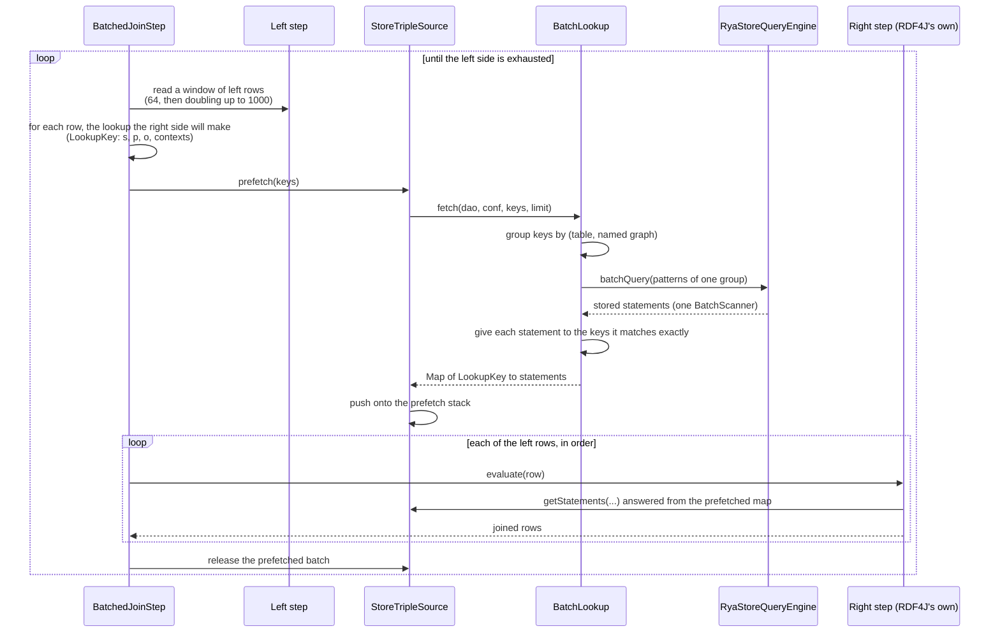

The right side is still RDF4J's own statement-pattern step, run once per left row. Only where its statements come from changes, so join semantics (optional variables, repeated variables, graph scopes) stay RDF4J's.

**Window sizes.** The first window is 64 left rows, and each next one doubles, up to `query.join.batchsize`, as entity prefetch does ([section 13.5](#135-entity-prefetch-a-chain-of-joins-at-once)). A query that stops early, such as one with a `LIMIT`, fetches the lookups of a small window instead of a whole batch.

### 13.3 When a join is batched

`RyaEvaluationStrategy.batchableRightPattern` allows batching only when all of these hold:
- **The store:** the triple source is a `StoreTripleSource`.
- **Settings:** `query.join.batchsize` is above 1 (default 1000), and `query.limit` is not set.
- **The query:** it has no `FROM` / `FROM NAMED` dataset.
- **The join:** it is not a merge join, and RDF4J is not tracking result sizes or times.
- **The right side:**
  - it is a statement pattern, possibly under filters, with no variable-scope change and no subquery;
  - it is not a `FixedStatementPattern` or a `TransitivePropertySP`;
  - if it is an `IndexedStatementPattern`, the left side binds its subject or its object (so the lookup is a plain store lookup).

The join then shows `algorithm: RyaBatchedJoin` in the plan. A chunk with a single left row skips the prefetch: its one lookup goes straight to the store.

### 13.4 Keeping the answers identical

`BatchLookup` is where correctness is decided:
1. **Grouping.** Keys are grouped by the table their pattern resolves to and by the named graph they ask for. Each group is one `batchQuery`.
2. **Exact matching.** The scan ranges are looser than the keys: they ignore the object's type, and they may overlap. So every stored statement is matched to each key on the key's bound positions:
   - same subject and predicate;
   - the same encoded object, data **and** type;
   - for default-graph keys, no context.

   A key's answer is exactly what a single lookup would have returned.
3. **No double counting.** Within a group, a stored cell counts once, identified by its statement, graph, qualifier, label and timestamp.
   - **Disjoint groups skip it** (SCALE-STUDY.md O17). A key's range is its bound parts in the table's order, each followed by a delimiter: on `spo`, `s 00 p 00` for `(s, p, ?)` and `s 00 p 00 o 01` for `(s, p, o)`. On `po` it is `p 00 o 00`, on `osp` `o 00 s 00`. Stored terms hold no delimiter byte.
     - So two ranges overlap only when one key's parts are a strict prefix of another's, as `(s, p, ?)` and `(s, p, o)` with the same subject and predicate are. Equal parts give the same range, which a scan reads once.
     - A group with no such pair is disjoint, whatever its shapes: no cell comes twice, and the scan doesn't record the cells it has seen. It still encodes each cell's object when a key binds one, to match the type exactly.
     - Only groups whose keys bind different numbers of parts are checked pattern by pattern.
   - Subject ranges (step 4) overlap the keys they stand for, so a group read that way keeps the check.
   - **Such a group is also read on several threads** (SCALE-STUDY.md O16, `query.join.lookupthreads`; unset, `Capabilities.lookupThreads()`: 4 on RocksDB, 1 on Accumulo and HBase). Each key's cells come from its own range, so the patterns can be cut into chunks of at least `query.join.lookupthreadkeys` (256). A group keeps one pattern per range, its bound parts in the table's order, so no range is read by two chunks: keys of one range may differ in an object's type, in their graph condition (any graph, the default graph) or only in the creation time a `RyaStatement` keeps. A key asked for twice is answered once, and a chunk left empty is dropped.
     - The query thread reads the first chunk; pool threads read the others, each reading, decoding and matching into a map of its own, under the query's trace.
     - The query thread waits for every chunk before it returns or throws, so no scan outlives the call. It then merges the maps: each key's list comes from one chunk, in a single scan's order.
     - The size cap of step 5 counts every chunk's statements together.
     - A thread that joins another's trace keeps its reasons to itself, since the trace's reason stack is the query thread's.
4. **One range per subject, when switched on** (`query.join.subjectranges`, off by default). In `spo`, a subject asked for by two or more keys of a group (the links of an entity chain, for example) is read as its whole range, `s 00`, instead of one range per key.
   - **The idea:** the subject's statements are neighbouring rows, so one seek reads them all.
   - **Why the answers don't change:** the exact matching of step 2 keeps only what each key asks for.
   - **Large subjects:** if the group's subject ranges return more than 64 cells per subject read whole, plus 1,024, a subject with many statements is among them. The group is then read again one range per key, and the trace notes it.
   - **Why it is off:** on the warm join benchmark it halved the ranges but read about four times the cells. Accumulo was no faster, and RocksDB was 50 to 64 % slower (SCALE-STUDY.md O21). It may pay where a seek is a block read, on a cold cache, and that is still to be measured.
5. **A size cap.** If more than `query.join.prefetchlimit` statements (default 100,000) would be held in memory, `fetch` returns `null`. Nothing is cached, and every key is looked up on its own.
6. **Never a partial batch.** A key missing from the cache must mean "ask the store", never "no results". So a batch is registered whole or not at all.

Batches form a stack in `StoreTripleSource`, so nested batched joins each keep their own until they release it.

**Testing:** the ITs can push every join through chunk boundaries with `-Dtripatha.test.joinBatchSize=2`, and the endpoint tests with `-Dtripatha.join-batch-size=2`.

### 13.5 Entity prefetch: a chain of joins at once

A query that reads several attributes of each entity has one join, or one `OPTIONAL`, per attribute. A batched join only covers its own join:
- each required attribute is a batched join of its own: one batch scan per attribute for every 1000 rows;
- an `OPTIONAL` is RDF4J's left join, which isn't batched at all: one lookup per row.

`EntityChain` finds such runs, and `EntityPrefetchStep` fetches all their lookups together:

```
LeftJoin                    OPTIONAL { ?s ex:email ?e }     link
└── Join                    ?s ex:name ?n                   link
    └── StatementPattern    ?s a ex:Person                  driver: binds ?s on every row
```

1. **Finding the chain.** `RyaEvaluationStrategy.prepare(Join)` (before trying a batched join) and `prepare(LeftJoin)` call `EntityChain.find`. It walks down left arguments while each node is a join or `OPTIONAL` whose right side is one statement pattern (a *link*). Where it stops is the *driver*.
2. **Which links qualify:**
   - the pattern's subject or object is bound on every driver row (`getAssuredBindingNames`), so each lookup is a range on one subject or object;
   - the pattern uses no variable that a link below it binds, unless the driver binds it on every row; otherwise the lookup would depend on that link's results. When the lowest links fail this, they become part of the driver (an inferred type, for example);
   - a join whose pattern is under a filter is not a link: it stays in the driver, so the links above it are fetched only for the rows that pass;
   - a chain needs two links, or one `OPTIONAL`. A single join is left to `BatchedJoinStep`.
3. **The fetch.** `EntityPrefetchStep` reads the driver's rows in windows. For each row it works out every link's lookup (`BatchedJoinStep.lookupFor`), then fetches them all with one `StoreTripleSource.prefetch`. `BatchLookup` groups them by table and graph, so a window usually costs one `batchQuery`.
4. **The links** are RDF4J's own nested loops over those rows: `JoinIterator` for joins, `LeftJoinQueryEvaluationStep` for `OPTIONAL`s. Their pattern steps call `getStatements`, which finds the answers in memory. Results, and their order, are those of the plan without the prefetch.
5. **Release.** The loops ask for the next driver row only after the current row's lookups are done, so a window's statements are released when the next window is read. A lookup that misses goes to the store: it costs time, never a wrong answer.
6. **Window sizes.** The first window is 64 rows, so `LIMIT` and `ASK` queries fetch little; each next one doubles, up to `query.join.batchsize`. A window that would hold more than `query.join.prefetchlimit` statements is halved and fetched again; a single row still over it is left to the store.
7. **The next window, fetched ahead** (SCALE-STUDY.md O16, `query.join.prefetchahead`; on by default where lookups are read on several threads, that is RocksDB). From the second window on:
   - the next window's rows are read from the driver as soon as the current window is handed on;
   - their keys are built and their lookups fetched on another thread, under the query's trace, while the current window is joined.
   - **Only the query thread holds a batch,** so `StoreTripleSource`'s batches stay its own: it takes the next window's statements when the current one is used up (`StoreTripleSource.fetch`, then `hold`). A fetch too large to hold falls back to the halving of step 6.
   - **Memory:** at most two windows are in memory.
   - **Early stops:** a query that stops in its first window fetches no more than before.
   - **Closing:** closing the step waits for a fetch still running, so none outlives the query.

It is on by default: `query.join.entityprefetch`, or `tripatha.entity-prefetch` on the endpoint. Joins in a chain show `algorithm: RyaEntityPrefetch` in the plan, and the trace reason is `entity prefetch: N lookups for M rows fetched together`.

**Limits.** Patterns rewritten by inference (subPropertyOf, inverseOf, symmetric and so on) are not single statement patterns any more, so they end the chain. Lookups are shared only within a window: an entity met in two windows is fetched twice.

**Testing:** `EntityChainTest` covers which nodes form a chain; `EntityPrefetchIT` checks results and order against the plan without it, the store lookups it saves, halved windows, labels and inference.

### 13.6 Merge joins: a star's constant patterns, intersected

"All entities matching X" (SCALE-STUDY.md D1) is often a star whose objects are constants: `?x a :Person ; :worksFor :Acme ; :nationality :IT`. Join ordering drives it with the shortest pattern and looks the others up, one lookup per driver row and pattern. But each pattern is already a sorted list: in `po`, the rows of one predicate and object are `p 00 o 00 s 01 type`, in subject order. Reading the lists side by side and keeping the subjects found in all of them reads each list once, in sequence.

```
Join                                       ?x :name ?n            looked up per row, as before
└── SubjectMergeJoin (?x, 2 lists)         read in subject order and intersected
    ├── StatementPattern  ?x :worksFor :Acme      2,532 subjects
    └── StatementPattern  ?x :nationality :IT    47,218 subjects
Join … ?x a :Person                       347,303 subjects: looked up for the merge's rows instead
```

1. **Finding the star.** `SubjectMergeOptimizer` runs last, after `LeftDeepJoinOptimizer`. In each left-deep chain of plain joins it looks at the driver, the first argument join ordering chose. If that is a star pattern on `?x`, every star pattern on `?x` in the chain is a candidate. A star pattern is a plain `StatementPattern` in the default scope, with a variable subject, a constant IRI predicate and a constant IRI or literal object. The chain stops at filters, OPTIONALs and joins with a scope of their own.
2. **Merge or look up.** A candidate's length is its `po` counter. Reading a list costs its length in cells read in sequence; looking up the shortest list's subjects in it costs that many lookups. So a candidate is merged if it is at most `query.join.mergeratio` times the shortest: about what a lookup costs in sequential cells. The rest stay joins after the merge, looked up for the merge's rows only. Inner joins commute, so moving them doesn't change the answers.
3. **The ratio** is unset by default. `RyaSailFactory` then sets it to the store's `Capabilities.lookupCost()`: 35 on Accumulo and 20 on HBase, where a lookup is a server round trip; 8 on RocksDB, where it is a seek. Each was measured on the join benchmark (SCALE-STUDY.md 4.7). 0 turns merges off; the endpoint's setting is `tripatha.join-merge-ratio`.
4. **The merge.** `SubjectMergeStep` opens one range per list (`StoreTripleSource.subjectsInOrder`: a `po` range with the object's type as a row suffix, read with the query's labels) and advances them together.
   - **Subjects only** (SCALE-STUDY.md O24): `RyaStoreQueryEngine.subjects` gives each cell's subject as its UTF-8 bytes, cut from the row between the known `p 00 o 00` and the type suffix, without decoding the statement. Only matching subjects become values.
   - Subjects are compared as unsigned bytes, which is code point order and so the order of the rows. `String.compareTo` compares UTF-16 units, which puts characters above U+FFFF before U+E000 to U+FFFF.
   - A subject with `n1` statements in one list and `n2` in the other (the same triple in several graphs, or under several labels) gives `n1 × n2` rows, as the nested loop does.
   - Rows come out in subject order instead of the driver's (in chunks of each slice's order when the merge is sliced and no lookups follow, item 5). SPARQL fixes no order without `ORDER BY`, so a `LIMIT` without one may return other rows of the same answer.
   - When the subject is already bound, as on the right of an OPTIONAL evaluated per row, the step runs the patterns' plain nested loop.
5. **Slices** (SCALE-STUDY.md O24): the lists can be read in slices of the subject space, each slice intersected on a thread of its own.
   - **The boundaries** are `spo`'s split points cut to their subjects (`RyaStoreDAO.subjectBoundaries`, kept a minute), through the SPI's `TableAdmin.splitRows`:
     - Accumulo: `listSplits`;
     - HBase: the region start keys;
     - RocksDB: the split points given to the table in this process, or else the first rows of the SST files on its fullest level.

     They are only a hint for balance: any boundaries give the same answers.
   - **A slice** reads every list as the range of its subjects in `[b_i, b_i+1)`: `p 00 o 00 b_i` up to `p 00 o 00 b_i+1`, excluded. A row is in a slice exactly when its subject is, since subjects hold no `00` or `01`.
   - **Threads:** the scans are all opened on the query thread, so the trace reports them under the merge's reason. Each slice is intersected on a daemon thread, and its matches come back in chunks, each in subject order, through a bounded queue.
   - **Order:** when lookups follow the merge (it is a join's or an OPTIONAL's left side, maybe under filters and `BIND`s), each slice has a queue of its own and the slices are emitted in subject order: the rows and their order are those of one slice, and the lookups read nearby rows. Otherwise every slice feeds one queue and the chunks come as they are ready. Emitted in order, a later slice gets only its queue's chunks (about 4,000 matches) ahead of the query thread, and nothing slow drains the first: at 100M triples 4 slices were 11 % faster than one, against 3 times at 10M (SCALE-STUDY.md 4.11). With lookups, they are the slow part, so in-order emission costs nothing there.
   - **Closing:** a slice's thread reads and closes its own scans (RocksDB's native scanners must not be closed while another thread reads them). A slice that hasn't started when the merge is closed (a `LIMIT`) is closed by the query thread instead, and a running one is stopped and waited for.
   - **The setting:** `query.join.mergeslices` caps the slices; 1 reads every list whole on the query thread.
6. **Above the merge,** `SubjectMergeJoin` binds the subject on every row (`getAssuredBindingNames`), so the attribute patterns form a `BatchedJoinStep` or an entity chain over it, as over any driver.
7. **A pattern on its own** (SCALE-STUDY.md O7a): a star pattern that no other list joins, such as `SELECT ?x { ?x a :C }`, its count without the entity index, or a class that drives a chain of lookups, is one subject-sorted list too. Read as a statement pattern, its cells are decoded into statements on the query thread, one after another. Read as a merge of one list, it gets items 4 and 5: subjects only, in slices on threads of their own, in order when lookups follow.
   - **When:** after the chains, `SubjectMergeOptimizer` wraps each star pattern evaluated once per query whose `po` counter is at least `query.join.mergesingle` (10,000; 0 never) in a `SubjectMergeJoin` of one list. Evaluated once means only unary operators (projection, filter, `BIND`, `DISTINCT`, `ORDER BY`, `LIMIT`, a group), unions and the left sides of joins, OPTIONALs and MINUS lie between the pattern and the root. On a right side it is evaluated per row, and inside `EXISTS` too.
   - **Not under a `LIMIT`** (plus its offset) shorter than the setting: one scan returns those rows sooner than slices are opened.
   - **Its rows** are the pattern's: a subject with `n` statements (graphs, labels) gives `n` rows. A pattern with a scope of its own (a `UNION`'s arm, a group) passes it on to the merge.
   - With the entity index READY, the list is read from its shards like a star's, and a count of it stays the store's (section 13.7).

**Not merged:** without counters (the choice needs them), with a dataset or `query.limit`, under RDF4J's result-size or time tracking, and with the hashed row layout, whose `po` rows are not in subject order. Patterns built by inference or for an index, named-graph patterns and value conditions are left alone. A prefix or value range of `po` is sorted by value, so it can't be intersected as it streams.

**Measured** (SCALE-STUDY.md 4.7, 10M triples): on the Accumulo test cluster, `class-large` (three lists of 20k, 93k and 134k subjects) went from 1,446 ms and 41,284 lookups to 137 ms and 6 ranges, and `class-2` from 267 to 47 ms; on the HBase test cluster `class-large` went from 506 to 149 ms. Merging a whole class of 347k subjects into a star whose other lists are short is slower than looking it up (+20 %), which is what the ratio prevents. On RocksDB only stars of similar lengths gain (`class-large` −28 %), so its ratio is 8.

**Testing:** `SubjectMergeIT` runs a set of stars with merges off and forced, with and without a label, over data with duplicates in graphs and labels, values of other types with the same data, and subjects whose UTF-16 and UTF-8 orders differ. It checks through the trace that the lists are read in order, that the attributes above are still an entity chain, and that a long list is looked up instead. Patterns on their own (item 7) are compared the same way, on 1 and 8 slices, with the trace showing which became merges, and none on the right of a MINUS, under a shorter `LIMIT`, or with the setting at 0. Its `spo` is split at five subjects, among them ones whose UTF-16 and UTF-8 orders differ: sliced merges must give the rows of one slice, in the same order, and a `LIMIT` must close them early. `-Dtripatha.test.mergeRatio=1000000` forces merges in every IT, and `-Dtripatha.test.mergeSingle=1` makes every star pattern on its own a merge.

### 13.7 The entity index: stars shard by shard

A merge join (13.6) reads a star's lists from the client: at 10^12 they hold billions of subjects each, and all of them cross to one process. The entity index (SCALE-STUDY.md O23, decision D13) keeps a second copy of those lists, sharded by subject, so that each shard can be intersected on its own, and in the servers.

**Layout** (`EntityIndex`, table `<prefix>entity`, optional: `index.entity`, endpoint `tripatha.entity-index`):

```
row         0003                                  shard: murmur3(subject) mod shards
family      urn:worksFor 01 urn:acme 01 02        the term: predicate 01 object, as po encodes it
qualifier   urn:alice 01 urn:g1 01                subject 01 graph 01 qualifier
visibility  the statement's label, timestamp the statement's
```

- **One posting per stored statement,** as in `spo`. The graph and the statement's qualifier are in the key, so the same triple in two graphs, or under two labels, is two postings, and a star counts it as the nested loop does.
- **Within a shard,** a term's postings are sorted by subject, and all of a subject's postings are in one shard. So the intersection of a star is the union of the shards' intersections.
- **`01` separates** the term's predicate from its object (no backend takes `00` in a family, and no predicate holds `01`), and the qualifier's parts. With the index on, a graph IRI or a statement qualifier holding U+0001 is refused.

**The shard count** is fixed when the index is built (`index.entity.shards`, part of its definition: changing it means a rebuild). A shard is one row, which neither Accumulo nor HBase splits between servers, so it must grow with the store: about one per 200 M triples of its expected size, 16 at least. The loader's `prepare` chooses it from `--triples` (`--entity-shards`) and splits the table at every shard. A reader that doesn't set it takes the count the index was built with.

**Its matches are answers.** The text and geo indexes give candidates that are checked against `spo` ([section 15.1](#151-filters-are-exact-indexes-only-narrow)); this one gives the subjects of the answer. So a posting must exist exactly when its statement does:
- `add` and the deletes write and remove postings with the statement's timestamp, as for the other indexes, and `rebuildAll` builds them from `spo`;
- `dropGraph` deletes them by the graph in their qualifier ([section 10.2](#102-dropping-graphs-dropgraph)), since their family is the term;
- enabling the index raises the store's version to `1.2.0`, so that older code refuses to write to it ([section 9.5](#95-opening-a-store));
- `IndexVerifier` checks it against `spo`, as it does the other indexes.

**In a merge join,** when the index is READY and `query.useindex` is on, `SubjectMergeStep` reads each pattern's list shard by shard from it instead of from `po`:
- the shards are cut into contiguous groups, one per thread (up to `query.join.mergeslices`);
- each thread opens a shard's scans, intersects them, closes them and moves to the next, reporting to the query's trace through `StoreTrace.join`;
- rows come in shard order, and in subject order within a shard: SPARQL fixes no order without `ORDER BY`.

**By the store** (`Store.intersect`: in each row, the subjects found under every family, as one cell each with its count). Each backend does it:
- **Accumulo, in its servers:** `EntityIntersectingIterator`, in the `tripatha.accumulo.iterators` jar on every tablet server, intersects a star's terms inside each shard row.
- **RocksDB, with native seeks:** `RocksIntersection` runs the same leapfrog over one RocksDB iterator per term, applying labels and the time range to each cell as `RocksScan` does.
- **HBase, in its region servers:** `IntersectionEndpoint`, a coprocessor endpoint in the `tripatha.hbase.coprocessor` jar, which the store attaches to the index tables it creates (SCALE-STUDY.md 4.21, decision D14).
  - **One call per shard row and page.** A page ends after a number of matches, cells read or milliseconds, always between two subjects, and says where the next one starts, so a 200M-posting shard never holds a call past `hbase.rpc.timeout`. Every cell the scanner examines counts, hidden ones included, which is why the endpoint applies the time range itself.
  - **Labels:** a scanner an endpoint opens skips the region's coprocessor hooks, and with them `VisibilityController`'s filter. So each of its scans goes through the region's `preScannerOpen`, on the call's own thread, and the caller's labels apply as on a client scan.
  - **Seeks inside a row** go through a filter whose hint is the target column (`SEEK_NEXT_USING_HINT`), one region scanner per term. After a seek a list reads one cell, doubling while it is read in order.
  - **The protocol** is a `.proto` compiled once with protoc 34.0, which matches HBase 3.0's shaded protobuf, and checked in (`generate-protos.sh`).
  - **When it can:** the store asks each table once, by calling the endpoint. A table created before it, or regions without the jar, answer no, and the stars are intersected on the client.

On Accumulo:
- **The leapfrog:** it seeks each term's list to the largest subject the lists are at, until they all agree, so a long list costs about as many seeks as the shortest has postings, not its length.
- **What comes back:** one key per match, `(shard, empty family, subject)`, with the product of the subject's postings per term as value. Labels are applied below user iterators, so only visible postings count. Resumed after a key, it resumes after that subject.
- **The query:** a batch scan over the shard rows with the iterator (priority 50, above Accumulo's TTL and regular-expression filters), traced as any scan.
- **When it can:** the servers must load the class: the store asks once per table (`Store.canIntersect`, through Accumulo's `testClassLoad`) and logs when they can't.

**In a merge join** (`RyaStoreQueryEngine.entityMatches`), when the index is READY, `query.useindex` and `query.entityindex.servers` are on and the store can intersect, each thread's group of shards is one `Store.intersect` call, under the query's trace. Otherwise the shards are intersected on the client as above: same answers, more data moved.
- **One queue:** the threads, one per group of shards (`query.join.mergeslices`), all feed one queue, since shards are hash partitions and their order doesn't matter.
- **Sorted runs:** when lookups follow the merge (it is the left side of a join or an OPTIONAL, maybe under filters and BINDs), its matches are sorted by subject in runs: a first run of 1,024, so a `LIMIT`'s first rows come early, then runs of up to 262,144. Lookups in hash order each read a block of their own; on the benchmark's Accumulo store that made a value star 2.6 times slower (SCALE-STUDY.md 4.10).
- **Every constant pattern joins the intersection** when the store intersects: `SubjectMergeOptimizer` then merges each star pattern on the subject, whatever its length (the merge ratio of 13.6 is for reading whole lists on the client).

**Counts by the store.** `SELECT (COUNT(*) AS ?n) WHERE { ?x a :P ; :worksFor :Acme }` needs no match on the client, and nor does a class's size, `SELECT (COUNT(*) AS ?n) WHERE { ?x a :P }`.
- **Which:** a group with no `GROUP BY` over a whole star (`SubjectMergeJoin`) or over one star pattern, each element `COUNT(*)` or `COUNT(?x)` (the rows) or `COUNT(DISTINCT ?x)` or `COUNT(DISTINCT *)` (the subjects): the star binds only ?x, and on every row.
- **One pattern** is never a merge (a merge needs two), so the optimizer checks a merge's conditions itself, but for counters and the ratio, which only choose what to merge: no dataset, since the index holds every graph; no `query.limit`, which caps the pattern's rows and so its count; not the hashed row layout; no result-size or time tracking. Its matches are its postings: one list, which the store reads without intersecting anything.
- **How:** `SubjectMergeCountOptimizer`, after `SubjectMergeOptimizer` and only when the store intersects, wraps such a group in a `SubjectMergeCount`. `SubjectMergeCountStep` asks `Store.countIntersection` for each group of shards, on a thread each (`query.join.mergeslices`, as a merge reads them; one call for every shard ran on one thread, 3 times slower), adds the counts up, and builds the group's one row as RDF4J's `GroupIterator` does: the parent bindings, each count an `xsd:integer`, 0 for no match.
- **On Accumulo** the iterator's `count` option makes it return one cell per shard row, family `count`, valued `subjects,rows`; a scan resumed after it goes on at the next row. **On HBase** the endpoint's count mode returns the same, one cell per shard row and page. The client also sums per-subject cells, so servers with an older jar still give the right count. Elsewhere the default sums `Store.intersect`'s cells, which on RocksDB stay in the process anyway.
- **Otherwise** (the subject already bound, a filter or another aggregate in the group, a `GROUP BY`) RDF4J's own group runs over the merge.

The client intersection, the fallback where the servers can't, reads every posting of the star's terms, as the merge of 13.6 does: correct everywhere, not faster.

**Testing:** `EntityIndexIT` checks the postings against `spo` after adds, deletes, graph drops, a purge and a rebuild, the version raise and the shard count. `SubjectMergeIT` reads its stars from the index too, in the servers and on the client; the test Accumulo cluster's servers run with the test classpath, which holds the iterator. `EntityIntersectingIteratorTest` checks the iterator alone: counts, subjects that start others, one term and three, and resuming. `EntityIndexIT` compares `Store.intersect` and `Store.countIntersection` with an intersection of the raw postings, for two terms and for each alone, with and without a label, on each backend that intersects. `-Dtripatha.test.indexes=true` keeps the index in every IT, checked after each test by `verifyIndexes`.

### 13.8 Counted patterns: a match's number, not its statements

In `SELECT ?p WHERE { ?p a :Person ; :knows ?f }`, the variable `?f` is named nowhere else. The pattern `?p :knows ?f` doesn't choose any value the query returns: it only decides how many times each person's row comes back, once per statement. So its lookups don't need the statements. They need how many there are (SCALE-STUDY.md O26). WatDiv's C3 has five such patterns out of six.

**Which patterns** (`CountedPatternOptimizer`, the last step of the pipeline, on the final joins). It marks a pattern when:
- it is a plain store pattern (not inferred, indexed or read as a range) on the right of a join or an OPTIONAL, alone or under filters, so its rows come from the left;
- its object is a variable no other part of the query names. Variables have names in more places than `Var` nodes, and all of them count: a projection (`SELECT *` lists every variable), an `ExtensionElem` (`BIND`), a group's names and its aggregates, a `VALUES` block, an order, a subquery, an outside binding;
- the query doesn't count distinct whole rows (`COUNT(DISTINCT *)` tells rows apart by every variable), describe resources or call a service, and has no dataset or `query.limit`.

Names are counted over the whole query, every scope included: a name used in a subquery keeps a pattern outside it from being counted, which is only ever conservative.

**The rows** (`CountedPattern`, a `StatementPattern` subclass, and `CountedPatternStep`):
- A row whose subject, predicate and graph (when the pattern has one) are bound and whose object isn't is counted: the step gets the number `n` and returns the same row `n` times. RDF4J's own step would return `n` rows that differ only in `?f`, which nothing reads. The row object can be shared, since RDF4J's steps copy a row before adding to it.
- Other rows are looked up by RDF4J's step as before: a graph to be bound by each statement (`GRAPH ?g`), the default graph alone (which the store can't narrow a count to), an object bound from outside.
- An OPTIONAL with a count of 0 keeps its row once, as `LeftJoinIterator` does for an empty right side.

**The batches.** `BatchedJoinStep` and `EntityPrefetchStep` build each row's lookups as before, and put a counted pattern's keys in the same batch as the others' (`StoreTripleSource.Batch` holds the statements of some keys and the counts of others). So the window's release rule of [section 13.4](#134-keeping-the-answers-identical) and the entity prefetch's fetching ahead cover counts unchanged.
- `BatchLookup.count` groups the keys by table, graph and how many parts they bind, so the ranges of one call can't overlap.
- A large group is counted in chunks on the lookup threads, as a disjoint group of statements is read.
- A count left out of the batch is asked of the store when its row comes.
- **Only a store that counts without reading counts apart** (`Store.countsWithoutReading`). On the others, a window's counted keys are read with its other keys, in the same scans, and their lists' sizes are the counts. A count of its own would be a second round trip for the same cells: on the join benchmark it made a chain of two counted links 91 % slower on Accumulo and 53 % on HBase. The rows are still repeated, not built per statement.

**The store counts** (`RyaQueryEngine.countBatch`, then `Store.countRanges`): the ranges and the spec a lookup would read, under its labels, graph, time range and row filters, with one number back per range. The ranges must not overlap.
- **The SPI's default** batch-scans them and counts each cell in the range holding its row (`RangeCounts`). Nothing is decoded into statements, which is most of a lookup's cost (SCALE-STUDY.md 4.14), but every cell still reaches the client.
- **RocksDB** counts with native iteration (`RocksCount`): it reads each key once, finds its graph and label from the key's end, and reads the value only when a time range needs the timestamp.
- **Accumulo counts in its tablet servers** (`RangeCountingIterator`, in the `tripatha.accumulo.iterators` jar): a batch scan of the ranges with the iterator above every other one, which returns one entry per range and tablet instead of its cells.
  - **The entry is the range's last key**, valued its count. When a batch fills, a tablet server resumes from just after the last key it returned, and that key closes the range, so nothing is counted twice. Emitted at the first key, the rest of the range would be.
  - **A range across tablets** gives one partial count per tablet. The client adds each count to the range holding its row (`RangeCounts.Locator`), which is why the ranges must not overlap: Accumulo's batch scanner would also merge overlapping ones.
  - **When it can:** the store asks once per table whether the servers load the class (`Store.countsWithoutReading`), as it does for the intersecting iterator; without the jar the client counts.
- **A window's count runs alongside its reads** (`BatchLookup.fetchAndCount`): on a lookup thread, under the query's trace, while the window's statements are read. One after the other, the count's extra round trip made a chain of two counted links 91 % slower on the Accumulo test cluster; at the same time it is within 1 %.
- **HBase counts in its region servers** (`RangeCountEndpoint`, in the coprocessor jar, which the store attaches to its statement tables).
  - **One call per region and page.** The client (`HBaseRangeCount`) groups the ranges by the region holding their start and asks the regions at once. Each counts its ranges with one region scanner: a `MultiRowRangeFilter` over them, the graphs as column prefixes, the time range, and the region's `preScannerOpen` for the caller's labels, as the intersection endpoint does.
  - **Region bounds:** each range is counted inside the region only, and the response gives the region's bounds. The client queues every part it didn't count for the next round: past the region's end, before its start (a stale location), or after the page. A split or a move costs a round, never a count.
  - **Pages** end between two rows once a number of rows or milliseconds is spent. A filter that sees every row the scan reads, hidden ones included, ends the scan, and the response says where to go on.
  - **When it can:** the store asks each table once by calling the count method, so a table created before it, or regions with an older jar, answer no, and the client counts.

**Measured** (SCALE-STUDY.md 4.22, WatDiv C3-01 in-process on RocksDB): reading every row went from 536 to 337 ms, and reading and writing TSV from 556 to 283 ms. The 444,070 rows were the same.

**Testing:**
- `CountedPatternIT` runs every query with counts on and off, with and without a label, and checks through the trace which ones counted. The data has a statement in two graphs and under two labels, subjects without a match, and statements outside a time-to-live.
- `CountedPatternOptimizerTest` covers the ways a query names a variable.
- `CountRangesIT` (`tripatha.test`) compares counts with scans on each backend.
- `-Dtripatha.test.countUnused=false` runs every sail test without counts.

---

## 14. Inference

Inference makes queries also return statements that follow from an **ontology** (RDFS/OWL statements such as `ex:Dog rdfs:subClassOf ex:Animal`), without storing them. Tripatha does it at **query time**: it rewrites the query tree so the extra matches are found by the same scans. It is off by default (`query.infer`, or `tripatha.inference` on the endpoint).

### 14.1 The InferenceEngine: the ontology in memory

`InferenceEngine` reads the ontology from the store when it starts, and again on a timer (every 5 minutes by default; `tripatha.inference-refresh` on the endpoint). It keeps:

| What | Built from |
|---|---|
| subclass graph (`ValueGraph`) | `rdfs:subClassOf`, `owl:equivalentClass` (both ways), `owl:unionOf` |
| subproperty graph | `rdfs:subPropertyOf`, `owl:equivalentProperty` (both ways) |
| property sets | members of `owl:SymmetricProperty`, `owl:TransitiveProperty`, `owl:ReflexiveProperty` |
| property maps | `owl:inverseOf`, `owl:propertyChainAxiom`, `rdfs:domain`, `rdfs:range` |
| class expressions | `owl:intersectionOf`, `owl:oneOf`, and restrictions with `owl:hasValue`, `owl:someValuesFrom`, `owl:allValuesFrom`, `owl:hasSelf` |

Changes to the ontology are invisible until the next refresh. Tests call `refreshGraph()` explicitly. A scheduled refresh that fails is logged and retried on the next tick. The parts are reloaded one after another, so until a refresh succeeds the ontology in memory may be partly updated.

Two kinds of reasoning still read the store at query time:
- **Transitive closures**, followed one hop at a time from the bound end.
- **`owl:sameAs` sets**, read when the query is rewritten.

### 14.2 The rewrite

`InferenceOptimizer` runs 15 tree visitors in a fixed order. Later visitors expand what earlier ones produced. Each one can be switched off with its own flag:

| # | Visitor | Flag (`infer.include.…`) | `?x rdf:type :C` or `?x :p ?y` also matches… |
|---|---|---|---|
| 1 | `DomainRangeVisitor` | `domainrange` | subjects of properties with `rdfs:domain :C`, objects of properties with `rdfs:range :C` |
| 2 | `SomeValuesFromVisitor` | `somevaluesfrom` | members of a `someValuesFrom` restriction, through its property and class |
| 3 | `AllValuesFromVisitor` | `allvaluesfrom` | values of a property whose subject is in an `allValuesFrom` restriction |
| 4 | `HasValueVisitor` | `hasvalue` | resources with the restriction's value, and the value for members of the restriction |
| 5 | `IntersectionOfVisitor` | `intersectionof` | resources of every class of an intersection that implies `:C` |
| 6 | `ReflexivePropertyVisitor` | `reflexiveprop` | `?x = ?y`, for a reflexive `:p` |
| 7 | `PropertyChainVisitor` | `propertychain` | the chain of properties `:p` is defined as |
| 8 | `TransitivePropertyVisitor` | `transprop` | the transitive closure of `:p` (becomes a `TransitivePropertySP`) |
| 9 | `SymmetricPropertyVisitor` | `symmprop` | `?y :p ?x`, for a symmetric `:p` |
| 10 | `InverseOfVisitor` | `inverseof` | `?y :q ?x`, for `:p owl:inverseOf :q` |
| 11 | `SubPropertyOfVisitor` | `subpropof` | `?x :sub ?y` for every subproperty `:sub` of `:p` |
| 12 | `SubClassOfVisitor` | `subclassof` | instances of every subclass of `:C` |
| 13 | `SameAsVisitor` | `sameas` | the same pattern with a constant subject or object replaced by each resource `owl:sameAs` it |
| 14 | `OneOfVisitor` | `oneof` | the enumerated members of `:C` (`owl:oneOf`) |
| 15 | `HasSelfVisitor` | `hasself` | `?x :p ?x` for a `hasSelf` restriction on `:p` |

Visitors only touch patterns whose predicate is a constant, except `SameAsVisitor`, which also expands patterns with a variable predicate. They skip the nodes inference itself created.

### 14.3 Example: `rdfs:subClassOf`

Ontology and data:

```turtle
ex:Dog rdfs:subClassOf ex:Animal .
ex:Cat rdfs:subClassOf ex:Animal .
ex:rex rdf:type ex:Dog .
```

Query: `SELECT ?x WHERE { ?x rdf:type ex:Animal }`.

Before the rewrite:

```
Projection (?x)
└── StatementPattern  ?x rdf:type ex:Animal
```

After `SubClassOfVisitor` (`?t` stands for a fresh variable with a random name):

```
Projection (?x)
└── InferJoin
    ├── FixedStatementPattern  ?t rdfs:subClassOf ex:Animal
    │      in-memory statements:  ex:Dog    rdfs:subClassOf ex:Animal
    │                             ex:Cat    rdfs:subClassOf ex:Animal
    │                             ex:Animal rdfs:subClassOf ex:Animal   (the class itself)
    └── DoNotExpandSP          ?x rdf:type ?t
```

- **`FixedStatementPattern`** never touches the store. `RyaEvaluationStrategy` matches it against its list, so `?t` becomes `ex:Dog`, `ex:Cat` and `ex:Animal` in turn. Its estimated cardinality is the length of the list, so join ordering runs it first.
- **`DoNotExpandSP`** is an ordinary lookup (`?x rdf:type ex:Dog`, on the `po` table) that later visitors must not expand again. It is a plain statement pattern on the right of a join, so the three lookups are fetched in one batched scan ([section 13](#13-batched-joins)).
- **`InferJoin` / `InferUnion`** are plain `Join` / `Union` nodes marked as produced by inference, which later visitors skip.

Result: `?x = ex:rex`.

### 14.4 Transitive properties

If `ex:partOf` is an `owl:TransitiveProperty`, `ex:wheel ex:partOf ?x` becomes a `TransitivePropertySP`. At evaluation time, `InferenceEngine.findTransitiveProperty` starts from the bound end and follows `ex:partOf` one hop at a time, one store lookup per hop. It returns a statement from the start to every node it reaches. If neither end is bound, the pattern is evaluated as a plain lookup, without the closure.

### 14.5 Caveats

- **RDF4J 6 `Var` nodes have one parent.** A visitor that reuses a variable in a new node must clone it (`AbstractInferVisitor.c(var)`). Tests run with `-ea`, so a violation fails an assertion.
- **Blank nodes** are IRIs to the engine ([section 6](#6-the-data-model)), which casts values to `IRI` throughout.
- **`getStatements` with inference** (the Repository API, with `includeInferred`) is evaluated as a one-pattern query through this same rewrite, but only across all graphs. A lookup restricted to graphs returns stored statements only.

---

## 15. Text and geo search

### 15.1 Filters are exact; indexes only narrow

Two kinds of filter can search literal values:
- **Text:** `text:matches(?literal, "query")` (`TextMatchesFunction`, registered through `META-INF/services`).
- **Geo:** RDF4J's GeoSPARQL functions (`geof:sfWithin`, `geof:distance`, …).

Both are always **evaluated exactly**, row by row, with or without an index.

Without an index, a filter has to check every candidate: `?doc rdfs:label ?label FILTER(text:matches(?label, "colosseo"))` reads every `rdfs:label` in the store. The optional **text** and **geo** indexes (`index.text`, `index.geo`) let the query start from the few statements that *could* pass the filter:

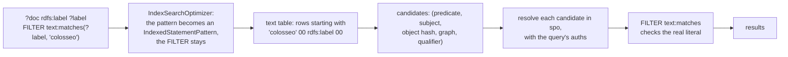

The index can only cost time, never change results:
- **Every hit is resolved:** each index hit is read back from `spo` with the query's own configuration (authorizations, TTL).
- **The filter still runs:** it makes the exact check on what comes back.

So an index entry that is too broad, or left behind by a failure, costs a lookup and returns nothing.

### 15.2 Index key layout

Both index tables use the same key layout (`IndexKeys`):

```
row        term-or-cell 00 predicate 00 subject 00 objectHash
family     graph IRI (empty for the default graph), as in spo
qualifier  the spo qualifier (normally empty)
visibility the statement's label
timestamp  the statement's timestamp
value      empty
```

- **`term-or-cell`** is a word (text index) or a geohash cell (geo index).
- **`objectHash`** is the first 8 bytes of SHA-256 over the object's Tripatha encoding (value and type), as 16 hex digits. The literal itself is never copied into the index.
- **Why the subject is in the row:** no row grows without bound, so tablets can still split under a very common word.

Real examples, from the running code:

```
ex:rome rdfs:label "Colosseo di Roma"@it          (text index: one entry per distinct word)
  colosseo 00 http://www.w3.org/2000/01/rdf-schema#label 00 http://ex.org/rome 00 ab142638208bc3bb
  di       00 http://www.w3.org/2000/01/rdf-schema#label 00 http://ex.org/rome 00 ab142638208bc3bb
  roma     00 http://www.w3.org/2000/01/rdf-schema#label 00 http://ex.org/rome 00 ab142638208bc3bb

ex:colosseo geo:asWKT "POINT(12.4922 41.8902)"^^geo:wktLiteral      (geo index: one cell)
  sr2yk3bs1772 00 http://www.opengis.net/ont/geosparql#asWKT 00 http://ex.org/colosseo 00 <hash>
```

### 15.3 Text analysis

`TextAnalyzer` splits text into the words that the index, the query parser and `text:matches` all use, so a word is spelled the same way everywhere:
1. **Normalize:** Unicode decomposition, lower case, combining marks (accents) removed, a few letters folded (`ß`→`ss`, `æ`→`ae`, `ø`→`o`, …).
2. **Split:** a word is a run of letters and digits. Each Han ideograph or Hiragana character is a word on its own.
3. **Cut:** words longer than 64 code points (`MAX_TERM`) are cut.

`"Colosseo di Roma — Café Ærø"` → `colosseo`, `di`, `roma`, `cafe`, `aero`.

Only `xsd:string` and language-tagged literals are text. `index.text.predicates` can restrict the index to some predicates (empty means all).

### 15.4 Text queries and their candidates

`TextQuery` parses the query language: words, `"phrases"`, `prefix*`, `AND` (or a space), `OR`, `NOT` and parentheses, with `NOT` binding tighter than `AND`, and `AND` tighter than `OR`.

`TextCandidates` turns a query into what the index can look up: a boolean expression of words and word prefixes, matched by every text that satisfies the query (and maybe more):
- **Phrases** become the AND of their words.
- **`NOT` parts** are dropped. The filter applies them later.
- **No lookup possible:** a query with no word that every match must contain cannot use the index. That covers a pure `NOT`, an `OR` with such a branch, and a prefix shorter than 3 characters (`MIN_PREFIX`).

```
alice AND (bob OR caro*) AND NOT "old draft"
  → AllOf[ Word alice, AnyOf[ Word bob, Start caro ] ]
```

`IndexSearcher` evaluates the candidate expression lazily:
- **Word or prefix:** a range over its rows, restricted to the predicate and graphs when known. Reading at most 1000 entries (`PROBE_LIMIT`) tells whether it is *small*. Small ones are kept in memory.
- **A word past the probe** is sized by its posting count (SCALE-STUDY.md O6), when the store's counts are complete; otherwise every large operand looks alike.
  - **The counts:** `<prefix>textcount` holds one counter per word, predicate and label, +1 per posting written and −1 per posting deleted, by every write path (writes, the bulk build, a rebuild).
  - **Complete:** they are, when the `ns` record `text.counts` holds the index's definition. A store created with the index has it; a redefinition drops it until a rebuild counts again.
  - **Drift:** a re-inserted statement counts twice, a graph drop doesn't adjust them, and a delete made while a rebuild's sort runs may leave one low. So they only order operands, never below the probe's limit. `query.textcounts=false` turns them off.
  - **Read rights:** an account that may not read `textcount` (Accumulo grants each table) still searches, and plans as without the counts.
- **AND:** the operand with the smallest estimate *drives*: its entries are streamed in chunks of 1000 (`VERIFY_CHUNK`), and each chunk is checked against the other operands. A check is an in-memory lookup if the operand is small, or one exact-key lookup per candidate in the index if not. A large prefix lets everything through, since the filter checks it anyway.
- **OR:** the union of its operands, without repeats.
- **Resolve:** candidates are resolved in chunks of 1000 (`RESOLVE_CHUNK`). One `batchQuery` on `spo` fetches each candidate's (subject, predicate) cells, and only the cells whose graph, qualifier and object hash match a candidate are kept.

### 15.5 Geo cells

A **geohash** names a rectangle of the Earth with a base-32 string. Each extra character divides a cell into 32 smaller ones, so **a cell's name is a prefix of the names of every cell inside it**. `sr2y` contains `sr2yk`, which contains `sr2yk3bs1772`.

`GeoCells` covers a shape with cells:
- **A point** gets one cell of 12 characters (`MAX_LEVEL`): a few centimetres.
- **A line or polygon** gets up to 32 cells (`K_STORE`), as fine as that budget allows. The cover always contains the shape, and the cells are grown by 10⁻⁹ degrees (`EPS`) before comparing, so shapes that only touch at a cell edge still share a cell.

For example, the small polygon `POLYGON((12.48 41.88, 12.50 41.88, 12.50 41.90, 12.48 41.90, 12.48 41.88))` is stored under 23 cells, from `sr2y7bp` to `sr2yk7`.

At query time, `GeoRegion` turns a filter into scans:

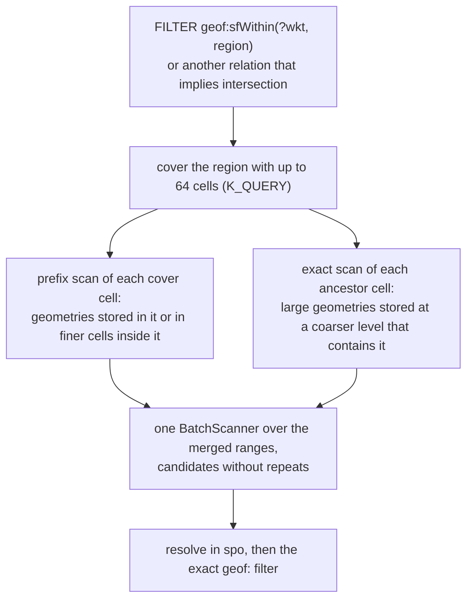

For the polygon above used as a query region: 54 prefix cells, plus the exact rows of the 11 ancestor cells `s`, `sr`, `sr2`, `sr2y`, `sr2y7`, `sr2y7b`, `sr2y7c`, `sr2y7f`, `sr2y7g`, `sr2yk` and `sr2yk0`.

Which filters can use the geo index:
- **Relations that imply intersection:** `sfEquals`, `sfIntersects`, `sfTouches`, `sfCrosses`, `sfWithin`, `sfContains`, `sfOverlaps`, their `eh*` and `rcc8*` equivalents, and `geof:relate` with a DE-9IM pattern that requires interiors or boundaries to meet.
- **Distances:** `geof:distance(?g, point, unit) < d` (or `<=`, or the reverse comparison). The circle is covered with cells and only points are looked up, since `geof:distance` rejects other geometries.

WKT is parsed with RDF4J's `SpatialSupport`. WKT that doesn't parse is stored but not indexed, and never matches.

### 15.6 Index lifecycle

An index is only usable if it covers every statement. `IndexManager` records each index's state in the `ns` table (row `tripatha`, family `index`, qualifier `text`, `geo` or `entity`): `READY` or `BUILDING`, plus its **definition**. Qualifier `job` names a running rebuild job. The definition is a string that captures the indexing rules (`text/1;max=64;preds=…`, `geo/1;k=32;lvl=12;eps=1.0E-9`).

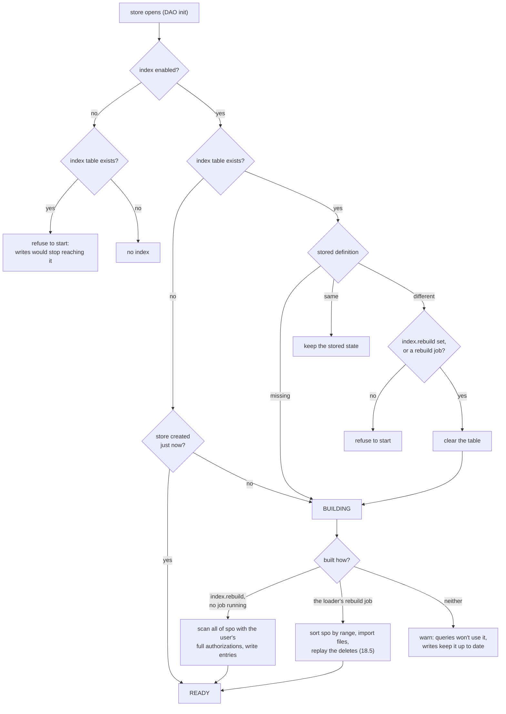

- **Writes:** while an index is enabled, every add and delete maintains it, whatever its state. While it is BUILDING, each delete is also recorded first (`RebuildLog`), for a rebuild job to replay ([section 18.5](#185-rebuild)).
- **States seen by other processes:** a store re-reads the states every minute (`index.state.refresh`) on a daemon thread, while it is used: readers start using an index a job made READY, and a writer whose index another process redefined refuses to write.
- **Queries:** queries use only `READY` indexes.
- **Versioned rules:** changing the analysis rules means bumping `TextAnalyzer.VERSION` or `GeoCells.DEFINITION`, so existing indexes are detected as different and must be rebuilt.

### 15.7 The query side, step by step

1. **`TextQueryValidator`** (always on) rejects a malformed constant `text:matches` query with a `MalformedQueryException`, which the endpoint maps to `400`.
2. **`IndexSearchOptimizer`** runs only when:
   - `query.useindex` is not false;
   - `query.limit` is not set;
   - at least one index is `READY`.

   For each chain of filters, it collects the conjuncts that can use an index, per variable. Text wins over geo on the same variable. It then looks for the statement patterns every filtered row must have come through: through joins, unions, nested filters, the left side of OPTIONAL and MINUS, and BINDs that don't rebind the variable. It replaces a pattern with an `IndexedStatementPattern` when:
   - its object is the filtered variable, unbound;
   - its subject is a variable;
   - the variable appears nowhere else in it;
   - for text, the index covers its predicate.
3. **`QueryJoinOptimizer`** sees the indexed pattern at a thousandth of the plain pattern's estimate (`SELECTIVITY`), so it usually runs first.
4. **At evaluation**, `RyaEvaluationStrategy` runs the pattern with RDF4J's own statement-pattern step over an `IndexTripleSource`:
   - neither subject nor object is bound: `IndexSearcher` searches the index;
   - otherwise (the pattern sits on the right of a join): a plain store lookup, which is cheaper and goes through the batched-join cache.

The index is **not** used when:
- the query sets Tripatha's `query.limit` (SPARQL `LIMIT` is fine);
- an embedded query sets the binding `query.useindex` to `false`;
- the plan starts elsewhere and reaches the pattern with its subject already bound.

**Testing:** with `-Dtripatha.test.indexes=true` every IT maintains both indexes, and `RyaSailITBase` checks each test's index tables against `spo` with `IndexVerifier`.

---

## 16. Security: visibility labels and authorizations

Tripatha passes Accumulo's cell-level security through to RDF statements: each statement has a visibility label, and each read uses a set of authorizations.

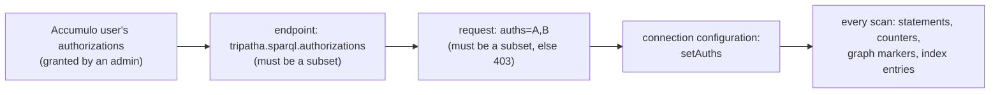

**Writing:**
- **The label:** a statement's label is the connection's `conf.cv`. On the endpoint that is `tripatha.sparql.default-visibility`. An update may set its own with `visibility=` when `tripatha.sparql.allow-request-visibility` is on, and the expression is checked first.
- **Where it goes:** the label is written on everything derived from the statement: the three statement cells, its counters, its graph marker and its index entries.

**Reading:** every scan uses the connection's authorizations. Readers therefore:
- see only the statements they may see;
- count only those in the statistics;
- list only graphs that have visible data;
- get index candidates only from visible entries, and resolve them against visible cells.

**Per-connection configuration.** Each connection clones the store's configuration, and each query clones the connection's. Per-request auths and labels must be set on `RdfCloudTripleStoreConnection.getConf()`, never on the store's shared configuration, which would leak them to every other request.

**Exceptions:**
- **Namespaces and state records:** the `ns` table (namespaces, storage version, index state) is read with empty authorizations and written without labels.
- **Index rebuilds** read `spo` with *all* of the Accumulo user's authorizations. Statements under labels the user lacks are not indexed, so the user that rebuilds must hold every label in the store.

**No HTTP authentication.** The endpoint does not authenticate users. Run it behind a proxy that does, or add Spring Security.

---

## 17. The SPARQL endpoint

### 17.1 Startup

`RyaSparqlApplication` is a Spring Boot application. `RyaStoreConfiguration` builds three beans:

1. **`Store`**, for `tripatha.backend`:
   - **Accumulo:** an `AccumuloStore` on a client built from `tripatha.accumulo.client-properties` (an `accumulo-client.properties` file, read with `AccumuloClients.fromFile`; if the file uses password authentication without a stored password, it comes from `tripatha.accumulo.password`, i.e. the `TRIPATHA_ACCUMULO_PASSWORD` environment variable), or from `tripatha.accumulo.instance`, `zookeepers`, `user` and `password`;
   - **HBase:** an `HBaseStore` from `tripatha.hbase.*`. It refuses to start when the account can't read a label of `tripatha.sparql.authorizations` (their canaries; see BACKENDS-STUDY.md 4.2).
   - **RocksDB:** a `RocksStore` on the directory `tripatha.rocksdb.path`, which this process alone can open.
2. **`StoreRdfConfiguration`**, from `RyaProperties` (`tripatha.*` in `application.yaml` or on the command line):

   | Setting | Configuration call |
   |---|---|
   | `tripatha.table-prefix` | `setTablePrefix` |
   | `tripatha.inference` | `setInfer` |
   | `tripatha.stats` | `setUseStats` and `setMaintainStats` |
   | `tripatha.join-batch-size` | `setJoinBatchSize` |
   | `tripatha.text-index`, `tripatha.text-index-predicates`, `tripatha.geo-index`, `tripatha.rebuild-indexes` | `setTextIndex`, `setTextIndexPredicates`, `setGeoIndex`, `setRebuildIndexes` |
   | `tripatha.sparql.authorizations` | `setAuths` (the most any request may read with) |
   | `tripatha.sparql.default-visibility` | `setCv` (the label written on inserts) |
   | `tripatha.inference-refresh` | the inference engine's refresh period |
3. **`SailRepository`**, built by `RyaSailFactory.createSail` and initialized at startup. Initialization:
   - opens the DAO: tables, combiner, version, index states, and an optional index rebuild;
   - opens the statistics reader;
   - loads the ontology when inference is on.

   It shuts down with the application.

The store belongs to Spring, which closes it (and its client) after the repository.

### 17.2 Handling a request

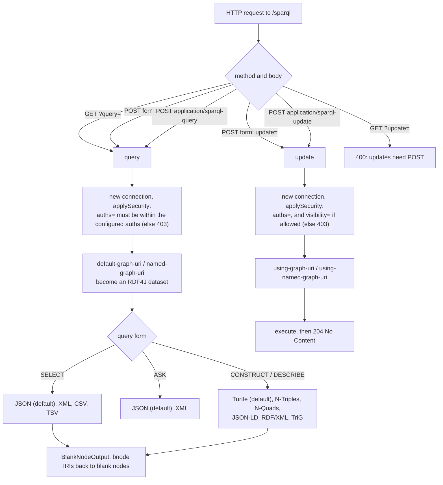

- **Tracing:** `trace=<id>` streams the request's Accumulo operations to `/sparql/trace/<id>` ([section 17.5](#175-tracing-a-query)).
- **Formats:** `ContentNegotiation` picks the format from `Accept`, by quality and then by the client's order. The first format of each list is the default. If nothing supported is acceptable, the answer is `406`.
- **Time limit:** every query and update gets RDF4J's maximum execution time:
  - by default `tripatha.sparql.query-timeout` (120 s);
  - or the request's `timeout=` parameter, in whole seconds, up to `tripatha.sparql.max-query-timeout` (30 min by default; `0s` for no limit). The query page sends it from its **Timeout** field.
- **RDF 1.2 output:** `BlankNodeOutput` restores blank nodes inside triple terms too. `DirectionJsonWriter` writes a literal's direction in SPARQL JSON as `"its:dir": "rtl"`, where RDF4J 6.1 writes `"--rtl"`.
- **Errors:** `SparqlExceptionHandler` maps them to plain-text answers:

  | Status | Cause |
  |---|---|
  | `400` | malformed query, or a bad parameter (including a `timeout=` that isn't a positive whole number) |
  | `403` | `auths=` beyond the configured auths, `visibility=` while it is disabled, or `timeout=` above the maximum |
  | `406` | no acceptable result format |
  | `503` | timeout |
  | `500` | anything else |

### 17.3 The query page

`src/main/resources/static/index.html` and `ui/` hold the browser page:
- **`tripatha-ui.js`** sets up YASGUI on `/sparql`, with the Examples menu and header fields the browser remembers: **Authorizations** (sent as `auths=`), **Timeout** (sent as `timeout=`) and the **Trace** switch.
- **`tripatha-trace.js`** is the resizable trace panel on the right ([section 17.5](#175-tracing-a-query)).
- **`tripatha-sparql12.js`** adds RDF 1.2 to YASGUI 4, which knows SPARQL 1.1 only, by replacing a few of its methods at load time (YASGUI's files are not changed):
  - `Yasqe.checkSyntax`: a small tokenizer of our own looks for SPARQL 1.2 syntax. A query that has some loses YASGUI's error marker, is highlighted by that tokenizer (a CodeMirror overlay), and gets its query-or-update kind from it. Other queries are left to YASGUI.
  - YASR's response parser: triple terms in SPARQL JSON are turned into bindings the table can hold, and N-Triples is read by our own N-Triples 1.2 reader. `tripatha-ui.js` asks for graph results in Turtle, and in N-Triples when the query uses SPARQL 1.2 syntax. When a Turtle result holds RDF 1.2 values (RDF4J starts it with `@version "1.2"`, and only then), it remembers the query and runs it once more in N-Triples.
  - The table plugin's cell renderer: triple terms as `<<( s p o )>>`, and the direction of directional literals.
- **`tripatha-map.js`** draws `geo:wktLiteral` results on a map.
- **`wkt.js`** turns WKT into GeoJSON.

The third-party files (YASGUI, the map library, …) are not in the repository. At build time, `maven-antrun-plugin` downloads pinned npm tarballs into `~/.m2/repository/.cache/tripatha-ui`, checks their SHA-512, and unpacks them into `static/vendor`. `SparqlUiIT` checks that every asset is served.

### 17.4 Running it

- **`tripatha.sparql/configure.sh`** (bash 3.2 compatible) asks for the settings and writes a launch script that passes them as `--tripatha.*` arguments. Only the password travels in the environment (`TRIPATHA_ACCUMULO_PASSWORD`), and the script never stores it.
- **`DevServer`** (test sources) runs the endpoint on a throwaway MiniAccumuloCluster.

### 17.5 Tracing a query

A trace answers *what does this query do in the store?* while it runs. It covers the plan RDF4J builds, every scan with its ranges, columns, iterators, entries and time, every flush of writes, and the reason Tripatha had for each.

**Recording (`tripatha.store`, package `trace`).**
- **Every backend reports the same way.** A store opens each read through `TracedScans.open(...)`, which reports the table, the ranges, the columns, the server-side filters and the labels, then counts the cells returned and the time spent in `hasNext()` and `next()`. A visible-cell delete is reported with `TracedScans.started(...)`. Writers call `trace.wrote(...)` for each row mutation and `trace.flushed(...)` when the writes are sent.
  - **What stays particular to a backend** is the name of the operation and the list of filters. Accumulo reports `Scanner`, `BatchScanner` and `BatchDeleter`, and lists the scan iterators it attaches, each with its priority, name, class and options (`AccumuloStore.describe`): `8 riq`, `9 fi`, `11 ri`, and any iterator a caller added. HBase reports `Get`, `Scan` and `BatchScan` with its filters, RocksDB `Scan` and `BatchScan` with the checks its scanner makes.
  - Without a trace, a read costs one thread-local lookup.
- **Reasons come from the call sites.** Code that is about to scan opens `StoreTrace.reason(() -> "…")` around creating the scanner. Reasons nest, so a scan can read `batched join: 5 right-hand lookups fetched together › batched lookup of 5 patterns on SPO`. Reasons are recorded by: the query engine (lookups, batched lookups), the statistics reader, graph sizes, the index searcher, the DAO (deletes, graph drops, graph list, size, namespaces), the batched join, inference (transitive closures, `owl:sameAs`), and query planning.
- **Plans.** `RdfCloudTripleStoreConnection.evaluateInternal` reports the tree as parsed and as optimized. When traced, it prepares the optimized tree exactly as `evaluate` would and then reports it, so the plan shows which joins became `RyaBatchedJoin`. Tracing doesn't turn on RDF4J's own result-size or time tracking, which would turn batched joins off.
- **Progress of long scans.** A scan's counters live in its iterator: entries, time inside Accumulo calls, the call in progress (if any) and the last key read. A daemon thread (`tripatha-trace-progress`) asks every running trace once a second for a `progress` event. The event lists each scan that has run for at least a second: its entries so far, the time spent, how long the current call has been waiting for the tablet servers, and the last row it read. A long scan therefore shows where it is in the table instead of looking stuck. Progress is only read, never written, by that thread.
- **One trace per thread.** A trace lives in a `ThreadLocal` from `StoreTrace.start(listener)` until its `Scope` is closed, which reports the `summary`. Scans capture their trace when they are created, so closing one from another thread still reports to the right trace.
- **Caps.** Up to 1,000 scans and flushes are reported one by one, with at most 10 ranges each. Past that, only the totals grow, and the summary says how many were left out.

**Streaming (`tripatha.sparql`).**

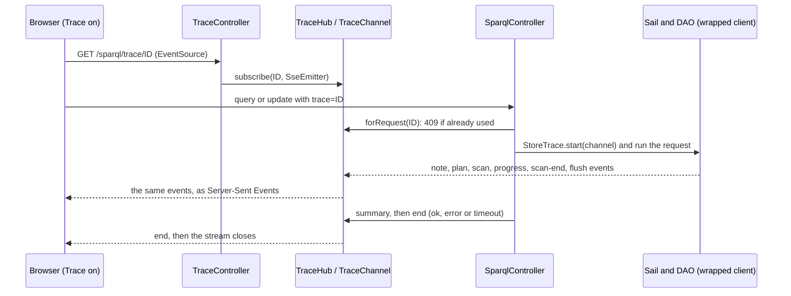

- **Pairing:** the page chooses a random id and opens the stream before sending the request. `TraceHub` pairs the two, whichever arrives first. Events that arrive before the stream connects are kept (up to 5,000).
- **Expiry:** a channel whose other half never shows up is dropped after 2 minutes.
- **The reader never slows the query:** a failed or slow send only stops the stream, never the query.
- **Clean-up:** the request always closes the trace in a `finally`, so a pooled server thread is never left traced. Otherwise it could report another user's next request.
- **Turning it off:** `tripatha.sparql.allow-trace=false` refuses both sides with `403`.

**The panel (`ui/tripatha-trace.js`)** is an `aside` to the right of the editor and results, as tall as the window, with its own scroll.
- **Contents:** the notes (the query and its authorizations), the two plans, one card per scan or flush, and a per-table summary.
- **While the query runs:** the header shows a running clock, and each running scan's card shows its entries so far, the row it has reached, and any wait for the tablet servers.
- **Resizing:** the divider before it resizes it by dragging or with the arrow keys.
- **Folding:** the **⟩** button folds it into a vertical tab, which blinks while the selected tab's traced query runs.
- **One trace per query tab:** the panel shows the selected tab's trace and switches with the tab. A tab keeps its stream open until `end` arrives, its next query starts, or it closes, so a query in a tab that isn't selected keeps being traced. A query run with Trace off clears its tab's trace.
- **Memory and narrow screens:** the width and the folded state are kept in `localStorage`. Below 900 pixels the panel goes under the results. It writes everything as text, and shows the separator bytes as small badges.

---

## 18. The synthetic-data loader

`tripatha.loader` generates a synthetic dataset (people, organizations, cities, landmarks, events, products, reviews, articles, sensors, observations…) and writes it through the normal DAO, in parallel, for stress tests of up to billions of triples. It is a Spring Boot executable jar run with `tripatha.loader/run.sh`.

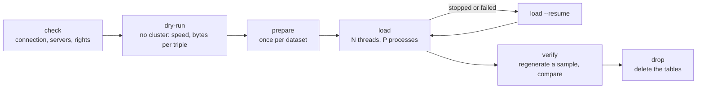

### 18.1 Deterministic generation

`EntityGenerator.generate(i)` returns the statements of entity `i`, about 7.5 on average. The result depends only on the dataset seed and `i`:
- **Randomness:** each entity uses its own `SplitMix64` random streams (graph and label, anchor, geometry, text). `SplitMix64` is implemented in the project, so the data never changes with the Java version.
- **Classes:** `ClassLayout` deals entity numbers into 1000 slots by weighted round robin, so classes interleave evenly and the `r`-th member of a class is found in O(1). Links can then point at random members of a class without generating them.
- **One timestamp:** each dataset uses one fixed timestamp, so writing an entity again produces exactly the same keys.

So any process can generate any range of entities, and a rerun after a failure overwrites what was there with identical cells. `GenConfig.fingerprint()` identifies a dataset.

### 18.2 `prepare`

`prepare` runs once, from one process, before any `load`:
1. **One DAO `init`** creates the tables. The index tables are created together with the store, so the indexes start `READY` ([section 15.6](#156-index-lifecycle)). Several processes initializing at once could race, which is why only `prepare` does it.
2. **`SplitPlanner` pre-splits every table**, about 4 tablets per tablet server. It samples entities, serializes their rows with the same code as the DAO, takes quantiles of the rows each table would receive, and shortens each split point to the shortest prefix that still separates it from the previous row. Writes then spread over all servers from the first second.
3. **`ReferenceData`** writes the ontology, 200 countries and a description of the dataset that includes its fingerprint.

### 18.3 `load`

```mermaid
sequenceDiagram
    participant M as Loader
    participant Wk as Worker thread (one DAO each)
    participant G as EntityGenerator
    participant D as RyaStoreDAO (flush off)
    participant P as Progress file
    M->>M: StoreCheck.forLoad (same dataset, same index settings)
    M->>Wk: start --threads workers
    loop until no blocks are left
        Wk->>M: claim the next block from the shared cursor
        Wk->>G: generate each entity of the block
        Wk->>D: add(all statements of the block), counters summed once
        alt the commit interval has passed
            Wk->>D: flush()
            Wk->>P: record the blocks written since the last flush
        end
    end
    Wk->>D: flush()
    Wk->>P: record the remaining blocks
```

- **Workers:** each worker thread has its own DAO, because `add` is synchronized per DAO. Its batch-writer settings come from the options (buffer, writer threads, latency, timeout, durability).
- **Blocks:** blocks of entities (`--block-size`, default 1000) are claimed from a shared counter. Each block is written with one `add`, so its statistics counters are summed before they are sent ([section 9.3](#93-counters-are-summed-before-they-are-written)).
- **Counters of 1:** a subject's statements all come from its own entity, so a block's `s`, `sp` and `so` sums are final totals. By default the block's add leaves out those equal to 1 (`--stats-ones skip`; `keep` writes them).
  - `prepare` writes the reference data the same way, in one call.
  - `SplitPlanner` and `dry-run` count as the load writes.
  - `verify` expects no cell where a label's count is 1.
  - `EntityGeneratorTest` checks that no subject spans two entities.
- **Progress:** a block is recorded in the progress file only after a flush that followed it. The file is written atomically (temporary file, then rename) and carries a fingerprint of the options, so `--resume` never mixes two loads. `--resume` skips recorded blocks and writes the others again. That is harmless for the statement tables (identical keys), but the counters of blocks in flight during a failure may be counted twice.
- **Parallelism:** `--part K --parts N` divides the entities between processes, on one or several machines.

### 18.4 `verify`

`verify` regenerates a random sample of entities. It checks, under the reader's authorizations, that:
- every statement the reader may see is in `spo`, and nothing else is;
- each subject's counter equals its number of visible statements.

---

### 18.5 `rebuild`

`rebuild` builds a store's indexes that aren't READY (SCALE-STUDY.md O5, 4.23) as a batch job, for any store, loaded by this tool or not. The options name the indexes as the endpoint has them (`--text-index`, `--geo-index`, `--entity-index`); every phase resumes (`--resume`):

1. **start:** the store, opened with the job's id, marks those indexes BUILDING for the job (clearing a redefined one) and records the job in `ns`.
2. **sort:** `spo` read by split range on threads (and processes, `--part`/`--parts`) with every label the account holds; each statement's index cells spilled to sorted runs, recorded with their range and a sample of its rows.
3. **merge:** the index tables split from the samples, as `prepare` splits a store; then each table's runs merged per row range into files in the backend's format (`BulkFiles`, shared with `build`).
4. **import:** every file once.
5. **finish,** once every part has imported: the deletes recorded during the job replayed, then the indexes READY.

**Writes go on.** The endpoint may write meanwhile, with the same index settings:
- **Adds** are indexed by their writers, as for any BUILDING index.
- **Deletes** are recorded in `ns` before they are made (`RebuildLog`), because an imported file would bring back the index cells of a statement deleted after the sort read it. The finish deletes those of every recorded cell no longer in `spo`, at its own timestamp, and writes again those of one added back. A second pass covers the deletes made during the first.
- **Graph drops and `purge` are refused** until the job finishes: they delete by column filter, with nothing to replay. So is a store opened with other settings for an index the job builds: it would clear the table.
- **Version:** the job's start raises the store to `1.3.0`, so older code, which records nothing, refuses to write to it.
- **Restarts:** to change an index's definition, stop the writers, run `rebuild --phase start`, then start them with the new settings; readers pick up READY by themselves.

On RocksDB only one process opens the store, so nothing else writes during the job.

### 18.6 The Spark build

`tripatha.spark` is the bulk build as a Spark job, for Accumulo (SCALE-STUDY.md O28, 4.28). It reads the generator's entities (into a store `prepare` made) or N-Triples and N-Quads files (into a new store, or one that holds statements with `--append`). It runs as `spark-submit --class org.tripatha.spark.SparkBuild` with the module's job jar, in two recorded phases, `write` and `import`:

```mermaid
flowchart LR
    plan["driver: sample, split points,<br/>file boundaries"] --> cells["tasks: statements → the DAO's cells<br/>(empty store, nothing connects)"]
    cells --> shuffle["shuffle: one partition per file,<br/>sorted in Accumulo's key order"]
    shuffle --> rfiles["tasks: one RFile each,<br/>on Accumulo's volume (S3, HDFS)"]
    rfiles --> import["driver: import per table<br/>with load plans"]
```

- **The same cells as `load`:** each task writes through a `RyaStoreDAO` over a `CapturingStore` of an `EmptyStore` holding the real store's tables. Counters are added up in the tasks and, after the sort, by each file's writer. Totals of 1 are left out by `BulkBuild.leftOut`, and only where the totals are the store's.
- **Files:** each table's tablets, cut further at sampled rows into files of about `--file-size` (at most 50 per tablet). The entity index's shard rows are spread by column hash. The RFiles must be on one of Accumulo's volumes, since Accumulo imports only from those.
- **Once each:** one timestamp per job, files named after their table and range, no speculation. Once an import starts, the files are never written again; a file that is gone was imported, and a directory that still holds Accumulo's `loadmap.json` is not imported again.
- **Files as input:** read by line in parallel; each blank node label is prefixed with its file's id, so every split of a file agrees on it; bad lines are counted and left out up to a limit; `--distinct` drops repeats; `--visibility` labels the job's statements.
- **`smoke`** checks a cluster before a build: executors write an RFile each under the work directory, and the driver imports and reads them back.

## 19. Test infrastructure

- **Naming:** `*Test` classes are pure unit tests (surefire, `mvn test`). `*IT` classes need a cluster (failsafe, `mvn verify`).
- **`MiniAccumuloSingleton`** and **`MiniHBaseSingleton`** start one in-process cluster per test JVM, on first use, and stop it with a shutdown hook. The HBase one runs `VisibilityController` with authorization on, and tests use it as a normal account, since the process user is a superuser who sees every cell.
- **`RocksDBTestBackend`** opens one RocksDB database per test JVM in a temporary directory, deleted when the JVM exits. It needs no cluster, so the ITs run on it in seconds.
- **`StoreITBase`** gives each test, on the backend of `-Dtripatha.test.backend` (`accumulo` by default, `hbase` or `rocksdb`):
  - a `Store`;
  - a unique table prefix, whose tables are deleted afterwards;
  - `grantAuthorizations(...)`. Accumulo rejects scans with labels the user doesn't hold and HBase ignores them, so visibility tests must call it.
- **`AccumuloITBase`** gives Accumulo-only tests a root `AccumuloClient`.
- **`RyaSailITBase`** (`tripatha.sail`) adds `newConf()`, `newDao(conf)` and `newStore(conf, inference)`.
- **System properties that widen coverage:**

  | Property | Effect |
  |---|---|
  | `-Dtripatha.test.joinBatchSize=2` | every batched join crosses chunk boundaries |
  | `-Dtripatha.join-batch-size=2` | the same, for the endpoint tests |
  | `-Dtripatha.test.indexes=true` | every test maintains both indexes, then `IndexVerifier` checks that each index table holds exactly the entries its statements call for |
  | `-Dtripatha.test.backend=hbase` | the ITs run on the HBase mini cluster |
  | `-Dtripatha.test.hbaseCounters=increment` | HBase counter tables use increments instead of the coprocessor |
  | `-Dtripatha.test.backend=rocksdb` | the ITs run on an embedded RocksDB database |
  | `-Dtripatha.test.lookupThreads=3` | every batch of disjoint lookups is read, or counted, on three threads |
  | `-Dtripatha.test.prefetchAhead=true` | every entity prefetch fetches its next window on another thread |
  | `-Dtripatha.test.countUnused=false` | no lookup is counted (section 13.8): the whole suite reads statements |
  | `-Dtripatha.test.hbaseIntersectPage=1` | HBase's intersection endpoint ends every page after one match and one cell (section 13.7) |

- **Coverage:** `-Pcoverage` adds JaCoCo to both test phases and merges the reports in `tripatha.coverage`.

## 20. Speed and scale: the optimizations

Tripatha's design has two performance goals, and every optimization below serves at least one of them:
- **One machine, against single-instance engines:** a RocksDB store served by the native executable, measured against QLever and Oxigraph on WatDiv, the one standard benchmark used for comparisons (SCALE-STUDY.md 4.13).
- **10^12 triples on a cluster** of Accumulo or HBase servers:
  - no step may funnel a large share of the data through one client;
  - loads must go in bulk;
  - tables must be sized for thousands of tablets or regions (SCALE-STUDY.md sections 1 to 3).

The rule for all of them: an optimization must hold on all three backends, at 10^12 triples, with the same answers. Where a step runs in the servers (an Accumulo iterator, an HBase coprocessor), the client does the same work when the server code isn't deployed: same answers, more data moved.

This section lists them in one place, with what each does, where it runs, its gain as measured, and where it is explained in detail. [SCALE-STUDY.md](SCALE-STUDY.md) is the tracker: its section 2 numbers them (`O…`), and its section 4 holds the measurements.

**Where it stands on WatDiv** (SCALE-STUDY.md 4.27 and the README's [Benchmarks](README.md#benchmarks): 100 queries of 20 templates at scale factor 100, on one machine, 2026-11-21, commit `c1e1968`). p50, geometric means:

| | Tripatha | QLever 0.6.0 | Oxigraph 0.5.13 |
|---|---|---|---|
| All 100 queries | **2.3 ms** | 9.5 ms | 3.8 ms |
| Complex (C1 to C3) | **54.7 ms** | 65.0 ms | 398.7 ms |
| Small (S, L, F) | **1.28 ms** | 6.79 ms | 1.66 ms |
| Templates where it's the fastest | **13** (5 tied) | 3 | 9 |

### 20.1 Joins: fewer round trips

A nested-loop join asks the store once per row; on a cluster each ask is a network round trip. These make a join's lookups few and large:

| Optimization | What it does | Gain | Details |
|---|---|---|---|
| Batched joins | A window of left rows' lookups is one batch scan per table. Windows start at 64 rows and double up to 1,000 (O15), so a `LIMIT` stops early | the basis of every join here | [13.1–13.4](#13-batched-joins) |
| Left-deep joins | `LeftDeepJoinOptimizer` turns RDF4J's right-nested joins into left-deep ones, so every join has its rows on the left and a pattern on the right | makes the batches possible | [13.1](#131-the-problem) |
| Entity prefetch | A chain of joins and OPTIONALs over one driver (an entity's attributes) fetched together, per window | one batch for the whole chain | [13.5](#135-entity-prefetch-a-chain-of-joins-at-once) |
| More lookups in flight (O16) | A batch of disjoint lookups read on several threads (4 by default on RocksDB); the next window fetched while the current one is joined | WatDiv C3 −50 %, the complex queries 112.2 → 97.7 ms | SCALE-STUDY.md 4.14 |
| Less work per looked-up row (O17) | A batch whose ranges can't overlap skips the cell check and the objects' re-encoding; rows decoded in one pass | WatDiv C3 −41 %, complex −24 %, all 100 −11 % | SCALE-STUDY.md 4.14 |
| Planning's reads together (O27) | The counters every pattern's estimate needs, read in one batch scan before join ordering | the median plan −27 % on the Accumulo test cluster (1.69 → 1.23 ms), −26 % on HBase; on Accumulo, planning had been half a small query's time | [11.2](#112-how-a-patterns-cardinality-is-estimated), SCALE-STUDY.md 4.26 |
| Counted patterns (O26) | A joined pattern whose object nothing else uses asks for a count per lookup, and repeats its row that many times: counted by the store without reading: RocksDB in its process, Accumulo in its tablet servers, HBase in its region servers | WatDiv C3-01 in-process −37 to −49 %; `star-unused` 23 % fewer cells to the client on Accumulo, 12 % on HBase | [13.8](#138-counted-patterns-a-matchs-number-not-its-statements) |
| One range per subject (O21) | A subject's links read as one range | built, off by default: no gain on a warm cache | [13.4](#134-keeping-the-answers-identical) |

### 20.2 Reading only what the query needs

| Optimization | What it does | Gain | Details |
|---|---|---|---|
| The table per pattern | Every statement in `spo`, `po` and `osp`, so any pattern is one range of one table | the base layout | [7](#7-storage-layout), [8](#8-from-a-triple-pattern-to-a-range-scan) |
| Statistics for join order | Cardinality counters per subject, predicate, object and pair, summed by the store, feed RDF4J's join optimizer | plans from real sizes | [11](#11-statistics-and-join-ordering) |
| The object's type as a row suffix (O20) | The type check is a byte comparison on RocksDB and one linear expression on Accumulo and HBase | | SCALE-STUDY.md O20 |
| `STRSTARTS` as a prefix range (O13) | The objects starting with the prefix are read, the filter kept | | [12.8](#128-strstarts-as-a-prefix-range) |
| Comparisons as value ranges (O14, O25) | `?o > 60` reads only the matching values, one range per stored type, with a real estimate for the join order | range queries 5 to 36 times faster on Accumulo, `class-value` 26 times | [12.9](#129-comparisons-as-value-ranges) |
| Text and geo indexes | Search filters read candidates from an index; the filter stays exact | | [15](#15-text-and-geo-search) |
| Text planning from posting counts (O6) | A word past the 1,000-entry probe is sized by its counter, so an `AND`'s rarer word drives | the join benchmark's `text-and` 291.5 → 112.3 ms on RocksDB 10M, 270.6 → 212.5 ms on Accumulo 3M; the load +8 %, the counts 0.4 % of the store | [15.4](#154-text-queries-and-their-candidates), SCALE-STUDY.md 4.25 |
| Approximate counts (O8) | `stats:approxSize`, `stats:approxInstances` and `stats:approxTriples`: graph, class and predicate sizes from the counters, one counter row each | a class's size: 0.4 ms and 1 cell against 12.4 ms and 53,432 cells counted (RocksDB 10M); constant at any size | [11.4](#114-graph-sizes-from-the-counters), [11.5](#115-class-and-predicate-sizes), SCALE-STUDY.md 4.24 |

### 20.3 Stars: merged, then intersected in the servers

"All entities matching X" (`?x a :Person ; :worksFor :Acme ; :nationality :IT`) is the shape that grows worst: at 10^12 each list holds billions of subjects.

| Optimization | What it does | Gain | Details |
|---|---|---|---|
| Merge joins (O22) | The star's constant patterns read as subject-sorted `po` lists and intersected, instead of one lookup per row | Accumulo `class-large` 1,446 → 137 ms, `class-2` 267 → 47 ms; HBase `class-large` 506 → 149 ms | [13.6](#136-merge-joins-a-stars-constant-patterns-intersected) |
| Slices and subjects only (O24) | Lists cut at `spo`'s split points and intersected on several threads; only each cell's subject read | 1.6 to 2 times on Accumulo and HBase, 3 on RocksDB; 3.7 times at 100M | [13.6](#136-merge-joins-a-stars-constant-patterns-intersected) |
| One large pattern as a merge (O7a) | A class on its own read as a merge of one list, in slices | 2.8 times on RocksDB and 2.3 on Accumulo at 10M, 4.9 times at 100M | [13.6](#136-merge-joins-a-stars-constant-patterns-intersected) |
| The entity index (O23) | Every posting also in a table sharded by subject; each shard's lists intersected by the store: Accumulo's tablet servers (an iterator), HBase's region servers (a coprocessor endpoint, D14), RocksDB's native seeks | stars 2.3 to 4 times faster on Accumulo and RocksDB, 39 to 81 % on HBase; costs 17 % more disk and a fifth of the load rate | [13.7](#137-the-entity-index-stars-shard-by-shard) |
| Counts in the store (O23) | A star's or a class's `COUNT` asked of the store: one number per shard comes back | counts 2.7 to 4.2 times faster on Accumulo, `count-class` 4 times | [13.7](#137-the-entity-index-stars-shard-by-shard) |

### 20.4 One machine: RocksDB and the native executable

| Optimization | What it does | Gain | Details |
|---|---|---|---|
| The RocksDB backend | An embedded store in the query's process: keys sort in Accumulo's order with RocksDB's own comparator (no Java comparator, which costs a JNI call per comparison); counters are a merge operator | no network at all | BACKENDS-STUDY.md 10 |
| Key decoding in runs (O19, O17) | Keys copied run by run between escapes, rows decoded in one pass | | SCALE-STUDY.md O19, 4.14 |
| The native executable's heap | Served with `-Xms` equal to `-Xmx`: the native Serial collector sizes its young generation from the minimum heap | WatDiv C3 −38 %, the complex queries −21 % | SCALE-STUDY.md 4.15 |
| Profile-guided build | Oracle GraalVM's `--pgo`, trained on the join benchmark (never WatDiv): `build-optimized.sh` | all 100 −11 to −16 %, complex −10 to −19 % | SCALE-STUDY.md 4.15 |

### 20.5 10^12 triples: loading

| Optimization | What it does | Gain | Details |
|---|---|---|---|
| Counters summed before they are written | A call's deltas summed per key, one cell each; a subject's counters of 1 left out, the planner reading a missing counter as 1 (O1) | 6.48 → 3.09 counter cells sent per triple | [9.3](#93-counters-are-summed-before-they-are-written), SCALE-STUDY.md 4.2 |
| HBase counters by coprocessor | Deltas as plain puts, summed on reads, flushes and compactions by `CounterObserver`, instead of increments that lock a row and sync the log each | | BACKENDS-STUDY.md 4 |
| Splits sized for 1T (O2) | `prepare` plans each table's splits from its estimated size on disk (10 GB per tablet or region), and makes that the backend's split size; HBase splits in rounds; the progress file stays a few bytes | about 2,100 tablets per statement table at 1T | SCALE-STUDY.md 4.16 |
| Index rebuilds as a batch job (O5) | The loader's `rebuild`: `spo` sorted by range into the indexes' files, imported; deletes made meanwhile recorded and replayed, graph drops held | Accumulo test cluster 3M: 16.6 → 5.8 s; RocksDB 10M: 18.5 → 9.3 s; the start-up rebuild's single thread (64 days at 10^12 at its 3M rate) becomes a job that scales with its machines | [18.5](#185-rebuild), SCALE-STUDY.md 4.23 |
| The bulk build (O3, O10) | Sorted files per table and range, merged, then imported: RFiles on Accumulo, SST files on RocksDB, HFiles with label ordinals on HBase. Counter totals of 1 left out (89.5 % of them) | 0.56 counter cells stored per triple; at 10M 13 times faster than `load` on the Accumulo test cluster, with an `eval` 90 % smaller; 1.5 times on RocksDB; on HBase 31 against 45 s at 3M | [18](#18-the-synthetic-data-loader), SCALE-STUDY.md 4.18–4.20 |
| The bulk build as a Spark job (O28) | Accumulo: the DAO's cells made in Spark's tasks, sorted by its shuffle into one RFile per tablet range, written to Accumulo's own volume (S3 or HDFS) and imported; from the generator or from N-Triples and N-Quads files | 10M on one machine: 63.5 s against `build`'s 50.8 s; WatDiv's 10.95M triples from N-Triples in 52.3 s; on a cluster, every executor sorts and writes | [18.6](#186-the-spark-build), SCALE-STUDY.md 4.28 |

### 20.6 10^12 triples: reading in the servers

At 10^12 what must not happen is a client reading billions of cells to keep a few. So work moves to where the data is, and only what the answer needs comes back:
- **Filters in the servers:** Accumulo's scan iterators apply the row and qualifier expressions and the time range, and `SummingCombiner` adds up counters ([3.5](#35-iterators), [8.2](#82-what-the-scan-adds-on-top-of-the-range)). HBase does the same with its filters and `CounterObserver`.
- **One read per region:** `HBaseBatchScan` reads many ranges as one multi-get plus one scan per region, in parallel.
- **Intersections in the servers:** the entity index's shards, intersected by Accumulo's iterator and HBase's endpoint. Only matches or counts come back (20.3).
  - HBase's endpoint answers in pages: a 200M-posting shard never holds a call past its timeout.
  - It applies the caller's labels through the region's own `preScannerOpen`.
- **Parallel by split:** merges and single large patterns are cut at `spo`'s split points, one thread per slice (O24, O7a).
- **Counts instead of matches:** a star's `COUNT` (O23), and the lookups of a pattern whose object nothing else uses (O26), counted in Accumulo's tablet servers by `RangeCountingIterator` and in HBase's region servers by `RangeCountEndpoint`: one number per range comes back.

### 20.7 Still open

- **Graph drops** still scan every table (D8 (c): O4 closed); index rebuilds are a batch job (O5, 20.5), and `purge` stays as it is.
- **Layout:** a dictionary encoding (O11), conditional on M5. The hashed row prefix is deprecated (O9, [7.6](#76-alternative-hashed-layout)).
- **Analytics** over the whole store, which need an engine of their own (O12).
- **Cluster defaults:** Accumulo and HBase read a batch on one thread and don't fetch ahead until both are measured on a cluster (M3, M4).
- **The 10^10 and 10^12 milestones** need a cluster.

---

## 21. Invariants

Breaking any of these loses data or results, or makes the store refuse to start:

1. **No `00` or `01` in encoded values.** They split rows. Use mango's encoders, never Accumulo lexicoders ([section 7.4](#74-why-00-and-01-are-reserved)).
2. **Don't change existing encodings.** Every stored row and every range depends on them. For example, adding a `wktLiteral` type resolver would change how the existing objects are stored.
3. **Index terms depend only on what `spo` stores.** Deletes recompute them from the stored statement.
4. **Index puts and deletes use the statement's timestamp**, like the statement tables.
5. **Changing the text or geo rules means bumping `TextAnalyzer.VERSION` or `GeoCells.DEFINITION`**, so existing indexes are rebuilt.
6. **An index table never exists while its index is off.** It would silently stop receiving writes.
7. **A batched-join prefetch is complete or absent.** A key missing from it must mean "ask the store".
8. **Blank nodes are IRIs in `RyaSchema.BNODE_NAMESPACE`** everywhere inside the Sail. The inference engine relies on it.
9. **`null` context:** any graph in a Tripatha pattern, the default graph in RDF4J.
10. **Per-request settings go on the connection's configuration**, never on the store's.
11. **New query nodes clone their `Var`s.** RDF4J 6 allows one parent per `Var`.
12. **`init()` must not write to an existing store.** Read-only users must be able to open it.
13. **One DAO, one writer thread.** Parallel writers use separate DAOs.
14. **A triple term is never a constant `Var` of a statement pattern.** It is bound through a row (`TripleTermOptimizer.fold`); RDF4J's statement-pattern step would otherwise give one `Var` two parents.
15. **A triple-term range only narrows.** The `TripleRef` that follows checks every result, as index searches are checked against `spo`.
16. **Every statement of a flagged store has its datatype marker.** Every `add` writes them, only a purge removes them, and a DAO never writes to a store newer than itself. A missing marker would hide the statements of its type from comparisons.
17. **A value range only narrows.** The filter stays and decides every row ([section 12.9](#129-comparisons-as-value-ranges)).
18. **Every stored statement has exactly one entity posting** when the entity index is on. Its matches are answers, not candidates: a missing posting loses rows, a stale one adds them ([section 13.7](#137-the-entity-index-stars-shard-by-shard)).
19. **A store with the entity index has storage version 1.2.0,** so code that doesn't keep the index never writes to it.
20. **A statement deleted during a rebuild stays out of the index.** While an index is BUILDING, each delete is recorded before it is made, and a job's finish replays the record after its import; graph drops wait for the job. A store that has had a job is at version 1.3.0, so code that records nothing never writes to it ([section 18.5](#185-rebuild)).

---

## 22. Glossary

| Term | Meaning |
|---|---|
| **Authorizations** | The labels a scan presents. A cell is returned only if its visibility expression is satisfied by them. |
| **BatchScanner** | Accumulo reader that scans many ranges in parallel and returns results unordered. |
| **BatchWriter** | Accumulo writer that buffers mutations and sends them in the background. `flush()` waits for them. |
| **Binding set** | One solution of a query: values for some variables. |
| **Cardinality** | Estimated number of results of a pattern, used to order joins. |
| **Column family / qualifier** | Second and third parts of an Accumulo key. Tripatha puts the graph IRI in the family. |
| **Combiner** | Accumulo iterator that merges all cells of a key into one, for example by adding them up. |
| **Context** | RDF4J's name for a named graph. |
| **DAO** | Data access object: `RyaStoreDAO`, the class that reads and writes the tables. |
| **Default graph** | The statements without a named graph. Their column family is empty. |
| **Geohash** | Base-32 name of a rectangle on Earth. A longer name is a smaller cell inside the shorter one. |
| **Index (secondary)** | The optional `text` and `geo` tables that list candidate statements for search filters. |
| **Iterator (Accumulo)** | Code running inside tablet servers on the sorted stream of cells (filters, combiners, versioning). |
| **Marker byte** | Last byte of a stored object, telling which resolver decodes it. |
| **Mutation** | A set of changes to one Accumulo row, applied atomically. |
| **Named graph** | A set of statements identified by an IRI. The fourth element of a quad. |
| **Range scan** | Reading every key between a start and an end key, which is fast because keys are sorted. |
| **Resolver** | `RyaTypeResolver`: turns one datatype into bytes and back. |
| **Row** | First part of an Accumulo key. Keys are sorted by it first. |
| **Sail** | RDF4J's storage plug-in API ("Storage And Inference Layer"). |
| **Scanner** | Accumulo reader for one range, with results in sorted order. |
| **Statement pattern** | A triple with variables. A leaf of the query tree. |
| **Tablet / tablet server** | A row range of a table, and the server that holds it. |
| **Trace** | A record of what one request does in Accumulo: its plan, scans and writes, each with a reason ([section 17.5](#175-tracing-a-query)). |
| **TripleSource** | The RDF4J interface the evaluation reads statements through: `getStatements(s, p, o, contexts)`. |
| **TupleExpr** | A node of RDF4J's query algebra tree. |
| **Visibility** | A label expression on an Accumulo cell, such as `A&(B\|C)`. Tripatha gives every cell of a statement the statement's label. |
